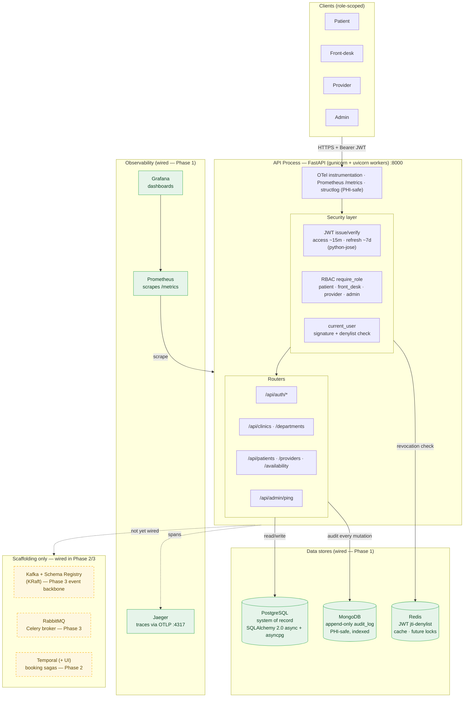
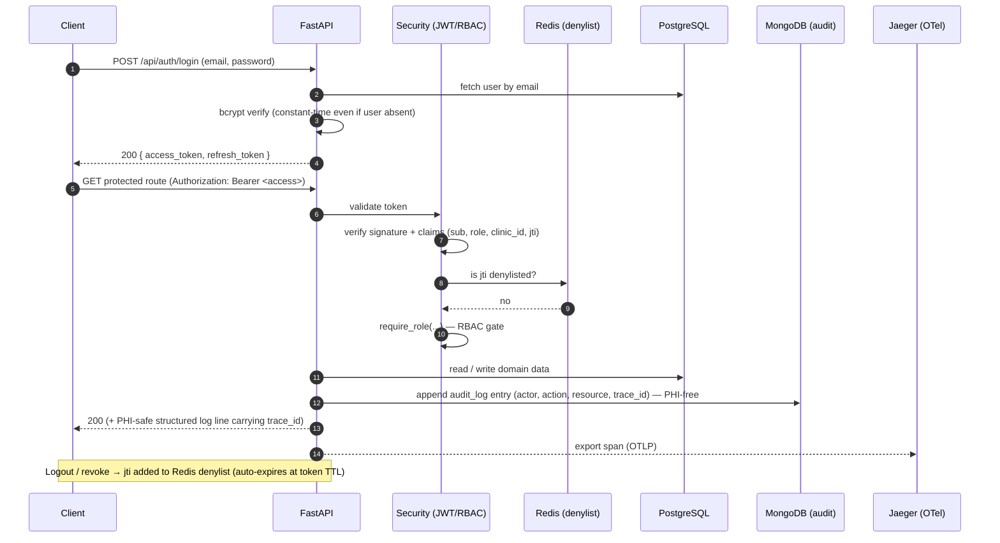
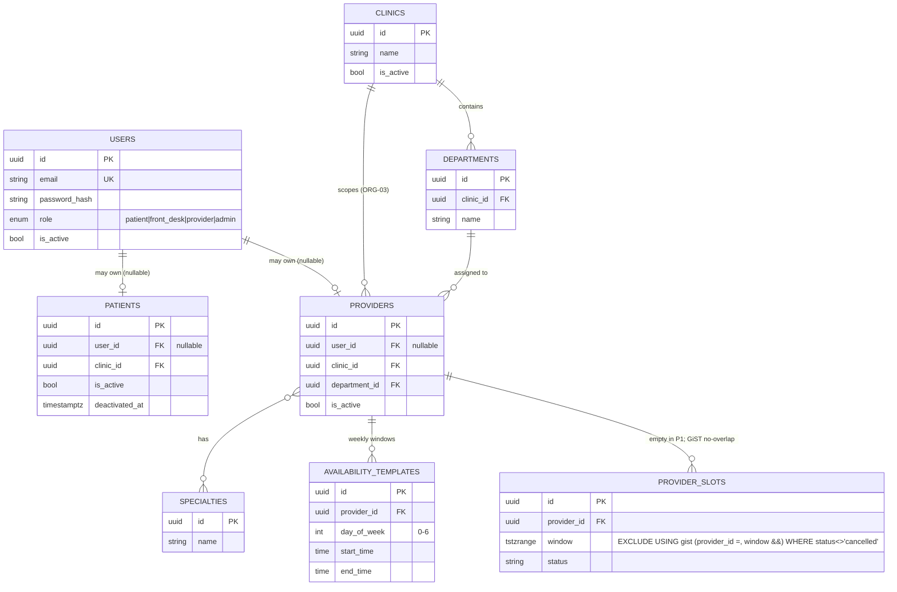

# SmartHealth — Architecture (Part A / Phase 1)

Foundational healthcare-operations backend: identity & RBAC, patient/provider/clinic/department
management, an append-only audit trail with no PHI in logs, first-class tracing, and the full
mandated stack running locally with health checks.

> **Scope note.** Phase 1 delivers the **core platform** and the **observability spine**. The
> event/orchestration components (Kafka, RabbitMQ, Temporal) are stood up in Docker Compose but are
> **scaffolding only** this phase — they are wired into request/workflow flow in Phase 2 (Temporal
> booking sagas) and Phase 3 (Kafka event backbone + Celery workers). The diagrams below label this
> distinction explicitly.

---

## 1. System / Component Diagram

---

## 2. Request Flow — the end-to-end tracer

This is the "thinnest path through every layer" proven in Plan 03 (the Wave 3 tracer). Every later
route reuses this exact spine.

---

## 3. Data Model (PostgreSQL)

Key decision: **`users` and `patients` are separate tables** (`patients.user_id` is nullable) so a
front-desk-created patient profile need not own a login account (PPL-01), while self-registration
still works (IAM-01). Availability is stored as **weekly templates**; `provider_slots` is created
**empty** but carries a **live GiST exclusion constraint** so Phase 2's booking saga inherits a
table on which double-booking is physically impossible. All operational entities carry
`is_active` / `deactivated_at` for **soft-delete** (no hard deletes — records stay auditable).

---

## 4. Technology Stack

| Concern | Technology | Role in Phase 1 |
|---|---|---|
| API framework | FastAPI + Pydantic v2 (gunicorn / uvicorn workers) | HTTP surface, validation |
| System of record | PostgreSQL 15 · SQLAlchemy 2.0 async · asyncpg · Alembic | Durable relational state + migrations |
| Audit trail | MongoDB 8 (async PyMongo) | Append-only, PHI-safe `audit_log` |
| Cache / revocation | Redis 8 | JWT `jti`-denylist; cache; future slot locks |
| AuthN / AuthZ | python-jose (JWT) · bcrypt · custom RBAC | Access+refresh tokens, 4-role RBAC |
| Tracing | OpenTelemetry SDK → OTLP → Jaeger | Distributed traces, `trace_id` in logs |
| Metrics | Prometheus + Grafana | `/metrics` scrape + dashboards |
| Logging | structlog (JSON, PHI-safe) | Correlated logs (trace/span IDs) |
| **Scaffolding (P2/P3)** | Kafka + Schema Registry, RabbitMQ, Temporal | Event backbone, workers, booking sagas |

### Local ports (Docker Compose)

| Service | Host port | Service | Host port |
|---|---|---|---|
| API (Swagger `/docs`) | 8000 | Temporal | 7233 |
| PostgreSQL | 5433 → 5432 | Temporal UI | 8080 |
| MongoDB | 27017 | Jaeger UI | 16686 |
| Redis | 6380 → 6379 | Prometheus | 9090 |
| RabbitMQ / mgmt | 5672 / 15672 | Grafana | 3001 → 3000 |
| Kafka | 9092 | Schema Registry | 8081 |

---

## 5. Key Design Decisions

| Decision | Choice | Why |
|---|---|---|
| Auth & session | Access (~15m) + refresh (~7d) JWT; Redis `jti`-denylist revocation | Real logout/revocation (IAM-03); short access TTL bounds a leaked token; no new infra (Redis already mandated) |
| Slot model | Weekly templates now; empty `provider_slots` with live GiST exclusion constraint | Phase 1 stays config-only; Phase 2 inherits a proven double-booking invariant |
| Identity vs profile | Separate `users` / `patients` (nullable `patients.user_id`) | Satisfies both self-registration (IAM-01) and staff-created no-login profiles (PPL-01) |
| Deletion | Soft-delete (`is_active` / `deactivated_at`), never hard delete | Healthcare records must remain auditable and retained |
| PHI safety | Field-name-only audit; structlog PHI redaction; tests assert no PHI in logs | HIPAA — no PHI in logs or traces |
| Async everywhere | SQLAlchemy 2.0 async + asyncpg; async PyMongo; `redis.asyncio` | Sustains concurrent load without blocking the event loop |

See [`architecture-dashboard.html`](./architecture-dashboard.html) for the interactive decision record,
and [`architecture.html`](./architecture.html) for a standalone diagram view.
