# SmartHealth — Architecture (Part A / Phase 3: event backbone, notifications, analytics, observability)

Foundational healthcare-operations backend. Phase 1.1 re-delivered it as independently deployable
services (gateway, Identity, Organization, Provider, Patient, Scheduling skeleton), each owning
its own PostgreSQL database, with RS256 tokens verified locally, an append-only PHI-free audit
trail and connected tracing. **Phase 2** turns Scheduling into a real service and adds **Visit**
and **Billing**: on-demand slots, asynchronous booking as a **Temporal saga with compensation**,
cancel, reschedule, a waitlist that auto-books freed slots, the visit state machine with
non-blocking downstream work, and a simulated billing pre-check — executed by two dedicated
worker containers (`scheduling-worker`, `visit-worker`). **Phase 2.1** closes the Week 1-2 mentor
review without adding product scope: an appointment state machine with a check-in window (4d), provider
schedule-change propagation (4e), reconcilers for stuck states (4f), single-use refresh tokens, paginated
lists, self-service reads, and quantified NFRs with a runnable load test ([`nfr.md`](./nfr.md)).
**Phase 3** adds the event backbone and the work that runs off it ([section 10](#10-phase-3-event-backbone-notifications-analytics-and-observability)):
every service in the D-07 event set writes a transactional outbox row in the same transaction as its state
change, Debezium relays it to Kafka with Avro payloads, and three idempotent consumers drive notifications and
reminders (Celery on RabbitMQ, Temporal timers), the visit downstream work (the visit sweeper is retired) and
the analytics projections; every process exposes Prometheus metrics, Grafana dashboards are provisioned from
files, and one booking is one connected trace.

> **Scope note.** Temporal is live from Phase 2; Kafka, Schema Registry, Debezium, RabbitMQ/Celery and the
> analytics service are live from Phase 3. Sections 1 to 9 keep the Phase 1.1 to 2.1 descriptions; where Phase 3
> changed one, the text says so and points to section 10. The notification activities inside the Phase 2
> workflows are **intent records** that send nothing; delivery is event-driven. The dedicated Audit service is
> not built (audit stays a shared library writing to Mongo). This is a local/dev system with synthetic data
> only; nothing here is claimed as production-hardened (logout, PHI log-safety and database isolation are
> implemented but not fully hardened; Kafka and Connect have no authentication on the dev network); see
> [Known limitations](#7-known-limitations-and-unverified-items) and [10.9](#109-limitations-and-operations-notes).

---

## 1. System / Component Diagram

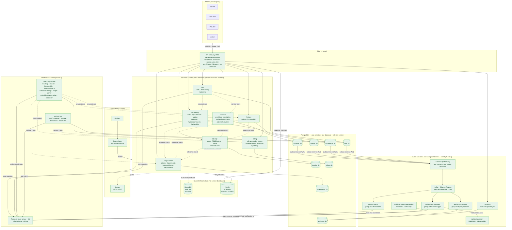

Dashed service-to-service arrows are synchronous `/internal` calls: Phase 1.1 reference checks
(section 4) and Phase 2's service-token calls from APIs and workers (section 5a). The solid arrows into
`Connect (Debezium)` are the Phase 3 outbox relay (section 10); the application services never call Kafka
themselves. RabbitMQ sits between `notification-consumer` and `notification-celery` (section 10.5), and
`notification-celery` writes its delivery log to MongoDB.

---

## 2. Service Breakdown

| Service | Owns | Database | Internal endpoints (not routed by the gateway) | Calls out to |
|---|---|---|---|---|
| **API Gateway** | Edge routing, per-IP rate limiting, path-safety checks | none | — | all five services' public routes (proxy); Redis (limits) |
| **Identity** | Accounts (`users`: credentials, role, `clinic_id`), register/login/refresh/logout, RS256 token issuance, JWKS, Redis denylist writes, 60 s service tokens | `identity_db` | `GET /internal/users/{id}` | Organization (validate `users.clinic_id`); Redis; MongoDB (audit) |
| **Organization** | Clinics, departments (soft-delete, clinic-scoped) | `organization_db` | `GET /internal/clinics/{id}`, `GET /internal/departments/{id}` | Identity JWKS (cached); Redis; MongoDB |
| **Provider** | Providers, specialties, provider↔specialty links, weekly availability templates, the `schedule_change_events` pull feed (4e) and the Phase 3 `outbox` | `provider_db` | `GET /internal/providers/{id}`, `GET /internal/providers/by-user/{id}`, `GET /internal/schedule-changes`, `POST /internal/schedule-changes/{id}/ack` (Scheduling only) | Organization (department), Identity (user); Identity JWKS; Redis; MongoDB |
| **Patient** | Patient profiles — the only service holding PHI; `GET /api/patients/me`; the Phase 3 `outbox` (`patient.registered`, `patient.deactivated`, ids and timestamps only) | `patient_db` | — | Organization (clinic), Identity (user); Identity JWKS; Redis; MongoDB |
| **Scheduling** | Slots (materialized on demand from Provider templates), appointments, idempotency keys, appointment history, waitlist, the `outbox` (Phase 3, six appointment events); booking / cancel / reschedule / waitlist-advance workflows and their activities | `scheduling_db` | `GET /internal/appointments/{id}?clinic_id=`, `POST /internal/appointments/{id}/check-in`, `POST /internal/appointments/{id}/complete` (Visit service token only) | Patient, Provider (including the schedule-change feed and a provider's own id for reads), Organization (validation), Billing (pre-check, transitions); Temporal |
| **Billing** | Billing records (`pending → verified/failed → …`), status history; deterministic simulated pre-check (`DENY-` prefix denies) | `billing_db` | `POST /internal/billing/prechecks`, `…/records/{appointment_id}/transitions`, `…/relink` (all need `Idempotency-Key`) | none (answers Scheduling and Visit only; no client secret) |
| **Visit** | Visits (`checked_in → in_progress → completed`), state history, downstream and settlement markers, the `outbox` (Phase 3); VisitCompleted and reconciler workflows (the sweeper is retired) | `visit_db` | — | Scheduling (internal check-in and complete), Provider (is this login the visit's provider?), Billing (finalize); Temporal |
| **scheduling-worker** | Executes Scheduling's workflows and activities on `scheduling-tq`; registers the hold-reaper, pending-starter, schedule-change-poller and reconciler Schedules | `scheduling_db` (same role as the API) | — | as Scheduling; never runs migrations |
| **visit-worker** | Executes `VisitCompletedWorkflow`, the retired sweeper tombstone and the reconciler on `visit-tq`; registers the `visit-reconciler` Schedule and deletes the retired `visit-downstream-sweeper` Schedule at start (Phase 3) | `visit_db` | — | Billing; never runs migrations |
| **visit-consumer** (Phase 3) | Kafka consumer, group `visit-downstream`: starts `visit-completed-<visit id>` for each `visit.completed` event and sets the marker | `visit_db` (own role) | — | Temporal; Kafka |
| **Analytics** (Phase 3) | Read-only metrics API (`/api/analytics/summary`, `/timeseries`) over the projections in its own database | `analytics_db` | — | none (answers the gateway and Grafana) |
| **analytics-consumer** (Phase 3) | Kafka consumer, group `analytics-projection`: maintains the three projection tables | `analytics_db` | — | Kafka |
| **notification-consumer, notification-celery, notification-temporal-worker** (Phase 3) | Group `notification-trigger`; the Celery delivery worker with the fake provider; the reminder and follow-up workflows on `notification-tq` | Mongo (delivery log); no Postgres | — | RabbitMQ, Temporal, Kafka |
| **connect** (Phase 3) | Debezium Kafka Connect: relays each outbox table (four connectors) | reads the four outbox tables through the `debezium` role | — | Postgres, Kafka |

Every service also verifies tokens locally from Identity's cached JWKS and checks the shared Redis
denylist. Shared code (`libs/`) is infrastructure only — token verification and JWKS client, audit
writer, observability setup, DB/session helpers — and never shares domain models. Each service
declares its own SQLAlchemy `DeclarativeBase` and its own Alembic migrations with a fresh baseline.

Isolation is asserted by tests: no service imports another, no foreign key crosses a service, PHI
columns exist only in Patient, the private key is loaded only by Identity, and each service's
database role is refused by every other service's database.

### Workflows, task queues and ids

| Workflow | Task queue | Workflow id | Started by |
|---|---|---|---|
| `BookingWorkflow` | `scheduling-tq` | `booking-<appointment id>` | `POST /api/appointments` after the accept commit; the pending-booking starter Schedule if that start was lost; the waitlist advance (child) |
| `CancelWorkflow` | `scheduling-tq` | `cancel-<appointment id>-<version>` | `POST /api/appointments/{id}/cancel` |
| `RescheduleWorkflow` | `scheduling-tq` | `reschedule-<appointment id>-<version>` | `POST /api/appointments/{id}/reschedule` |
| `WaitlistAdvanceWorkflow` | `scheduling-tq` | `waitlist-advance-<cancel/reschedule workflow id>` | Cancel / reschedule (abandoned child, after notify) |
| `HoldReaperWorkflow`, `PendingBookingStarterWorkflow` | `scheduling-tq` | Schedules `scheduling-hold-reaper`, `scheduling-pending-starter` | Temporal Schedules (60 s / 30 s) |
| `ScheduleChangePollerWorkflow` | `scheduling-tq` | Schedule `scheduling-schedule-change-poller` | Temporal Schedule (`SCHEDULING_SCHEDULE_CHANGE_POLL_SECONDS`, 15 s) |
| `ScheduleChangeWorkflow` | `scheduling-tq` | `schedule-change-<event id>` | The poller, once per Provider change event (Phase 2.1, 4e) |
| `ReconcilerWorkflow` | `scheduling-tq` | Schedule `scheduling-reconciler` | Temporal Schedule (`SCHEDULING_RECONCILER_INTERVAL_SECONDS`, 60 s; Phase 2.1, 4f) |
| `VisitCompletedWorkflow` | `visit-tq` | `visit-completed-<visit id>` | The `visit-downstream` consumer on `visit.completed` (Phase 3); before Phase 3 the API after its commit, with the sweeper as recovery |
| `VisitDownstreamSweeperWorkflow` | `visit-tq` | Schedule `visit-downstream-sweeper` (deleted) | **Retired in Phase 3**: the Schedule is deleted at every visit-worker start; the workflow and activity name stay registered as a no-op tombstone so recorded histories replay |
| `ReminderWorkflow` | `notification-tq` | `reminder-<appointment id>` | The notification consumer on `appointment.booked` (signals on cancel, reschedule; Phase 3) |
| `FollowUpReminderWorkflow` | `notification-tq` | `followup-<visit id>` | The notification consumer on `visit.completed` (Phase 3) |
| `VisitReconcilerWorkflow` | `visit-tq` | Schedule `visit-reconciler` | Temporal Schedule (`VISIT_RECONCILE_INTERVAL_SECONDS`, 60 s; also one pass at worker start; Phase 2.1, 4f) |

Workflow inputs and results are plain ids and status strings (`domain/contracts.py`, checked by a
test): no coverage reference, token, phone or address ever enters Temporal history.

---

## 3. Request Flow — through the gateway

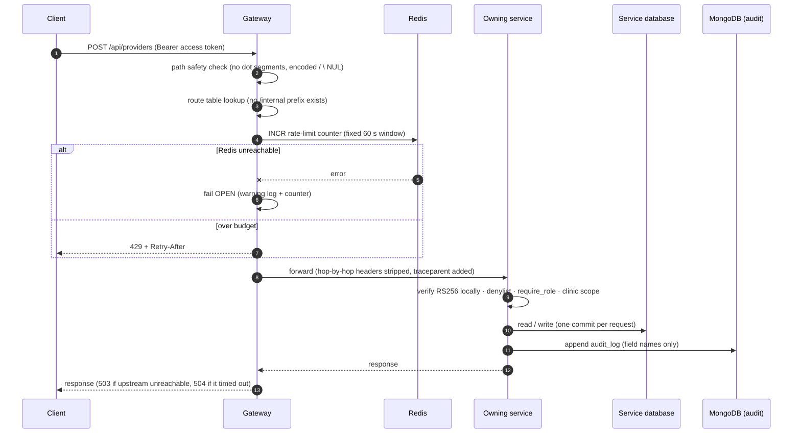

The gateway does **not** verify JWTs: each service verifies for itself, so no service trusts the edge.
The gateway never retries (a retried POST could double-apply a write) and never aggregates
responses (reads return ids only; clients combine them).

---

## 4. Reference-check Flow — fail closed (D-05)

At write time the owning service is asked whether a referenced record exists. Example: creating a
provider under a department.

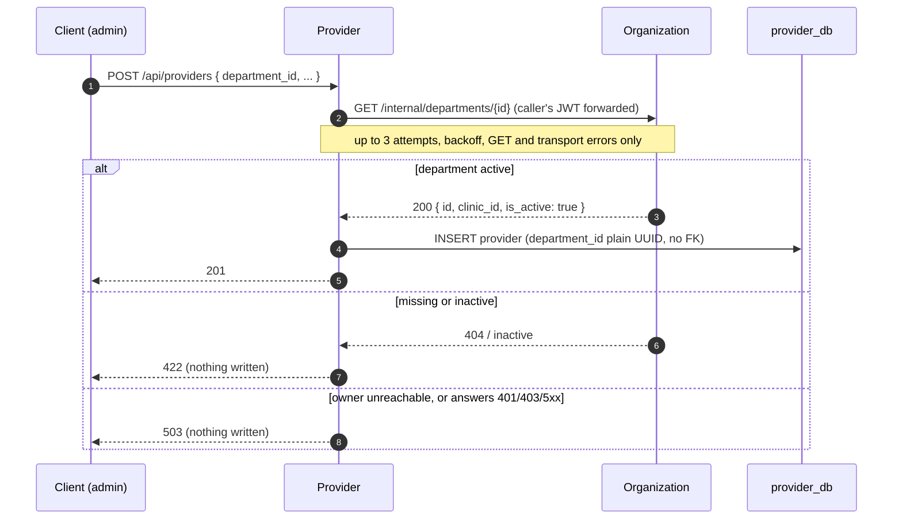

| Reference | Owner called | Outcome when missing/inactive | Outcome when owner cannot answer |
|---|---|---|---|
| `users.clinic_id` | Organization | 422 | 503 |
| `patients.clinic_id` | Organization | 422 | 503 |
| `patients.user_id` | Identity | 422 | 503 |
| `providers.department_id`, `availability_templates.department_id` | Organization | 422 | 503 |
| `providers.user_id` | Identity | 422 | 503 |

A 401/403/5xx from the owner is deliberately a 503, never a 422, so an authentication
misconfiguration between services is not mistaken for a missing record. Deactivating a referenced
record **never cascades** (D-06): existing references keep their ids and only new writes pointing at
an inactive target are refused. There is no reverse call and no distributed transaction. Phase 3 built Kafka
and the outbox (section 10) but **not** the event-fed local copies that would remove this availability
coupling: the reference checks above are unchanged (D-08 remains open).

---

## 4a. Booking saga with compensation (Phase 2)

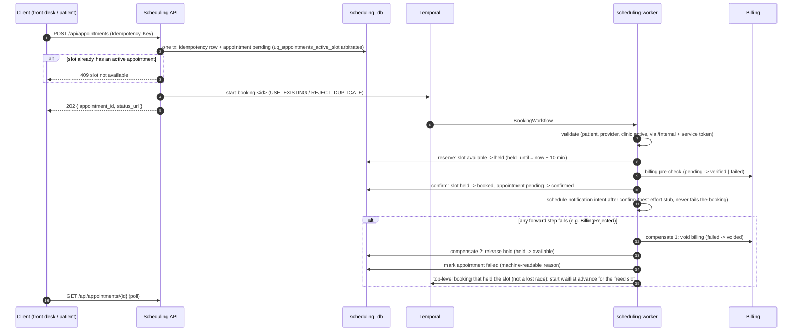

Since Phase 3 the confirm step also commits the `appointment.booked` outbox row in the same transaction (section
10.1); the 202 accept path is unchanged, and the notification step above is still an intent record, with the
real notice sent by the notification consumer from the event.

Compensation runs **in reverse order as forward state transitions** (nothing is deleted), and every
step writes one audit entry with `dedupe_key = <workflow id>:<step>`, so a retried activity never
double-audits. Order note: the implemented order is validate, hold, **billing pre-check,
confirm, then a best-effort notification intent** (plan 02.1-07, S7). SCHED-02 lists the
notification earlier and the implementation deliberately differs: the notification intent is
requested **after confirm** succeeds, so a booking that fails at confirm (`ConfirmLostHold`)
sends none, and a patient is never told about a booking that is then compensated. SCHED-02's
"prevent conflicts" is the reserve step's database constraints. The order change and the
failure-path waitlist re-offer are `workflow.patched` (`booking-notify-after-confirm-v1`,
`booking-failure-waitlist-v1`), so histories recorded earlier still replay.

Post-commit safety (S3): `void_billing` and `release_slot` read the appointment's status and do
nothing once it is `confirmed`, `checked_in`, `completed` or `no_show`; the audit write after a
committed confirm, cancel, swap, check-in or complete is best effort (a failure is logged as
`audit.write_failed`, the transition stays durable in `appointment_status_history`). Booking a
slot that already started is `422 slot has already started` at the API and `SlotInPast` in the
validate step (S6). The hold reaper offers each slot it frees to the waitlist, and a failed top-level
booking offers its slot under `waitlist-advance-booking-<appointment id>` (the same id the
reconciler uses in 4f, so the two paths cannot both start an advance) (S5).

Cancel and reschedule:

- **Cancel** (`CancelWorkflow`): cancel the appointment and release its slot → billing
  `refund_pending → refunded` when more than `SCHEDULING_CANCEL_CUTOFF_HOURS` (24 h) ahead, else
  `no_refund` (staff may waive) → notification intent → start the waitlist advance (child).
- **Reschedule** (`RescheduleWorkflow`): hold the new slot first → one Scheduling transaction
  releases the old slot, books the new one and repoints the appointment → re-link billing →
  notify → waitlist advance for the old slot. Never cancel-then-rebook.
- **Waitlist advance**: FIFO claim of the first matching `waiting` entry with
  `FOR UPDATE SKIP LOCKED` → a child `BookingWorkflow` for that patient → entry `booked`; a failed
  booking marks the entry `failed` and tries the next (cap 5); losing the slot race puts the
  entry back to `waiting`.

## 4b. Visit completion with non-blocking downstream work (Phase 2, trigger changed in Phase 3)

```mermaid
sequenceDiagram
    autonumber
    participant P as Provider
    participant VIS as Visit API
    participant PG as visit_db
    participant K as Kafka (smarthealth.visit.events)
    participant VC as visit-consumer
    participant T as Temporal
    participant VW as visit-worker
    participant BIL as Billing
    participant SCH as Scheduling

    P->>VIS: POST /api/visits/{id}/complete
    VIS->>PG: one tx: in_progress -> completed + history row + outbox row (visit.completed); downstream_started_at = NULL
    VIS-->>P: 200 completed (no Temporal call in the API)
    PG-->>K: Debezium (visit-outbox)
    K->>VC: visit.completed (group visit-downstream)
    VC->>T: start visit-completed-<id> (REJECT_DUPLICATE), then downstream_started_at = now
    T->>VW: VisitCompletedWorkflow
    par independent branches
        VW->>BIL: finalize billing (verified -> finalized), retried with no time limit
    and
        VW->>SCH: complete the appointment (checked_in -> completed)
    and
        VW->>VW: follow-up intent record
    and
        VW->>VW: analytics intent record
    end
    VW->>PG: settlement markers (billing and appointment outcome, set once)
    Note over T,VW: visit-reconciler (4f) settles started-but-unsettled visits; there is no sweeper any more
```

**Phase 3 changed the trigger, not the workflow.** In Phase 2 the API started `visit-completed-<id>` after its
commit and a `visit-downstream-sweeper` Schedule recovered lost starts. The sweeper is **retired** (plan 03-12):
the completion now commits a `visit.completed` outbox row with the status change, and the `visit-downstream`
consumer is the only trigger (section 10.4). The workflow, its activities and its recorded histories are
unchanged; the sweeper's Schedule is deleted at every visit-worker start and its workflow class stays registered
as a no-op tombstone, safe to remove once no run of it is left in any environment.

The appointment step is a fourth concurrent branch behind `workflow.patched`, so a retrying billing
branch never delays it and vice versa. Each step stamps a settlement marker on the visit
(`billing_settled_at/_outcome`, `appointment_settled_at/_outcome`, migration `visit_0002`) once it has
landed or reached a terminal business outcome (`not_finalizable`, `no_record`, `no_appointment`,
`not_checked_in`); the marker is what the reconciler reads. Billing finalize no longer gives up: its
retry has no schedule-to-close limit, so the workflow can stay open while Billing is down.


## 4c. Layered idempotency

1. **Database arbiters first**: the partial unique index `uq_appointments_active_slot`, the
   idempotency-key row `(caller_user_id, key)` with a request hash, conditional state updates
   (`UPDATE … WHERE status = <expected>`), `uq_visits_appointment`, history uniques
   (`uq_visit_history_visit_to`, `uq_billing_history_record_key`).
2. **Workflow id second**: deterministic ids with `USE_EXISTING` / `REJECT_DUPLICATE` make a
   second start a no-op; the namespace retains closed workflows for 24 h only, so the database
   rules above are what hold beyond that.
3. **Activities** are idempotent by construction (conditional updates, `Idempotency-Key` on every
   Billing call, audit `dedupe_key`), so Temporal retries are safe.
4. **Events** (Phase 3) add the consumer layer: a processed-event claim in the effect's transaction, a
   deterministic workflow id, or a dedupe key at the send, by effect type (section 10.2).

## 4d. Appointment state machine (Phase 2.1)

Mentor item **M1**. Before Phase 2.1 an appointment was only `pending`, `confirmed`, `cancelled` or
`failed`, so a patient who had checked in could still cancel and receive a refund. The vocabulary is
now seven states, defined once in `services/scheduling/domain/enums.py` (the model builds the CHECK
constraint and the index predicates from it, so model and migration cannot drift).

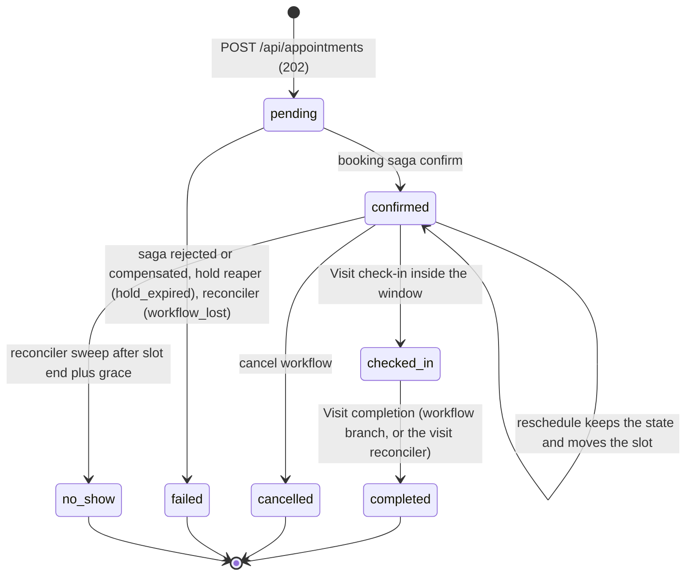

| Transition | Actor | Rule |
|---|---|---|
| `pending → confirmed` | `BookingWorkflow` confirm step | slot `held → booked` in the same transaction |
| `pending → failed` | booking saga compensation; hold reaper; Scheduling reconciler | machine-readable `failure_reason` (`BillingRejected`, `hold_expired`, `workflow_lost`, ...) |
| `confirmed → checked_in` | Visit, through `POST /internal/appointments/{id}/check-in` (Visit service token only) | inside the check-in window, judged by the **database clock** |
| `checked_in → completed` | `VisitCompletedWorkflow` appointment branch, `POST /internal/appointments/{id}/complete` | a repeat is a 200 no-op; an appointment that never checked in is `409 appointment not checked in` |
| `confirmed → no_show` | reconciler sweep (4f) | slot end plus `SCHEDULING_NO_SHOW_GRACE_MINUTES` (30) has passed; no manual staff action |
| `confirmed → cancelled` | `CancelWorkflow` | only from `confirmed`; refused with 409 for `checked_in`, `completed` and `no_show` |
| `confirmed → confirmed` | `RescheduleWorkflow` | reserve-then-swap; refused for the three new states |

**Check-in window.** It opens `SCHEDULING_CHECKIN_OPENS_BEFORE_MINUTES` (default 60) before `slot_start` and
closes `SCHEDULING_CHECKIN_CLOSES_AFTER_END_MINUTES` (default 0) after `slot_end`. The decision is made in
the same locking `SELECT` that reads the row, with `now()` of the database, never the application clock,
and the minutes are read from settings at request time.

**Database guarantees.** `scheduling_0004` widens `ck_appointments_status_valid`,
`uq_appointments_active_slot` and `ex_appointments_patient_no_overlap` to every slot-holding status
(`pending`, `confirmed`, `checked_in`, `completed`, `no_show`), so a checked-in, completed or no-show
appointment keeps its slot and keeps its patient busy at the storage layer, not just in application code.
Every transition is a conditional `UPDATE` after a row lock that returns an outcome (`checked_in`,
`already`, `too_early`, `too_late`, `not_confirmed`) and writes one `appointment_status_history` row, so
twenty concurrent check-ins make one transition.

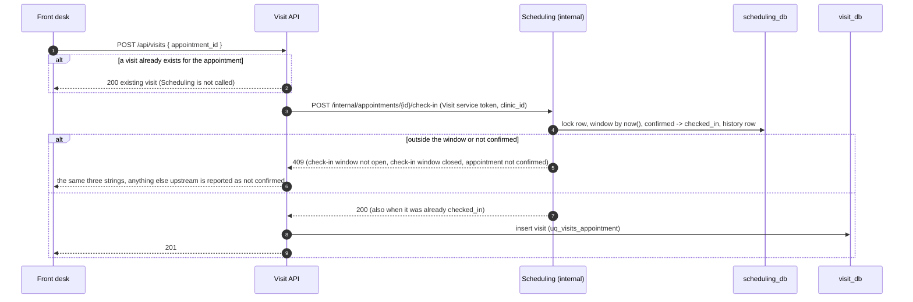

Scheduling's transition runs first and the visit insert second. The crash window between them (the
appointment is `checked_in`, no visit yet) converges on the next request: Scheduling answers 200
"already" and the visit is then created, with no compensating call and no extra state. An appointment
left `checked_in` with no visit if the patient never retries is not reconciled (an open risk, section 7).

## 4e. Provider schedule change (Phase 2.1)

Mentor item **M2**. Editing or deactivating an availability template, or deactivating a provider, used
to leave already-generated slots bookable. Provider cannot call Scheduling to fix that (no service
calls another's write path), and a push would be lost if Scheduling or Temporal were down at the moment
of the change, so the direction is a **pull from an outbox**:

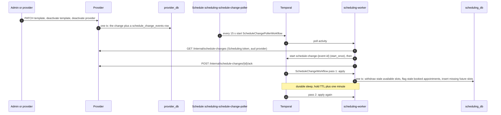

- **Outbox row.** `provider_db.schedule_change_events` (`provider_0002`): `id`, `provider_id`,
  `template_id` (null for a provider deactivation), `change_type` (`template_updated`,
  `template_deactivated`, `provider_deactivated`, `ck_schedule_change_events_type_valid`), `created_at`,
  `delivered_at`. It is written inside the repository function that already owns the commit, so the change
  and its event are atomic; a change that alters nothing writes no event. It carries ids only, no
  foreign key, and delivered rows are never purged. The partial index `ix_schedule_change_events_pending`
  serves the feed.
- **Feed.** `GET /internal/schedule-changes?limit=` returns undelivered events oldest first (no cursor:
  rows can commit out of order, so acknowledgement is a conditional update, not an offset);
  `POST .../{id}/ack` is idempotent. Both accept only Scheduling's `aud=provider` service token.
- **Poller.** The Schedule `scheduling-schedule-change-poller` runs `ScheduleChangePollerWorkflow` every
  `SCHEDULING_SCHEDULE_CHANGE_POLL_SECONDS`. For each of up to 100 events it starts one
  `ScheduleChangeWorkflow` under `schedule-change-<event id>` and only then acknowledges, so a crash
  re-delivers (at-least-once) and the repeat is a no-op.
- **Affected set by set difference.** The apply activity re-expands the provider's current templates (clinic
  timezone, DST-safe, from clinic-local yesterday to the provider's latest slot) with the same generator
  that creates slots, and treats every future slot whose exact `(start, end)` is not in that set as stale.
  An inactive or unknown provider is the empty set. No slot-to-template link is needed.
- **What the apply does.** Stale `available` slots are withdrawn (`cancelled`) by a conditional update.
  Stale `held` slots belong to an in-flight booking and are skipped in pass 1. A stale `booked` slot's
  `confirmed` or `checked_in` appointment is **flagged**, not cancelled: `schedule_change_flagged_at` and
  `schedule_change_reason` (`scheduling_0005`, partial index `ix_appointments_schedule_flagged`), a
  `schedule_changed:<reason>` history note, and one best-effort notification intent. For an active provider
  the missing future candidates are inserted (`ON CONFLICT DO NOTHING`), so an edit replaces slots.
- **Second pass.** After a durable timer of hold TTL plus one minute the workflow applies again, so a
  booking that confirmed just after pass 1 is flagged instead of missed.
- **Staff flow.** `GET /api/appointments?flagged=true&status=confirmed` is the worklist, and a patient sees
  the flag on their own appointment. Cancelling or rescheduling a flagged appointment **withdraws** its stale
  slot instead of freeing it (otherwise the provider would be bookable at a time they no longer work); a
  reschedule clears the flag. The flag stays on a cancelled appointment.
- **Ambiguity withdraws nothing.** An owner that cannot answer is a retryable error before any write; a
  missing department, clinic or timezone is a non-retryable error that fails the workflow visibly.

Phase 3 also publishes each of these changes to Kafka as `provider.schedule_changed` (through Provider's own
`outbox`, one event per feed row), but **nothing consumes it**: Scheduling keeps pulling the feed, and the
poller Schedule is kept paused on the live Temporal server by the user's decision (section 10.9).

## 4f. Reconcilers (Phase 2.1)

Mentor item **S4**. Each reconciler is a Temporal Schedule (overlap `SKIP`) running one idempotent workflow.
Every state change is a conditional update, every list is oldest first and capped, and one row's failure is
logged (ids and exception type only) and never blocks the rest. They re-derive what should have happened
from the database; they never invent an outcome.

**Scheduling reconciler** (`scheduling-reconciler`, `ReconcilerWorkflow`, every
`SCHEDULING_RECONCILER_INTERVAL_SECONDS`, 60 s). Three activities in a fixed order; one failing never blocks
the others:

1. *Stuck `pending` and the billing lookback.* A `pending` appointment older than
   `SCHEDULING_RECONCILE_PENDING_AFTER_MINUTES` (10) blocks its slot forever, because
   `uq_appointments_active_slot` covers `pending`. The step asks Temporal whether `booking-<id>` is still
   running; a running workflow is skipped, a missing or closed one is gone, and any other Temporal error skips
   the step (a booking is never failed because the control plane is down). For a gone workflow it re-reads the
   appointment, voids billing, then in one transaction releases the hold, marks the appointment `failed` with
   `workflow_lost` and writes a `billing_void_checked` note; if the void cannot be done the appointment stays
   `pending` and the next run retries. Afterwards it offers the freed slot to the waitlist. The lookback then
   voids billing for appointments failed with `hold_expired` or `workflow_lost` in the last
   `SCHEDULING_RECONCILE_BILLING_LOOKBACK_HOURS` (24) that have no `billing_void_checked` note.
2. *Stuck waitlist.* An entry `matched` for longer than `SCHEDULING_RECONCILE_MATCHED_AFTER_MINUTES` (15) is
   resolved from the outcome of its matched appointment: back to `waiting` for a lost race (`SlotUnavailable`,
   `ConfirmLostHold`, `hold_expired`, `workflow_lost`), `failed` with the reason for any other failure,
   `booked` for a committed or cancelled appointment, and left alone while the appointment is `pending`.
3. *No-show sweep.* A `confirmed` appointment whose slot ended more than
   `SCHEDULING_NO_SHOW_GRACE_MINUTES` ago gets Billing `no_refund` first and then `mark_no_show` (state and
   clock re-checked under the row lock). It re-reads the appointment as `confirmed` immediately before the
   Billing call, so a patient who checked in meanwhile never has billing moved. Either failure leaves the
   appointment `confirmed` and the next run repeats both.

The reconciler offers a freed slot under `waitlist-advance-booking-<appointment id>`, the id the booking
workflow's own failure re-offer uses, so the two paths are idempotent with each other. Rows it changes carry
the actor `system:reconciler` in `appointment_status_history`. At most `SCHEDULING_RECONCILE_BATCH_LIMIT` (50)
rows per list per run.

**Visit reconciler** (`visit-reconciler`, `VisitReconcilerWorkflow`, every `VISIT_RECONCILE_INTERVAL_SECONDS`,
60 s, plus one pass when the worker starts). A completed visit whose `billing_settled_at` or
`appointment_settled_at` marker is still empty after `VISIT_RECONCILE_GRACE_MINUTES` (10) is settled by the
same step bodies the workflow uses, under the workflow id `visit-completed-<visit id>`, so Billing's
`Idempotency-Key` and the audit dedupe key are identical whether the workflow or the reconciler runs a step.
It never updates a marker directly. Terminal business outcomes (`BillingNotFinalizable`,
`AppointmentNotCheckedIn`) are logged as refusals, not failures. Only started workflows are covered here; a
completion whose workflow was never started is the `visit-downstream` consumer's job (the sweeper that used to
do it is retired).

**Replay discipline.** `ReconcilerWorkflow` and `VisitReconcilerWorkflow` are new workflow types and need no
patch marker; any later change to their command sequence needs `workflow.patched` and a newly recorded history
(`reconciler_p21.json` is never re-recorded). The booking, visit-completion and visit-billing changes are
behind patch ids with recorded histories that keep replaying. Temporal replay compares commands, not activity
options, so the open-ended billing retry (an options-only change) is not enforced by replay; its patch is a
convention that makes the version visible in a run's history, and a test pins that property.

## 4g. Mentor review remediation map (Phase 2.1)

Each review item maps to a mechanism above and to test files that fail if the behaviour or the file
disappears (`tests/docs/test_phase21_traceability.py` enforces the mapping and that every id is named here).

| Item | Review finding | Where it is built | Section |
|---|---|---|---|
| **M1** | Appointment state machine, check-in window, cancel/reschedule after check-in | `checked_in`, `completed`, `no_show`; `scheduling_0004`; internal check-in and complete; Visit check-in and completion integration | 4d, 4b |
| **M2** | Provider schedule change must reach slots and bookings | `schedule_change_events` outbox, poller Schedule, `ScheduleChangeWorkflow`, flagged appointments | 4e |
| **S3** | Failures after commit | Compensations guarded by state; audit after a committed step is best effort (moving it into the outbox is deferred, section 10.9) | 4a, 7 |
| **S4** | Stuck states | Scheduling and Visit reconcilers; open-ended visit billing retry | 4f, 4b |
| **S5** | Waitlist re-offer after a failed direct booking | Booking failure re-offer, reaper offer, reconciler offer | 4a, 4f |
| **S6** | Booking a slot in the past | `422 slot has already started`; `SlotInPast` in the saga | 4a |
| **S7** | Notification only after confirm | Order validate, hold, billing pre-check, confirm, notification intent, behind `workflow.patched` | 4a |
| **C1** | `/refresh` must check the denylist and rotate | Single-use rotation with an `rjti` claim | 5 |
| **C2** | bcrypt on the event loop | Bounded `bcrypt*` thread pool (`IDENTITY_BCRYPT_THREADS`) | 5 |
| **C3** | Case-insensitive email | Normalization, `lower(email)` lookups, `uq_users_email_lower` (`identity_0002`) | 5 |
| **C4** | Provider reads own appointments; patient reads own profile | `GET /api/appointments` for a provider; `GET /api/patients/me` | 2, 5 |
| **C5** | Paginated lists | `libs.pagination`, `limit`/`offset`, `X-Total-Count` on patients, providers, clinics | 5 |
| **D1** | Quantified NFRs | NFR-01..08 in the PRD and [`nfr.md`](./nfr.md), single-sourced in `loadtest/nfr.json` | 9 |
| **D2** | A load test | k6 profiles and a seed script in `loadtest/`, `scripts/loadtest_seed.py` (targets not yet measured) | 7, 9 |

---

## 5. Token Verification Flow — RS256 + JWKS

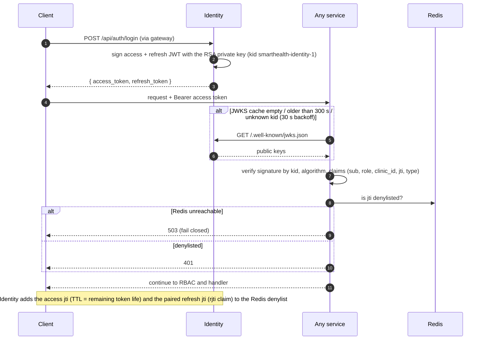

Only Identity holds the private key: it is generated by `scripts/generate_jwt_keypair.py`, gitignored,
and delivered to the Identity container alone as a Compose secret; Identity refuses to start without
it. Key rotation is supported through `kid` but has not been exercised.

**Refresh rotation and identity carry-overs (Phase 2.1, C1-C3).**

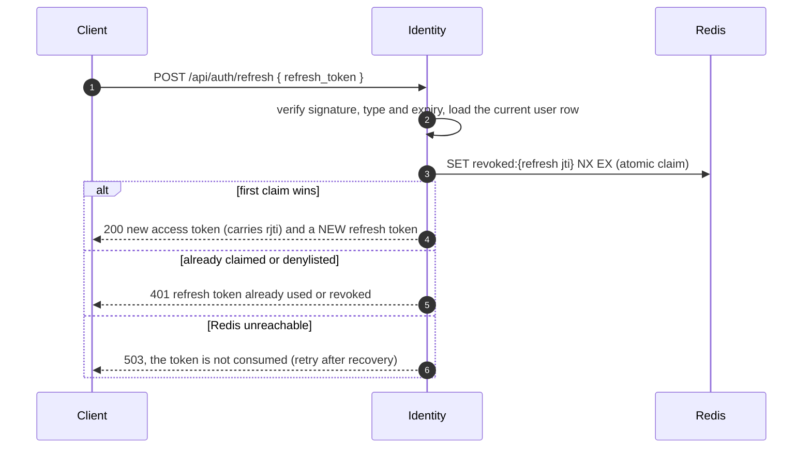

- **Single-use, rotated refresh tokens (C1).** The old refresh jti is claimed with one atomic `SET NX EX`
  *after* the token and user validated, so a bad token never burns anything and concurrent reuse yields
  exactly one winner. A client must store the rotated token from every response. A revoked token and a used
  one are deliberately indistinguishable. The access token carries an `rjti` claim naming its paired refresh
  token, so logout revokes both without client cooperation; access tokens issued before the change have no
  `rjti` and revoke only themselves. A Redis outage fails closed (503), as on the access path.
- **bcrypt off the event loop (C2).** Hashing and verification run on a bounded, named thread pool
  (`IDENTITY_BCRYPT_THREADS`, default 4; bcrypt releases the GIL) through `hash_password_async` and
  `verify_password_async`; login still verifies against a dummy hash for an unknown user. The prepared RSA
  signing key is built once per loaded key, because re-parsing the PEM per token stalled the loop as well.
- **Case-insensitive email (C3).** One normalizer (strip, lowercase) runs on register, staff create and login;
  lookups use `lower(email)`; migration `identity_0002` adds the unique expression index
  `uq_users_email_lower` after a count-only duplicate preflight (it refuses without printing an address).
  **No row is rewritten**: legacy mixed-case rows keep their casing, are matched through `lower(email)` and
  block other casings; the downgrade just drops the index.
- **Self-service reads (C4).** `GET /api/patients/me` returns the caller's own profile (identity comes only
  from the token; `404 patient profile not found` for every miss). A provider reads only their own
  appointments through the existing `GET /api/appointments` routes: Scheduling resolves the provider's id
  from Provider with a service token (`503` if Provider is down) and forces the filter; a foreign or missing
  appointment is the same 404. Booking, cancel and reschedule stay patient, front-desk and admin.
  `get_history` orders by creation time with notes after the transition they were written with.
- **Pagination convention (C5).** `libs.pagination`: patients, providers and clinics return a plain array,
  `limit` 1..200 (default 50), `offset` >= 0, a total order of `(created_at, id)` and the total in
  `X-Total-Count`; a value outside the bounds is `422`, never clamped; scope checks run before any query and
  the header is set only on a 200. The department list inside a clinic is unpaginated; Visit's list keeps its
  own inline `limit`/`offset`; the appointment list keeps `limit` (default 100, max 200) and has no total.

## 5a. Internal-auth contract for workers (Phase 2, D-06)

A workflow outlives the HTTP request, so the caller's JWT is never passed into Temporal. Instead:

- Each calling service has a **client secret file** (`scripts/generate_service_secrets.py`;
  Compose secret, never an env value or image content). Billing calls nobody and has none.
- It obtains a **service token** from Identity's `POST /internal/service-tokens` (HTTP Basic with
  the secret, one requested audience), short-lived (`SERVICE_TOKEN_EXPIRE_SECONDS`, default 60 s)
  and cached until shortly before `exp`.
- Identity mints only audiences listed for that client: Scheduling → patient, provider,
  organization, billing, scheduling; Visit → scheduling, provider, billing, visit.
- Every internal route declares its own `aud` and an explicit allowed-caller set (e.g. Billing's
  transitions accept Scheduling and Visit, and Visit may only target `finalized`).

---

## 6. Connected-trace Flow

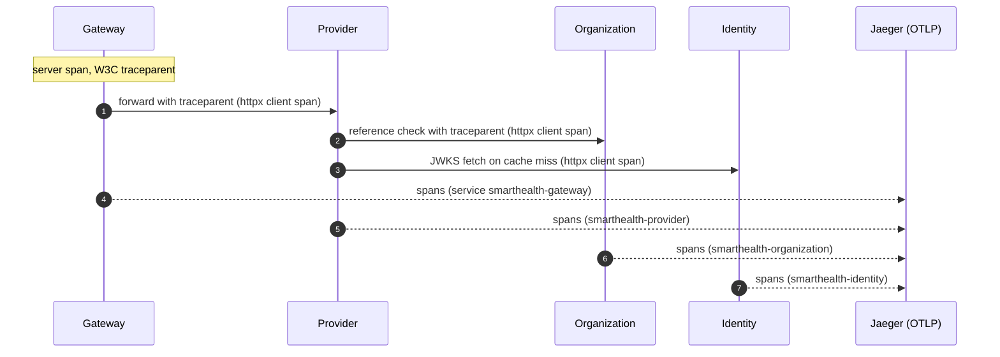

One request is one trace across services. A provider create was observed as a single trace spanning
the gateway, Provider, Organization and (JWKS fetch) Identity, confirmed through Jaeger's HTTP query
API; nobody has yet looked at it in the Jaeger UI. Every service has its own OpenTelemetry service
name and its own Prometheus scrape job; the gateway serves `/metrics` only on an internal listener
(:9100, not published). Logs are structlog JSON carrying `trace_id`/`span_id` and identifiers only.
Phase 3 extends the trace across Temporal, Kafka and Celery (a booking measured as one trace of 57 spans in 12
services) and scrapes the workers, consumers and Celery worker too; see section 10.7.

---

## 7. Known limitations and unverified items

Phase 2 — interim mechanisms and gaps:

- **What Phase 3 did to these Phase 2 interim mechanisms** (details in 10.8): the visit downstream sweeper
  is **retired** (the `visit.completed` outbox event is the only trigger); the pending-booking starter, hold
  reaper and both reconcilers **stay** as safety nets, because events do not subsume them; the notification,
  follow-up and analytics steps in the workflows are still **intent records** and the real notices and metrics
  come from the event consumers; client status is still polled. Temporal `auto-setup` is a dev convenience, not
  the production topology (`temporalio/server` + schema job).
- The workers and consumers are now scraped (section 10.7); in Phase 2 only the API services were.
- Waitlist: FIFO per provider, optional window, at most 5 entries tried per freed slot, no
  priority and no notification to the matched patient.
- Audit (Mongo) is written after the Postgres commit and is not atomic with it (WR-04).
- Not verified: a viewer inspecting workflow traces end-to-end in Jaeger.
- **Load and NFRs are targets, not results.** NFR-01..08 and a runnable k6 load test exist
  ([`nfr.md`](./nfr.md), `loadtest/README.md`), but the targets are **not yet measured**: the full
  profiles `sustained` and `burst` have never run, and the `smoke` profile (5 requests per second for 30 s)
  crossed its latency thresholds in both runs against the real stack in plan 02.1-13 (booking accept p95 2.0
  to 6.0 s against 300 ms, saga completion p95 16.7 to 28.5 s against 5 s; every accepted booking still
  confirmed; two uncontrolled runs on a heavily loaded laptop with no Jaeger collector). After Phase 3 the
  `smoke` profile passed every threshold in three runs on the Phase 3 stack (accept p95 21.8, 29.3 and 49.1
  ms; see [`nfr.md`](./nfr.md)), and `sustained`, `burst` and `contention` were not run (deferred by the user),
  so NFR-01 to NFR-08 are still targets that are not yet measured. The local single-instance stack is not
  claimed to meet NFR-01 or NFR-02. The concurrency suites and the live demo are the only load evidence today.

Phase 2.1 — what is interim and what is open:

- **Audit after a committed step is best effort (S3).** A failed Mongo write after a committed confirm,
  cancel, swap, check-in, complete or schedule-change apply is logged as `audit.write_failed` and never
  changes the outcome. The transition is durable in `appointment_status_history`, but if Mongo is down at
  that moment the audit entry can be lost for good; nothing backfills it. The general fix is to carry the audit
  in the outbox; Phase 3 built the outbox but deferred that follow-up (section 10.9).
- **Polled, not event-driven.** Schedule changes (default 15 s) and reconciliation (60 s) are polled.
  Delivered `schedule_change_events` rows are never purged. Waiting waitlist entries of a deactivated
  provider are not cleaned up. Phase 3 also publishes them as `provider.schedule_changed`, which nothing consumes.
- **Held at pass 2.** A slot still `held` when the schedule-change second pass runs is skipped and gets no
  third pass; if the reaper frees it later, the stale slot stays bookable until the next change event or a
  re-run of the idempotent apply. A flagged appointment stays `confirmed` and keeps its slot until staff act.
- **Cancel and reschedule billing is still bounded.** Their billing steps that exhaust
  `FORWARD_ACTIVITY` are recorded as `*_incomplete:billing_pending` for an operator. Reconciled: a failed
  booking's billing (lookback void), the no-show refund state and visit billing, which alone retries without
  a time limit (its workflow can therefore stay open while Billing is down).
- **Reconciler fairness.** Lists are oldest first with a cap (50 in Scheduling, 100 in Visit) and no per-row
  backoff; more persistently failing rows than the cap would starve newer ones.
- **`no_show` is automated only**, and visits created before Phase 2.1 have no `checked_in` appointment:
  they settle their appointment as `not_checked_in`, and there is no backfill. An appointment left
  `checked_in` with no visit (the patient never retried after a mid-sequence failure) is not reconciled.
- **Refresh tokens are single-use** (clients must store the rotated token); access tokens issued before the
  change carry no `rjti`. Legacy mixed-case emails are matched, not rewritten.
- **Pagination and provider reads.** Appointment lists have no `X-Total-Count`; a provider read costs one
  service-token call to Provider and is `503` while it is down.
- **Tests and the live stack.** The e2e visit flow needs a slot inside the check-in window and skips
  within 40 minutes of clinic-local midnight. Integration tests share databases with the live
  reconcilers, and the schedule-change poller is kept paused while the feed tests run.

Carried from Phase 1.1 (`.planning/phases/01.1-microservice-re-architecture/deferred-items.md`):

- Gateway buffers whole request bodies with no size cap (the limiter bounds count, not size).
- One shared Redis holds the denylist and the rate-limit counters (outage: limiter fails open,
  verification fails closed with 503; a flush would drop revocations).
- Application containers run as root. (Service tokens gained `aud` in Phase 2.)
- Not verified: real-socket outage behaviour of the synchronous checks, a cold start from an empty
  volume, a person viewing the trace in the Jaeger UI, and the `scripts/bootstrap_admin.py`
  admin-creation branch (tests only cover the no-op path because the harness always has an admin).
- Assumptions awaiting mentor confirmation: the provider → department → clinic scope chain relies
  on write-time validation (ORG-03); overlapping availability templates remain allowed (PPL-03);
  clients combining services may briefly see stale cross-service state (PPL-04).

---

## 8. Technology Stack

| Concern | Technology | Role |
|---|---|---|
| API framework | FastAPI + Pydantic v2 (gunicorn / uvicorn workers) | Gateway and every service |
| System of record | PostgreSQL 15 · SQLAlchemy 2.0 async · asyncpg · Alembic | One database per service, migrations per service |
| Audit trail | MongoDB 8 (async PyMongo) | One shared, append-only, PHI-safe `audit_log` |
| Cache / revocation / limits | Redis 8 | jti denylist; gateway rate-limit counters |
| AuthN / AuthZ | python-jose (RS256 + JWKS) · bcrypt · custom RBAC | Access + refresh tokens, 4-role RBAC |
| Service-to-service | httpx · tenacity | Reference checks, bounded GET retries |
| Tracing | OpenTelemetry SDK → OTLP → Jaeger | Connected traces, `trace_id` in logs |
| Metrics | Prometheus + Grafana 13 (provisioned from files) | 20 scrape targets (APIs, workers, consumers, Celery, RabbitMQ); four dashboards: booking/NFR, events, notifications, operations |
| Workflows | Temporal (`temporalio` 1.34.0; `auto-setup` 1.29.7 server for local dev) | Booking/cancel/reschedule/waitlist/visit-completion sagas, schedule-change and reconciler workflows, retries, Schedules |
| Load test | k6 (`grafana/k6:1.8.2`, Docker image only) | `loadtest/`: smoke, sustained, burst and contention profiles; targets not yet measured |
| Event backbone (Phase 3) | Kafka `cp-kafka:7.6.13` (KRaft) + Schema Registry `cp-schema-registry:7.6.13`, Avro (`confluent-kafka` 2.15.0, `fastavro`); Debezium on `quay.io/debezium/connect:3.7.1.Final` | Transactional outbox relayed by CDC; one topic per aggregate; the Connect image deliberately differs from the Confluent line (10.8) |
| Background work (Phase 3) | Celery 5.6.3 + kombu 5.6.2 on RabbitMQ 4.3 (threads pool); Temporal timers for reminders | Notification delivery through a fake provider; reminders and follow-ups |
| Analytics (Phase 3) | Own `analytics_db` projections, five SQL views, read API behind the gateway | The five operational metrics, also read by Grafana as `grafana_ro` |

### Local ports (Docker Compose defaults; overridable in `infra/.env`)

| Service | Host port | Service | Host port |
|---|---|---|---|
| **API Gateway (the only application port)** | 8000 | Temporal | 7233 |
| PostgreSQL | 5433 → 5432 | Temporal UI | 8080 |
| MongoDB | 27017 | Jaeger UI | 16686 |
| Redis | 6379 | Prometheus | 9090 |
| RabbitMQ / mgmt | 5672 / 15672 | Grafana | 3000 |
| Kafka | 9092 | Schema Registry | 8081 |

Identity, Organization, Provider, Patient, Scheduling, Visit, Billing, Analytics, every worker and every
consumer publish no host port; they are reachable only on the Compose network, through the gateway.
Kafka Connect (its REST API) and every metrics port (9100, 9464) are internal to the Compose network too.

---

## 9. Key Design Decisions

| Decision | Choice | Why |
|---|---|---|
| Service cut | Six services, database each (D-01) | Mentor review asked for true microservices; clear bounded contexts; PHI confined to Patient. Costs: network hops, availability coupling, no distributed transactions |
| Token model | RS256 + JWKS; Redis jti-denylist | Only Identity can mint tokens; services verify without calling Identity; real logout |
| Gateway | Thin FastAPI proxy, per-IP Redis limits, fail-open, no JWT check at the edge | Most reviewable; defence in depth; availability over rate protection |
| Cross-service integrity | Synchronous owner check at write time (D-05), 422/503, no cascade (D-06) | Kept in Phase 3: the outbox and Kafka exist (section 10) but event-fed local copies were not built (D-08 stays open); simplest correct option |
| Reads | Ids only (D-07) | No enrichment calls; clients combine |
| Slot model | Weekly templates in Provider; empty `provider_slots` with live GiST exclusion constraint in Scheduling (D-03) | Phase 2 inherits a proven double-booking invariant without moving a table |
| Identity vs profile | Accounts in Identity; profiles in Patient/Provider linked by plain `user_id` (D-04) | Self-registration and staff-created no-login profiles; PHI out of Identity |
| Audit | Shared library writing one shared `audit_log` (D-02) | A dedicated Audit service was not built; the call signature is stable, and carrying audit in the outbox is deferred (10.9) |
| Deletion | Soft-delete, never hard delete | Healthcare records must remain auditable and retained |
| PHI safety | Field-name-only audit; structlog redaction; tests assert no PHI in logs | No PHI in logs or traces |
| Orchestration (Phase 2) | Temporal for multi-step sagas, not Celery | Durable execution and replay, built-in retries and compensation, Schedules instead of cron; Celery keeps single-step jobs in Phase 3 |
| Workflow placement (D-05) | Workflow lives with the aggregate owner; one task queue and one worker container per service | Activities touch only their own database; workers scale and fail independently of the APIs |
| Booking API (D-07/D-08) | Asynchronous 202 + `Idempotency-Key` stored in Postgres | A saga can take seconds; the key survives a Redis flush and replays the original answer |
| Double-booking (D-02) | Partial unique index on active appointments + slot hold | The database, not the workflow, is the final arbiter under concurrency |
| Compensation (D-09) | Reverse-order forward transitions, audit per step | Failed bookings are reconstructable; nothing is deleted |
| Billing (D-10) | Deterministic simulated pre-check behind a service boundary | Reproducible failure tests; a real gateway can replace the stub |
| Visit completion (D-16, changed by Phase 3 D-03) | Commit the transition and a `visit.completed` outbox row, then a consumer starts the downstream workflow; the sweeper is retired | The transition never waits on billing or analytics; the outbox replaces commit-then-start plus a recovery sweeper (10.8) |
| Audit after a committed step (Phase 2.1, S3) | Non-fatal: log `audit.write_failed`, keep the outcome; moving audit into the outbox is deferred | The transition is already durable in `appointment_status_history`; failing the request or the workflow after the commit would corrupt the caller's view. Cost: an audit entry can be lost if Mongo is down at that instant |
| Schedule-change delivery (Phase 2.1, M2) | Provider table pulled by a polling Schedule, not pushed | A push is lost if Scheduling or Temporal is down when the change happens; the pending-until-acknowledged table has no such window. Phase 3 also publishes the change as `provider.schedule_changed` (nothing consumes it). Cost: up to one poll interval of delay |
| Stale-slot detection (Phase 2.1, M2) | Set difference against the re-expanded current templates, not tracking which template made which slot | Idempotent, needs no slot-to-template link and reuses the tested generator, so the candidate set cannot drift from what generation produces |
| Stuck-state recovery (Phase 2.1, S4) | Temporal Schedule per service running one idempotent reconciler workflow (overlap SKIP, batch cap, conditional updates) | Same pattern as the hold reaper and the starter, observable in the Temporal UI; re-derives outcomes from the database instead of guessing. Cost: polling, and no fairness beyond oldest first |
| Check-in window (Phase 2.1, M1) | Opens 60 minutes before the slot, closes at slot end; no-show grace 30 minutes; all by the database clock and configurable | Judging with `now()` in the locking `SELECT` removes clock skew between services and makes the decision atomic with the transition |
| Refresh tokens (Phase 2.1, C1) | Single-use rotation with an atomic Redis claim and an `rjti` claim on the access token | One winner under concurrent reuse; logout revokes both tokens without client cooperation. Cost: clients must store the rotated token; a Redis outage blocks refresh (fail closed) |
| bcrypt placement (Phase 2.1, C2) | Bounded named thread pool via `run_in_executor` | bcrypt releases the GIL, so a small pool runs in parallel without stalling the event loop (proven by a loop-lag test) |
| Case-insensitive email (Phase 2.1, C3) | `lower(email)` unique expression index and a normalizer, without rewriting existing rows | Cheap and reversible: the migration refuses over duplicates (count only) and the downgrade just drops the index. Cost: legacy rows keep mixed casing |
| Pagination convention (Phase 2.1, C5) | Plain array body, `X-Total-Count`, `limit` 1..200 default 50, `offset` >= 0, order `(created_at, id)`, `422` outside bounds | Backward compatible with existing clients and Visit's list; the id tiebreak makes paging stable |
| Load test and NFRs (Phase 2.1, D1, D2) | k6 from a pinned Docker image; targets single-sourced in `loadtest/nfr.json`, checked against the PRD table and `nfr.md` by a test | No package added to the project; a changed number cannot drift between the documents and the thresholds. Cost: the targets stay unmeasured until `sustained`, `burst` and `contention` are run (deferred until after Phase 3) |

Phase 3 decisions (CDC outbox, Avro, projections on a Kafka consumer, Temporal reminders, Celery) are
recorded in [section 10.8](#108-phase-3-decisions).

---

## 10. Phase 3: event backbone, notifications, analytics and observability

Phase 3 makes every state change in the D-07 event set a durable, replayable Kafka event, runs
notifications, reminders, follow-ups and the analytics projections as background work that no
user-facing request waits for, and makes the system measurable. Services never talk to Kafka on the
request path: a service inserts one row into its own `outbox` table inside the transaction that changes
its state, and Debezium (change data capture on the Postgres write-ahead log) relays it. This section
describes what the code does; limitations are in [10.9](#109-limitations-and-operations-notes), and the
statement of what "every state change" covers is in [10.1](#101-event-backbone-and-the-booking-event-flow).

### 10.1 Event backbone and the booking event flow

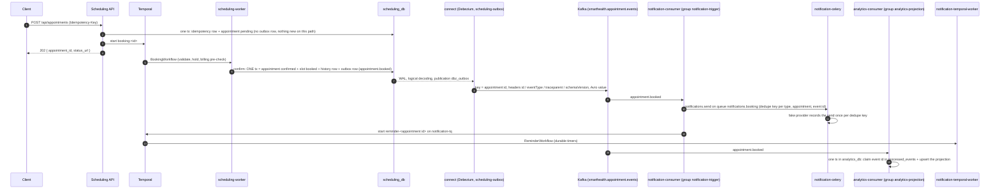

What is synchronous: only the `outbox` insert inside the confirm step (`confirm_booking`, run by the
Temporal worker). The 202 accept path is unchanged: `accept_booking` writes no outbox row, so a booking that
is accepted and then fails before confirm emits no event. Everything to the right of the commit is
asynchronous and independent of the caller; the client still learns the outcome by polling the status URL.
The event is written with the state change or not at all, so there is no window in which the appointment is
confirmed but no event will ever exist, and no service holds a relay loop.

**Topics and who reads them.** One topic per aggregate, keyed by the aggregate id, so every event of one
appointment lands in one partition in order; the event type travels in the Avro record name and the
`eventType` header, never in the topic name. All topics have 3 partitions, replication factor 1 (single dev
broker) and `retention.ms=-1`, and are created by `kafka-init`, because auto-creation would give one
partition and default retention.

| Topic | Key | Written by (outbox, connector) | Read by (consumer group) |
|---|---|---|---|
| `smarthealth.appointment.events` | appointment id | Scheduling, `scheduling-outbox` | `notification-trigger`, `analytics-projection` |
| `smarthealth.visit.events` | visit id | Visit, `visit-outbox` | `visit-downstream`, `notification-trigger`, `analytics-projection` |
| `smarthealth.patient.events` | patient id | Patient, `patient-outbox` | `analytics-projection` |
| `smarthealth.provider.events` | provider id | Provider, `provider-outbox` | nobody (published, not consumed; see 10.9) |
| `smarthealth.cdcprobe.events` | test aggregate | tests only | nobody (used to prove the CDC path without touching real topics) |
| `smarthealth.dlq.visit-downstream`, `smarthealth.dlq.notification-trigger`, `smarthealth.dlq.analytics-projection` | original key | the consumer group of the same name, for poison messages | operators |

**Event set (D-07), ten types, one Schema Registry subject each** (the Avro record name,
`com.smarthealth.events.<PascalName>`, compatibility BACKWARD): `appointment.booked`,
`appointment.cancelled`, `appointment.rescheduled`, `appointment.checked_in`, `appointment.completed`,
`appointment.no_show` (Scheduling), `visit.completed` (Visit), `patient.registered`,
`patient.deactivated` (Patient) and `provider.schedule_changed` (Provider). Payloads carry ids and
timestamps only, never PHI: a test scans every `.avsc` for banned field names, and the producers' tests check
the payload bytes and the raw Kafka bytes for seeded PHI values.

**The statement "every state change" is scoped to that set.** Billing transitions, waitlist changes, a visit
moving to in-progress, and the reconciler and hold-reaper actions are not evented. An analytics number or a
notification therefore reflects only the ten event types above.

**The outbox.** Each producing service owns exactly one `outbox` table in its own database (no
cross-database write): `id` (uuid, primary key), `aggregatetype`, `aggregateid`, `type`, `payload` (`bytea`,
the Avro-serialized record), `traceparent`, `schema_version`, `occurred_at`. The row is inserted by
`enqueue_event` in the caller's own session and the caller commits, so rollback removes the row with the state
change. The event id is deterministic (a uuid5 of aggregate id, event type and a discriminator such as the
post-transition appointment version), and the insert is `ON CONFLICT (id) DO NOTHING`, so a retried step cannot
write a second row. The table is insert-only and keeps every row as the replay source.

**The relay.** One Debezium connector per outbox database (`scheduling-outbox`, `patient-outbox`,
`provider-outbox`, `visit-outbox`), each with its own replication slot (`dbz_scheduling`, `dbz_patient`,
`dbz_provider`, `dbz_visit`) on the publication `dbz_outbox`, which covers the `outbox` table only. The
connector logs in as the least-privilege role `debezium` (replication and `SELECT` on the outbox table, and
nothing on any business table). The Debezium outbox event router publishes `payload` unchanged
(`BinaryDataConverter`), the topic from `aggregatetype`, the key from `aggregateid` and the headers `id`,
`eventType`, `traceparent`, `schemaVersion`. Services serialize the Avro themselves with a strict serializer
(`auto.register.schemas=False`); only the one-shot `schema-init` job registers schemas, so a service can never
create a subject at runtime.

**What the pipeline guarantees, in one sentence.** No event is lost once its transaction commits;
delivery on the wire is at-least-once (Debezium can re-emit after a hard kill of Connect); and the effect of
each event is exactly-once because every consumer is idempotent (effect-level exactly-once). The measured
evidence and the limits of that claim are in [10.2](#102-delivery-semantics).

| Compose service | Phase 3 role |
|---|---|
| `kafka-init` | One-shot: creates the eight topics with explicit partitions and retention |
| `schema-init` | One-shot: registers the ten subjects and sets BACKWARD (`python -m libs.events.register`); the only registry writer |
| `connect` | Kafka Connect with Debezium (`quay.io/debezium/connect:3.7.1.Final`); no host port, REST API reachable only on the Compose network |
| `connect-init` | One-shot: registers the four connectors by name and polls connector **and task** state until RUNNING |
| `visit-consumer` | Kafka consumer, group `visit-downstream`: starts the downstream workflow for `visit.completed` |
| `analytics` | Read-only analytics API (`/api/analytics`) over `analytics_db` |
| `analytics-consumer` | Kafka consumer, group `analytics-projection`: maintains the projections |
| `rabbitmq-init` | One-shot: provisions vhost `smarthealth` and the non-admin broker user `smarthealth_notification` |
| `notification-celery` | Celery worker (threads pool) that delivers notifications through the fake provider |
| `notification-consumer` | Kafka consumer, group `notification-trigger`: turns events into sends and reminder workflows |
| `notification-temporal-worker` | Temporal worker on `notification-tq` running the reminder and follow-up workflows |

`postgres` itself changed: it now starts with `wal_level=logical` and `max_slot_wal_keep_size=2GB`, and the
`db-init` job creates the `debezium` and `grafana_ro` roles and `analytics_db`. Moving an existing volume to
`wal_level=logical` needs one Postgres restart and loses no data; every service reconnects through its
pre-ping pool and restart policy.

### 10.2 Delivery semantics

Debezium is at-least-once on the wire: it commits its read position to Kafka periodically, so a hard kill of
Connect re-emits whatever it had sent since the last flush. "Never lost or duplicated" is therefore stated as
two claims and not as one:

1. **No loss.** An event exists exactly when its state change committed (same transaction), and the
   replication slot keeps WAL until Connect confirms it, so a Connect outage delays events and drops none.
2. **No duplicate effect.** Every consumer is idempotent, so a duplicate on the wire changes nothing
   (effect-level exactly-once). The topic itself can carry a duplicate; nothing in the repository claims
   otherwise.

**Measured evidence** (live Compose stack, plans 03-05, 03-11 and 03-17):

| What was forced | What was observed |
|---|---|
| `connect` SIGKILLed within seconds of delivering the first five events of an aggregate (03-05) | 11 messages for that aggregate with 6 distinct event ids: **5 duplicates**, nothing lost, the event committed while Connect was down arrived last |
| `connect` SIGKILLed the moment a real booking's `appointment.booked` reached Kafka (03-17) | the event appeared **2 times with 1 distinct event id**; the booking still had one delivery (attempts 1, one provider call), one reminder run, and `appointments_booked` rose by exactly one |
| consumer group offsets rewound for all three groups and the services restarted (03-17) | each group reprocessed its events (the run's own events: 1 for `visit-downstream`, 10 for `analytics-projection`, 7 for `notification-trigger`); the analytics summary, every delivery and provider call, and every Temporal execution count were equal before and after |
| `scheduling-worker` SIGKILLed right after a cancel committed (03-11) | `appointment.cancelled` arrived within the window with its deterministic id |
| `connect` stopped while a booking confirmed (03-11) | no event during the outage (10 s quiet read); the event arrived after Connect was healthy; a graceful stop commits offsets, so that run saw 1 copy |
| Visit API SIGKILLed after the completion 200, the visit consumer stopped, and `connect` stopped (03-11; the D-03 gate) | in every case, exactly one `visit-completed-<visit id>` execution and the marker set, started by the consumer (its own log line is the evidence), not by a sweeper |

**Three idempotency flavours.** D-08's "processed-event table in the same transaction as the effect" is exact
only for a database effect, so the consumers use the form that fits their effect:

| Effect | Idempotency mechanism | Where |
|---|---|---|
| A database write | `processed_events (event_id, consumer)` claimed with `INSERT ... ON CONFLICT DO NOTHING` in the **same transaction** as the upsert; a rolled-back effect rolls the claim back | `analytics-projection` |
| A Temporal workflow start | Deterministic workflow id (`visit-completed-<visit id>`, `reminder-<appointment id>`, `followup-<visit id>`) with `REJECT_DUPLICATE` | `visit-downstream`, `notification-trigger` |
| A Celery send | Unique dedupe key at the delivery log and at the provider's idempotency store | `notification-trigger` |

**The consumer base** (`libs/events/consumer.py`, used by all three groups) decodes each message, runs the
handler in a span that is a child of the producer's span, and commits the offset only after the effect, after
an explicit ignore, or after a confirmed write to the group's DLQ. A message that can never succeed
(undecodable bytes, a malformed payload, an unknown id) is copied to the group's dead-letter topic with the
original key, value and headers plus `dlq.*` headers that carry the error **type** only, never the error text,
and the partition moves on. An ordinary handler error is retried up to three attempts and then dead-lettered.
An infrastructure outage (Schema Registry, Postgres, Temporal, RabbitMQ) is never dead-lettered: the offset is
held, the consumer seeks back and retries with capped backoff, so an outage delays an event and never drops it.

**Ordering.** Kafka orders only within a partition, and the key is the aggregate id, so the events of one
appointment are ordered; events of different aggregates, and events on different topics, are not. The
analytics projections are written to tolerate any order (a cancel before its booking, a late reschedule): tests
apply a reversed and a seeded-shuffled sequence and get the same numbers.

### 10.3 Cancel and reschedule

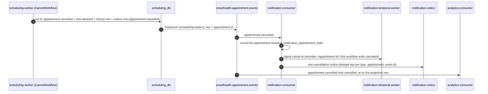

Cancel commits `appointment.cancelled` in the same transaction as the status change, the slot release and the
history row. Reschedule's single swap transaction (release the old slot, book the new one, repoint the
appointment) commits `appointment.rescheduled` carrying the old and new slot ids and starts. A repeat of either
(a retried activity, an already-cancelled appointment) emits nothing, because the event is written only in the
branch that actually changed the row, and its id is derived from the post-transition `version`. A refused
cancel (check-in already happened, for example) emits nothing.

The notification consumer reacts per event: `appointment.cancelled` closes the appointment, signals the
reminder to stop and sends one cancellation notice; `appointment.rescheduled` sends one reschedule notice and
moves the reminder to the new slot with signal-with-start, so a reminder that had already finished starts a new
run for the new slot; `appointment.no_show` sends nothing and only stops the reminder; `appointment.checked_in`
stops the reminder and closes the appointment. The reminder's dedupe key includes the slot's epoch seconds, so
a rescheduled slot gets its own reminders and the old slot's keys are never reused. The analytics consumer
sets `cancelled_at` and, for a reschedule, increments `rescheduled_count` and replaces the slot start only when
the event is newer than the one it already holds.

### 10.4 Visit lifecycle

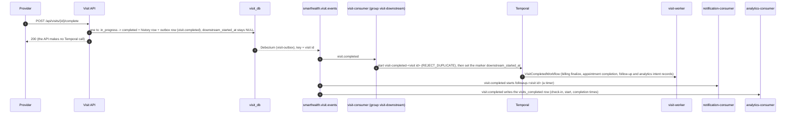

Check-in moves the appointment to `checked_in` first (Scheduling emits `appointment.checked_in` with the
check-in time and the slot start), then Visit inserts the visit. Completing the visit commits `visit.completed`
in the same transaction as the status change; the event carries the visit, appointment, clinic, patient and
provider ids and the check-in, start and completion timestamps. The visit-downstream consumer loads the visit
and starts the unchanged `VisitCompletedWorkflow` under the same deterministic id Phase 2 used; a
`visit.completed` for a visit that does not exist or is not completed is dead-lettered as non-retryable, and a
Temporal or database outage is retried. When the workflow's appointment branch completes the appointment,
Scheduling commits `appointment.completed` through the same outbox. The follow-up reminder fires
`NOTIFICATION_FOLLOWUP_DELAY_MINUTES` (default 4320, three days) after completion.

Visits that were completed before Phase 3 and never had their downstream work started have no outbox row.
`scripts/backfill_visit_completed_events.py` writes the missing `visit.completed` rows with the same event id
the live code would have used: `.venv/bin/python scripts/backfill_visit_completed_events.py` is a dry run
that prints counts, and `--apply` writes (optional `--clinic-id` and `--limit`). The dry run against the live
`visit_db` found 0 candidates, so it was never applied there. Run `--apply` only after a dry run shows
candidates; each written event starts one downstream workflow and, through analytics, one projection update.

### 10.5 Notifications and reminders

**Delivery.** `notification-consumer` turns events into one Celery task, `notifications.send`, published to
RabbitMQ (queues `notifications.booking`, `notifications.reminder`, `notifications.followup` on the direct
exchange `notifications`); `notification-celery` runs it. Messages that cannot be delivered are routed through
the dead-letter exchange `smarthealth.dlx` to `notifications.dlq`. The Celery configuration is the one RabbitMQ
4.3 requires: Celery 5.6.3 refuses to start on 4.3 with its defaults (`transient_nonexcl_queues is
deprecated`), so remote control, task events, mingle, gossip and heartbeat are switched off. The worker uses
the threads pool (`-c 8`), `acks_late`, `reject_on_worker_lost`, prefetch 1, JSON serialization only, and
classic queues (quorum queues with a delivery limit are the production path, not used here). Task arguments
are ids, a type, a dedupe key and a timestamp; never a Pydantic object and never PHI.

**Retries and the dead-letter path.** A transient provider failure is retried with exponential backoff
(`NOTIFICATION_RETRY_BACKOFF_BASE_SECONDS`, default 2 s, doubling) up to `NOTIFICATION_MAX_RETRIES` (default
5); a permanent failure, a malformed message and an unexpected exception are rejected without requeue and land
in `notifications.dlq`, so nothing is silently acknowledged and lost. An unreachable delivery log is treated
as transient. The reject reason is the exception class name only: a validation error's text would echo the
offending value. The Kafka side has its own DLQ, `smarthealth.dlq.notification-trigger`, for poison events.

**Dedupe and guards.** One send per dedupe key, enforced at two layers: the delivery log
(`notification_deliveries`, unique on `dedupe_key`, status `sending` to `sent`, `failed`, `skipped_closed` or
`skipped_stale`) and the provider's own idempotency store (`notification_provider_calls`, unique on
`dedupe_key`, where the insert is the delivery). The key is `<type>:<appointment id>:<event id>` for event
sends, `appointment.reminder:<appointment id>:<slot epoch>:<lead>` for reminders and `visit.followup:<visit id>`
for follow-ups. Two guards keep late work from doing harm: a reminder for an appointment recorded as closed
(cancelled, no-show or checked in, in `notification_appointment_state`) is `skipped_closed`, which closes the
window in which a reminder fires before the cancel event has been consumed; and a booking, cancellation or
reschedule event older than `NOTIFICATION_MAX_EVENT_AGE_MINUTES` (default 1440) is recorded `skipped_stale`
instead of sent, so replaying history never sends day-old mail.

**The guarantee, stated honestly.** One send per dedupe key holds at the delivery log and at the fake
provider's idempotency store. It was proven with a real worker subprocess killed (`os._exit`) between the
provider call and `mark_sent`: the unacknowledged message was redelivered, the provider answered from its
store (`replayed=True`), the delivery ended `sent` on attempt 2, and the provider held one call record for the
key. **A real SMS or email provider must accept an idempotency key for the same guarantee.** Without one, each
crash between the provider call and `mark_sent` can cause one duplicate send. The fake provider demonstrates
the pattern; no real provider is integrated (out of scope).

**Reminders on Temporal (D-02).** `ReminderWorkflow` (id `reminder-<appointment id>`) and
`FollowUpReminderWorkflow` (id `followup-<visit id>`) run on the task queue `notification-tq` in
`notification-temporal-worker`. The reminder walks its leads (`NOTIFICATION_REMINDER_LEADS_MINUTES`, default
`1440,120`: 24 h and 2 h before the slot) largest first with a signal-interruptible durable timer, skips any
lead already in the past, and answers `cancel` and `reschedule` signals. When a timer fires, the
`notification.enqueue` activity publishes the same `notifications.send` task the consumer uses, so Temporal
owns *when* and Celery owns *delivery*. Cost: one idle workflow per active appointment, timer-driven, no
polling. Both workflows have recorded histories and replay tests; any later change to their command sequence
needs `workflow.patched` and a newly recorded history.

**The Phase 2 notification activities are intent records.** `schedule_notification`, the schedule-change
notification and the visit workflow's follow-up and analytics stubs still log a PHI-free line and write an audit
entry; they send nothing. Delivery is event-driven only, so no appointment is notified twice by two paths. The
activities and the workflow shapes were left unchanged on purpose: removing an activity name would break replay
of histories already recorded, and nothing needed a patch.

**Broker provisioning.** `rabbitmq-init` creates the vhost `smarthealth` and the user
`smarthealth_notification` (no management tags, permissions on that vhost only; the management API also grants
the administrator access to the new vhost, which is RabbitMQ's own behaviour). Only `rabbitmq-init` holds the
administrator credentials. The failure-injection switch `NOTIFICATION_FAKE_CRASH_ENABLED` is not set anywhere
in Compose, and a test asserts it. The broker password is a file (`NOTIFICATION_BROKER_PASSWORD_FILE`, a
Compose secret), never an environment value.

**Start policy (D-13).** `NOTIFICATION_CONSUMER_START` is `latest` in Compose, and the container pins the
go-live offsets: at its first start it commits the current high watermark for every partition the group has no
offset for, so events produced after the container started are consumed and the throw-away test events already
on the topics are not. A restarted container keeps its committed position. The code default is `earliest`, so
tests and a deliberate replay read history.

### 10.6 Analytics

```text
smarthealth.patient.events  ┐
smarthealth.appointment.events ├─> analytics-consumer (group analytics-projection) ──> analytics_db ──> analytics API (/api/analytics)
smarthealth.visit.events    ┘     claim event id + upsert in ONE transaction            5 views         Grafana (grafana_ro, SELECT only)
```

`analytics-consumer` maintains three order-tolerant projection tables (`patients`, `appointments`,
`visits_completed`) and the idempotency table `processed_events` in the service's own database `analytics_db`
(`ANALYTICS_DATABASE_URL`, Alembic revision `analytics_0001`), and nothing else. The service holds no other
database URL and imports no other service. Each upsert creates the row if it is absent, facts are first-write-wins,
and the one mutable value (`appointments.slot_start`) is versioned by `(occurred_at, slot_start)`, so arrival
order never matters. An event for an id the projection has never seen is absorbed (a row that no view includes),
never dead-lettered.

**Metric definitions** (the five metrics, computed by views whose `COMMENT ON VIEW` states the same thing):

| Metric | Definition |
|---|---|
| Total patients | Patients registered and not deactivated, per clinic, as a current count (not windowed). `patient.deactivated` lowers it |
| Appointments booked | Appointments with an `appointment.booked` event, per clinic, grouped by the UTC calendar day of `booked_at`; a later cancel does not remove a booking from its day |
| Completed visits | One per `visit.completed` event, per clinic, by the UTC day of `completed_at` |
| Cancellation rate | `sum(cancelled) / sum(booked)` over the window: of the appointments booked on those UTC days, how many were later cancelled. The denominator is appointments booked in the window, not cancellations in it |
| Average wait time | Visit start minus check-in, in seconds, over visits completed in the window (`avg(wait_seconds)`). Visits without a recorded start or with a negative difference are left out of the wait only. This replaces "appointment start minus check-in", which is zero or negative for an on-time arrival |

Days are UTC days. A rate or an average whose denominator is empty is reported as no data (JSON `null`), never 0.

**The read API.** `GET /api/analytics/summary?clinic_id=&from=&to=` returns `total_patients`,
`appointments_booked`, `completed_visits`, `cancellation_rate` and `average_wait_seconds`;
`GET /api/analytics/timeseries?metric=appointments_booked|completed_visits&...` returns a zero-filled value per
UTC day. Admin and front desk only (a provider or patient token is 403, no token is 401); an admin reads any
clinic or all clinics, a front-desk user only the clinic in the token (another `clinic_id` is 403, including a
clinic with no data, so the answer is not an existence oracle). The window is inclusive UTC days, defaulting to
the last `ANALYTICS_DEFAULT_WINDOW_DAYS` (30) ending today, at most 366 days (otherwise 422). Responses carry
aggregates and clinic ids only. Grafana reads the same views as the SELECT-only role `grafana_ro`, so the
dashboards and the API agree.

**Analytics start at cutover (D-13).** Events are emitted only for new activity, so the five metrics count
from Phase 3 go-live: `ANALYTICS_CONSUMER_START` is `latest` in Compose and the container pins the go-live
offsets exactly as in 10.5 (measured on first start: `start=latest, pinned_partitions=9` and all projection
tables empty). Patients, appointments and visits that predate go-live are not backfilled into the event stream,
so `total_patients` counts only patients registered after go-live. The only backfill is the completed-visit
downstream backfill in 10.4.

**Rebuild by replay.** The projections are derived data. To rebuild them, stop the consumer, dry-run, apply,
start the consumer (the tool refuses to run while the group has a live member):

```bash
docker compose -f infra/docker-compose.yml stop analytics-consumer
docker compose -f infra/docker-compose.yml run --rm --no-deps analytics python -m services.analytics.rebuild            # dry run
docker compose -f infra/docker-compose.yml run --rm --no-deps analytics python -m services.analytics.rebuild --apply
docker compose -f infra/docker-compose.yml start analytics-consumer
```

`--apply` truncates the three tables and this projection's claims in one transaction and then resets the group
to each partition's earliest retained offset. **A rebuild replays everything still retained, including the
throw-away test events that the live consumer skipped at go-live**, so the numbers after a rebuild can differ
from the live numbers by those events. Events removed by retention, or from before the cutover, cannot be
replayed this way (the topics keep everything, `retention.ms=-1`). `processed_events` has no retention: one row
per event per consumer, growing without bound.

**EVENT-04.** The projections run on a Kafka consumer, not on Celery: see 10.8.

### 10.7 Observability

**Metrics.** Every process is scraped: 20 Prometheus targets across 17 jobs (the eight HTTP APIs and
`analytics`; each Temporal worker on its application port 9100 and its Temporal SDK port 9464; the three Kafka
consumers; `notification-celery`; RabbitMQ). The consumers' and workers' metrics ports exist only inside the
Compose network; none is published to the host (a test asserts it), and no metric label carries an entity id.
The domain metrics are `booking_saga_seconds{outcome}` (saga time read from the database clock, observed in the
confirm and mark-failed activities), `outbox_insert_seconds{event_type}`, the consumer base's
`events_consumed_total`, `event_processing_seconds`, `event_end_to_end_lag_seconds`, `dlq_events_total` and
`kafka_consumer_lag`, and the notification counters and the delivery-time histogram. The per-handler HTTP
histogram has finer buckets than the library default (0.025, 0.05, 0.1, 0.2, 0.3, 0.5, 0.8, 1, 2.5, 5 s),
set in one helper that every service calls, so every NFR latency threshold has a bucket edge. That makes a panel
reliable for "above or below the threshold line"; it does not make the plotted quantile exact to the third
digit (a quantile with few samples in a bucket reads near that bucket's upper edge). Only `scheduling` was
rebuilt with the new buckets; the other services pick them up at their next rebuild.

**Dashboards, as code.** Four dashboards are provisioned from `infra/grafana/dashboards` with
`allowUiUpdates: false`: `smarthealth-booking-nfr` (accept, read and saga latency with the NFR thresholds drawn
from `loadtest/nfr.json`, the gateway 5xx ratio, the outbox insert time), `smarthealth-events` (consumer lag,
events by outcome, processing and end-to-end lag, dead-lettered events, and a replication-slot table showing
retained WAL), `smarthealth-notifications` (sends, skips, retries, dead letters, provider replays, delivery
time, RabbitMQ depth, Temporal workflow and activity rates) and `smarthealth-operations` (the five operational
metrics per clinic, read from the analytics views). The datasources are Prometheus, `analytics-pg` (the
SELECT-only `grafana_ro` role, password from a Compose secret file) and Jaeger. A static test checks every
dashboard's uids, datasources and PromQL metric names against what the code emits. The panels were exercised
through Grafana's query API, and at the phase gate (11 November 2026) the user opened all four in a browser and
checked them; nobody had looked at them in a browser before that.

**One booking is one trace.** The W3C `traceparent` of the producing span is stored in the outbox row, carried
by Debezium into the Kafka header, extracted by the consumer base (about 30 lines of our own code; the
OpenTelemetry confluent-kafka instrumentation is deliberately not installed because it records a *link* to the
producer rather than a parent, which would make two traces) and passed to Celery's headers by the Celery
instrumentation. A booking sent with a known trace id produced one trace in Jaeger spanning gateway, Scheduling,
the Scheduling worker, Billing, the notification consumer, the Celery worker, the notification Temporal worker
and the analytics consumer: trace id `e839d1a9ec7d48e435d09abb68881b00`, 57 spans across 12 services, visible
in Jaeger within 7 s of the booking and read through Jaeger's HTTP API by an automated test. That trace id was
lost: Jaeger keeps traces in memory and its container was OOM-killed and restarted during the phase-gate
regression (10.9), so the id above no longer resolves. The evidence from the gate run is a fresh trace,
`8132991350448d3158960a29412aa965`, 61 spans across 12 services, printed by the end-to-end trace test and opened
in the Jaeger UI by the user on 11 November 2026. The consumer spans are `CHILD_OF` a span in the same trace,
not links.

**The reminder's trace is long-lived.** The notification consumer starts the reminder workflow inside the
booking's trace, so the Temporal worker already contributes a span to it. The timer then fires hours or days
later. The later reminder firing is expected to continue the same trace through Temporal's tracing interceptor,
but that was **not exercised** (it would take days); the trace can therefore have a wide gap in Jaeger, and
the claim of one connected trace covers the booking path up to the reminder start.

**Logs.** structlog JSON with `trace_id` and `span_id` for the booking, availability sync, billing, Celery send
and the consumers (`event.consumed` is written inside the processing span). Run live, the booking's trace id
was found as a JSON line in six containers (`scheduling`, `scheduling-worker`, `billing`, `notification-consumer`,
`notification-celery`, `analytics-consumer`), and none of six seeded PHI values appeared in any of them.

### 10.8 Phase 3 decisions

| Decision | Choice | Why, and the cost accepted |
|---|---|---|
| Outbox relay (D-01) | **CDC (Debezium on the Postgres WAL)**, not a polling publisher | No relay code in any service, ordering comes from the WAL, and there is no polling load on Postgres or relay loop to make highly available. Cost accepted: Kafka Connect and logical replication must be operated (`wal_level=logical`, a replication slot per database that retains WAL while Connect is down, connector *task* state to monitor, one Postgres restart), and delivery is at-least-once on the wire. Reversing it later means writing a relay and removing the connector configs |
| Connect image | `quay.io/debezium/connect:3.7.1.Final` for Kafka Connect only; broker and Schema Registry stay on `7.6.13` | The "same Confluent Platform line" rule in the stack notes is about broker versus Schema Registry; Connect is only a Kafka client. `cp-kafka-connect:7.6.13` runs Java 11 and cannot load Debezium 3.x (class-file version 61 needs Java 17; the plugin scan fails with `UnsupportedClassVersionError`), and Debezium 2.x on it is an end-of-life line. This **deliberately deviates** from the CP-line rule. The user's answer at plan 03-01: accepted ("Accept all six (Recommended)") |
| Event format (D-05) | Avro with Schema Registry, one subject per event type, BACKWARD, serialized by the **service** (strict `AvroSerializer`, `auto.register.schemas=False`) into a `bytea` payload; registration only by `schema-init` | Debezium cannot generate registered, evolvable Avro from a JSON payload, so it forwards bytes. Cost: Schema Registry is a (cached) dependency of the write path (10.9). One-way: subjects and consumers depend on the schemas |
| Topic layout | One topic per aggregate, key = aggregate id, event type in the record name | Per-event-type topics would lose per-aggregate ordering (booked before cancelled) |
| Idempotency | Three flavours by effect type (10.2) | The processed-event table is transactional only for database effects; Temporal and Celery effects use a deterministic workflow id and a dedupe key |
| Projections on a Kafka consumer (the **EVENT-04 deviation**) | Analytics projections run on the `analytics-projection` Kafka consumer, not as Celery tasks | The requirement EVENT-04 lists projections among background tasks on Celery and RabbitMQ. A stateful upsert needs the idempotency claim in the **same database transaction** as the effect, which a Kafka consumer with a processed-event table gives and a Celery task does not. Celery covers notifications and follow-up sends. The user accepted this deviation at plan 03-01 ("Accept all six (Recommended)"); the wording of EVENT-04 in `REQUIREMENTS.md` is the user's decision and was not edited |
| Reminders (D-02) | Temporal durable timers, delivery through Celery | A timer is a workflow: durable, replay-tested, cancellable and movable by signal, one deterministic id per appointment. A Celery ETA message lives in the broker (lost with it, hard to cancel or move without revoke bookkeeping) and a beat schedule is a cron, not a per-appointment timer. Cost: one idle workflow per active appointment |
| Celery configuration | Threads pool, `acks_late`, classic queues, RabbitMQ 4.3 feature flags off, dead-letter exchange | Required for Celery 5.6.3 on RabbitMQ 4.3 (10.5). Classic queues for a single-node dev stack; quorum queues with a delivery limit are the production path |
| Dedicated broker user | `smarthealth_notification`, no tags, one vhost, provisioned by `rabbitmq-init` | The application never holds the administrator account |
| Visit sweeper (D-03) | **Retired.** `visit.completed` is the only downstream trigger | The visit-worker deletes the `visit-downstream-sweeper` Schedule at every start (idempotent); the start-up sweep and the sweeper settings are gone; the workflow class and activity name stay registered as a no-op tombstone so histories already recorded still replay (safe to remove once `list_workflows("WorkflowType='VisitDownstreamSweeperWorkflow'")` is empty everywhere). Replacement proven by the kill-between-commit-and-publish tests (10.2) |
| Notification delivery | Event-driven only; the Phase 2 stub activities are intent records | Two paths would double-send (different dedupe keys) |
| Analytics start (D-13) | Count from go-live; no history backfill | Events exist only for new activity; a backfill can be added later without changing the contract |
| Average wait definition | Check-in to visit start | Appointment start minus check-in is zero or negative for on-time arrivals and measures early arrival, not waiting |

**Interim mechanisms after Phase 3.** The sweeper is the only one retired. The others stay as safety nets, and
each stays because events do not subsume it:

| Mechanism | Status | Why it stays |
|---|---|---|
| Visit downstream sweeper | **Retired** (Schedule deleted, tombstone workflow) | Replaced by the `visit.completed` outbox event and the `visit-downstream` consumer |
| Hold reaper (`scheduling-hold-reaper`) | Stays | An expired hold is the absence of an event: the booking workflow that held the slot may be gone, and nothing is emitted for a hold that simply times out |
| Pending-booking starter (`scheduling-pending-starter`) | Stays | It recovers a workflow start lost *after the accept commit*. The accept path writes no outbox row (the NFR-03 accept path must not gain work), so no event exists for a pending appointment |
| Scheduling reconciler (`scheduling-reconciler`) | Stays | It resolves stuck `pending` bookings whose workflow is gone, stuck waitlist entries and the time-driven no-show sweep; none is triggered by an event (the sweep itself *emits* `appointment.no_show`) |
| Visit reconciler (`visit-reconciler`) | Stays | It settles visits whose workflow *started* but whose billing or appointment marker never landed; the trigger event cannot fix an already-started run |
| Schedule-change poller (`scheduling-schedule-change-poller`) | Stays **paused** on the live Temporal server (user decision) | `provider.schedule_changed` is published but nothing consumes it (10.9); the pull feed and its workflows still exist |
| Notification stub activities | Stay, as intent records | See 10.5 |
| Temporal `auto-setup` | Stays, **non-production** | A local-dev convenience; production uses `temporalio/server` with a schema job |

### 10.9 Limitations and operations notes

- **At-least-once on the wire.** Duplicates on a topic are possible after a hard kill of Connect (measured:
  5 duplicates of 11 messages in plan 03-05; 2 copies of one event id in plan 03-17). Every consumer absorbs
  them; the effect is exactly one (10.2). Consumers that are not idempotent must not be added to these topics.
- **Real-provider idempotency key.** The one-send-per-dedupe-key guarantee needs an idempotency key at the
  provider (10.5); without one, each crash between the provider call and `mark_sent` can cause one duplicate.
- **Schema Registry is a cached write-path dependency.** The first serialization of each event type does a
  synchronous registry lookup, so every producer warms its serializers at start-up (in a thread, retried) and a
  Scheduling worker that cannot warm exits and restarts. Steady-state encoding is CPU only, so a registry outage
  after warm-up does not affect writes; a cold start during an outage cannot become ready. The outbox insert
  itself measured p95 about 1 ms and p99 about 3 ms for `appointment.booked` in Prometheus after the smoke run.
- **Replication slots retain WAL while Connect is down.** An inactive slot stops Postgres from recycling WAL;
  `max_slot_wal_keep_size=2GB` caps it, and a slot that exceeds the cap is invalidated by Postgres (a fresh
  connector snapshot would then be needed; that path was not exercised). Deleting a connector does **not**
  drop its slot; after the connector is gone, drop it by hand, for example
  `SELECT pg_drop_replication_slot('dbz_scheduling');`. A quiet database must still confirm WAL: with only
  `heartbeat.interval.ms` the `dbz_provider` slot's confirmed position stayed frozen (it retained 83 to 87 MB
  when measured in plan 03-17, 517 MB earlier). Each connector now also runs a heartbeat action query,
  `SELECT pg_logical_emit_message(true, 'smarthealth-heartbeat', clock_timestamp()::text)`, every 10 s, which
  writes a tiny WAL message into the monitored database (no table, no migration, no event: the prefix is on
  `message.prefix.exclude.list`). Retained WAL for `dbz_provider` went from 83 MB (frozen) to 2.4 to 5 MB
  (moving) three minutes after the change and 1.4 MB when idle; the other three slots read 5 to 15 MB after
  three minutes and 1.4 MB when idle. The events dashboard's slot table shows the current value.
- **The outbox is insert-only.** Rows are never pruned (an accepted decision: they are the replay source), so the
  table grows without bound. An operator who must reclaim space can delete old rows, for example
  `DELETE FROM outbox WHERE occurred_at < now() - interval '90 days';`, only after every connector shows RUNNING
  and its slot confirmed past those rows. That statement is documented, not exercised here: try it on a copy first.
- **No retention anywhere else either.** Kafka topics keep everything (`retention.ms=-1`), `processed_events`,
  `notification_deliveries` and `notification_appointment_state` grow without bound, and the live DLQ topics also
  hold records from test runs (filter by key or event id, do not count the topic).
- **No authentication on the dev event network.** Kafka (plaintext listeners), Schema Registry and the Connect
  REST API accept unauthenticated calls from inside the Compose network; Kafka (9092) and Schema Registry (8081)
  are also published on host ports in the dev Compose file, and the Connect REST API is not.
  Production would need SASL and TLS on Kafka, ACLs per consumer group, Schema Registry authentication and
  authenticated Connect REST access.
- **`temporalio/auto-setup` is non-production** (see 10.8).
- **Containers run as root.** The notification and Celery containers included (Celery warns about it). The
  Semgrep `missing-user` Dockerfile findings are accepted for now by the user; production hardening is deferred.
  That is ten Dockerfiles: the eight accepted at the Phase 2 closeout and the two added in Phase 3
  (`services/analytics` and `services/notification`), which the user accepted for now at the phase gate.
- **Test-environment capacity (measured at the Phase 3 gate).** The dev Postgres runs with `max_connections=300`.
  The full non-e2e suite run against the live stack reaches that ceiling: the containers hold about 110 idle
  connections and the pytest process grows from about 50 to about 200 as fixtures open engines, peaking at 304
  in the last part of a 26 minute run. Some tests then fail with `TooManyConnectionsError` in the full run
  and pass when run alone (two such cases in two runs). The Docker VM (7.65 GiB) OOM-killed the Jaeger container
  once during the full regression; Jaeger keeps traces in memory, so the traces it held were lost on restart.
  Subprocess tests that fork from the threaded pytest process on macOS can crash with SIGTRAP (exit -5, a
  fork-in-a-multithreaded-process crash on the child side); they passed when rerun alone. The two non-e2e runs
  each had failures (2 and 5), so the full non-e2e suite did not finish clean on any run; the e2e suite passed
  71 of 71 on its second run. The follow-up (raise the dev `max_connections`, cap Jaeger memory, dispose engines
  per test) is **not done**.
- **S3 audit-via-outbox is deferred.** Post-commit audit writes to Mongo remain best effort and can be lost if
  Mongo is down at that instant; moving them into the outbox is the natural fix and was deferred (accepted),
  because it must not widen the booking accept path.
- **`provider.schedule_changed` is published but not consumed.** Scheduling does not consume it, and the
  schedule-change poller Schedule stays paused on the live Temporal server (user decision); the pull feed in
  4e is unchanged.
- **Scope of "every state change".** Only the ten D-07 event types are evented. Billing transitions, waitlist
  changes, a visit moving to in-progress, and the reconciler and hold-reaper actions are not.
- **Analytics start at cutover.** Metrics count from go-live and `total_patients` counts only patients
  registered after it (10.6); a rebuild replays everything still retained, including throw-away test events.
- **Event-fed local copies were not built.** Phase 2.1 expected Phase 3 might replace the synchronous
  reference checks (section 4) with event-fed copies. It did not: the checks are unchanged and still make a
  write depend on the owning service being up.
- **The gateway rate budgets are a test-time setting.** The live gateway ran for the tests and the load runs
  with the budgets raised (1000 per minute for the auth routes, 100000 for the rest); the Compose defaults are
  20 and 300. Raise them per run on a local stack only.
- **Load.** The k6 `smoke` profile passed every threshold on the Phase 3 stack in three runs (10 to 11 November
  2026; see `docs/nfr.md`), and accept latency crept up between them, so it is the number to watch.
  `sustained`, `burst` and `contention` were **not run**: the user deferred them until after Phase 3, so
  NFR-01..08 remain targets that are not yet measured.
- **Not verified:** the reminder's later firing inside the same trace (10.7),
  the decode-time Schema Registry outage path of the consumer base (implemented, no automated test), and the
  connector after the slot cap is exceeded.

See [`architecture-dashboard.html`](./architecture-dashboard.html) for the interactive decision record
(alternatives and tradeoffs per decision), [`architecture.html`](./architecture.html) for a standalone
diagram view, and [`erd.md`](./erd.md) for the per-service schemas.
