# SmartHealth — Architecture (Part A / Phase 2.1: scheduling, visits, billing, mentor-review remediation)

Foundational healthcare-operations backend. Phase 1.1 re-delivered it as independently deployable
services (gateway, Identity, Organization, Provider, Patient, Scheduling skeleton), each owning
its own PostgreSQL database, with RS256 tokens verified locally, an append-only PHI-free audit
trail and connected tracing. **Phase 2** turns Scheduling into a real service and adds **Visit**
and **Billing**: on-demand slots, asynchronous booking as a **Temporal saga with compensation**,
cancel, reschedule, a waitlist that auto-books freed slots, the visit state machine with
non-blocking downstream work, and a simulated billing pre-check — executed by two dedicated
worker containers (`scheduling-worker`, `visit-worker`). **Phase 2.1** closes the Week 1-2 mentor
review without adding product scope: an appointment state machine with a check-in window (4d), provider
schedule-change propagation (4e), reconcilers for stuck states (4f), single-use refresh tokens, paginated
lists, self-service reads, and quantified NFRs with a runnable load test ([`nfr.md`](./nfr.md)).

> **Scope note.** Temporal is live from Phase 2. Kafka and RabbitMQ/Celery are still
> **scaffolding only** (Phase 3: event backbone, Celery jobs, outbox, dedicated Audit service).
> Notification, follow-up and analytics steps are stubs behind one activity each. This is a
> local/dev system with synthetic data only; nothing here is claimed as production-hardened
> (logout, PHI log-safety and database isolation are implemented but not fully hardened); see
> [Known limitations](#7-known-limitations-and-unverified-items).

---

## 1. System / Component Diagram

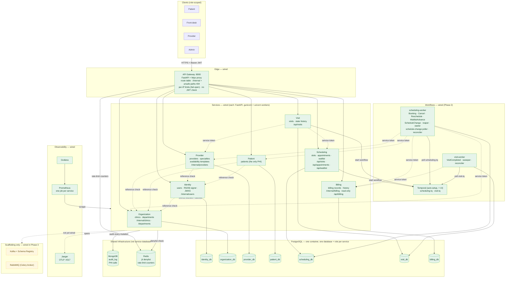

Dashed service-to-service arrows are synchronous `/internal` calls: Phase 1.1 reference checks
(section 4) and Phase 2's service-token calls from APIs and workers (section 5a).

---

## 2. Service Breakdown

| Service | Owns | Database | Internal endpoints (not routed by the gateway) | Calls out to |
|---|---|---|---|---|
| **API Gateway** | Edge routing, per-IP rate limiting, path-safety checks | none | — | all five services' public routes (proxy); Redis (limits) |
| **Identity** | Accounts (`users`: credentials, role, `clinic_id`), register/login/refresh/logout, RS256 token issuance, JWKS, Redis denylist writes, 60 s service tokens | `identity_db` | `GET /internal/users/{id}` | Organization (validate `users.clinic_id`); Redis; MongoDB (audit) |
| **Organization** | Clinics, departments (soft-delete, clinic-scoped) | `organization_db` | `GET /internal/clinics/{id}`, `GET /internal/departments/{id}` | Identity JWKS (cached); Redis; MongoDB |
| **Provider** | Providers, specialties, provider↔specialty links, weekly availability templates, the `schedule_change_events` outbox (4e) | `provider_db` | `GET /internal/providers/{id}`, `GET /internal/providers/by-user/{id}`, `GET /internal/schedule-changes`, `POST /internal/schedule-changes/{id}/ack` (Scheduling only) | Organization (department), Identity (user); Identity JWKS; Redis; MongoDB |
| **Patient** | Patient profiles — the only service holding PHI; `GET /api/patients/me` | `patient_db` | — | Organization (clinic), Identity (user); Identity JWKS; Redis; MongoDB |
| **Scheduling** | Slots (materialized on demand from Provider templates), appointments, idempotency keys, appointment history, waitlist; booking / cancel / reschedule / waitlist-advance workflows and their activities | `scheduling_db` | `GET /internal/appointments/{id}?clinic_id=`, `POST /internal/appointments/{id}/check-in`, `POST /internal/appointments/{id}/complete` (Visit service token only) | Patient, Provider (including the schedule-change feed and a provider's own id for reads), Organization (validation), Billing (pre-check, transitions); Temporal |
| **Billing** | Billing records (`pending → verified/failed → …`), status history; deterministic simulated pre-check (`DENY-` prefix denies) | `billing_db` | `POST /internal/billing/prechecks`, `…/records/{appointment_id}/transitions`, `…/relink` (all need `Idempotency-Key`) | none (answers Scheduling and Visit only; no client secret) |
| **Visit** | Visits (`checked_in → in_progress → completed`), state history, downstream and settlement markers; VisitCompleted, sweeper and reconciler workflows | `visit_db` | — | Scheduling (internal check-in and complete), Provider (is this login the visit's provider?), Billing (finalize); Temporal |
| **scheduling-worker** | Executes Scheduling's workflows and activities on `scheduling-tq`; registers the hold-reaper, pending-starter, schedule-change-poller and reconciler Schedules | `scheduling_db` (same role as the API) | — | as Scheduling; never runs migrations |
| **visit-worker** | Executes `VisitCompletedWorkflow`, the sweeper and the reconciler on `visit-tq`; registers the `visit-downstream-sweeper` and `visit-reconciler` Schedules | `visit_db` | — | Billing; never runs migrations |

Every service also verifies tokens locally from Identity's cached JWKS and checks the shared Redis
denylist. Shared code (`libs/`) is infrastructure only — token verification and JWKS client, audit
writer, observability setup, DB/session helpers — and never shares domain models. Each service
declares its own SQLAlchemy `DeclarativeBase` and its own Alembic migrations with a fresh baseline.

Isolation is asserted by tests: no service imports another, no foreign key crosses a service, PHI
columns exist only in Patient, the private key is loaded only by Identity, and each service's
database role is refused by every other service's database.

### Workflows, task queues and ids

| Workflow | Task queue | Workflow id | Started by |
|---|---|---|---|
| `BookingWorkflow` | `scheduling-tq` | `booking-<appointment id>` | `POST /api/appointments` after the accept commit; the pending-booking starter Schedule if that start was lost; the waitlist advance (child) |
| `CancelWorkflow` | `scheduling-tq` | `cancel-<appointment id>-<version>` | `POST /api/appointments/{id}/cancel` |
| `RescheduleWorkflow` | `scheduling-tq` | `reschedule-<appointment id>-<version>` | `POST /api/appointments/{id}/reschedule` |
| `WaitlistAdvanceWorkflow` | `scheduling-tq` | `waitlist-advance-<cancel/reschedule workflow id>` | Cancel / reschedule (abandoned child, after notify) |
| `HoldReaperWorkflow`, `PendingBookingStarterWorkflow` | `scheduling-tq` | Schedules `scheduling-hold-reaper`, `scheduling-pending-starter` | Temporal Schedules (60 s / 30 s) |
| `ScheduleChangePollerWorkflow` | `scheduling-tq` | Schedule `scheduling-schedule-change-poller` | Temporal Schedule (`SCHEDULING_SCHEDULE_CHANGE_POLL_SECONDS`, 15 s) |
| `ScheduleChangeWorkflow` | `scheduling-tq` | `schedule-change-<event id>` | The poller, once per Provider change event (Phase 2.1, 4e) |
| `ReconcilerWorkflow` | `scheduling-tq` | Schedule `scheduling-reconciler` | Temporal Schedule (`SCHEDULING_RECONCILER_INTERVAL_SECONDS`, 60 s; Phase 2.1, 4f) |
| `VisitCompletedWorkflow` | `visit-tq` | `visit-completed-<visit id>` | `POST /api/visits/{id}/complete` after its commit; the sweeper if lost |
| `VisitDownstreamSweeperWorkflow` | `visit-tq` | Schedule `visit-downstream-sweeper` | Temporal Schedule (60 s) |
| `VisitReconcilerWorkflow` | `visit-tq` | Schedule `visit-reconciler` | Temporal Schedule (`VISIT_RECONCILE_INTERVAL_SECONDS`, 60 s; also one pass at worker start; Phase 2.1, 4f) |

Workflow inputs and results are plain ids and status strings (`domain/contracts.py`, checked by a
test): no coverage reference, token, phone or address ever enters Temporal history.

---

## 3. Request Flow — through the gateway

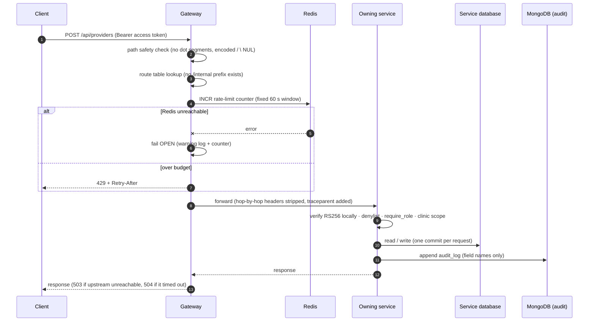

The gateway does **not** verify JWTs: each service verifies for itself, so no service trusts the edge.
The gateway never retries (a retried POST could double-apply a write) and never aggregates
responses (reads return ids only; clients combine them).

---

## 4. Reference-check Flow — fail closed (D-05)

At write time the owning service is asked whether a referenced record exists. Example: creating a
provider under a department.

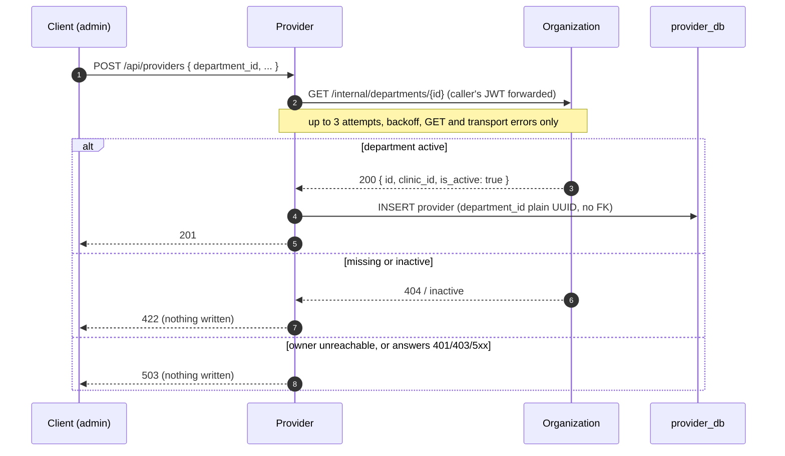

| Reference | Owner called | Outcome when missing/inactive | Outcome when owner cannot answer |
|---|---|---|---|
| `users.clinic_id` | Organization | 422 | 503 |
| `patients.clinic_id` | Organization | 422 | 503 |
| `patients.user_id` | Identity | 422 | 503 |
| `providers.department_id`, `availability_templates.department_id` | Organization | 422 | 503 |
| `providers.user_id` | Identity | 422 | 503 |

A 401/403/5xx from the owner is deliberately a 503, never a 422, so an authentication
misconfiguration between services is not mistaken for a missing record. Deactivating a referenced
record **never cascades** (D-06): existing references keep their ids and only new writes pointing at
an inactive target are refused. There is no reverse call and no distributed transaction. Kafka,
the outbox and event-fed local copies that would remove this availability coupling are Phase 3 (D-08).

---

## 4a. Booking saga with compensation (Phase 2)

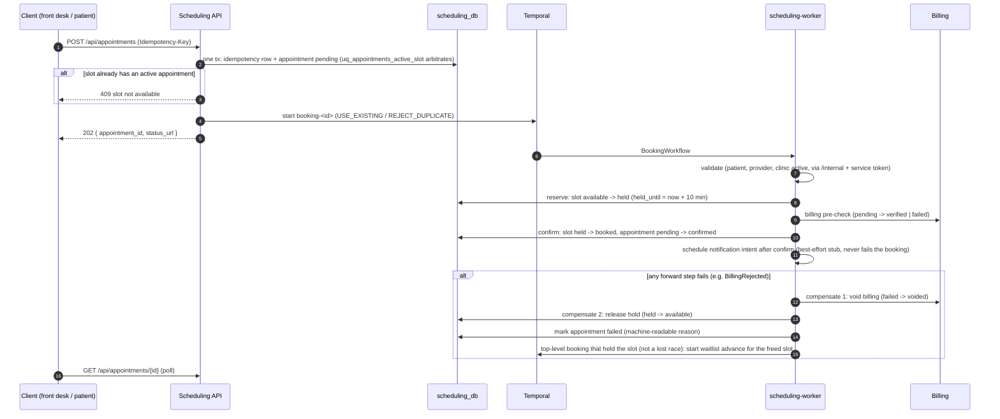

Compensation runs **in reverse order as forward state transitions** (nothing is deleted), and every
step writes one audit entry with `dedupe_key = <workflow id>:<step>`, so a retried activity never
double-audits. Order note: the implemented order is validate, hold, **billing pre-check,
confirm, then a best-effort notification intent** (plan 02.1-07, S7). SCHED-02 lists the
notification earlier and the implementation deliberately differs: the notification intent is
requested **after confirm** succeeds, so a booking that fails at confirm (`ConfirmLostHold`)
sends none, and a patient is never told about a booking that is then compensated. SCHED-02's
"prevent conflicts" is the reserve step's database constraints. The order change and the
failure-path waitlist re-offer are `workflow.patched` (`booking-notify-after-confirm-v1`,
`booking-failure-waitlist-v1`), so histories recorded earlier still replay.

Post-commit safety (S3): `void_billing` and `release_slot` read the appointment's status and do
nothing once it is `confirmed`, `checked_in`, `completed` or `no_show`; the audit write after a
committed confirm, cancel, swap, check-in or complete is best effort (a failure is logged as
`audit.write_failed`, the transition stays durable in `appointment_status_history`). Booking a
slot that already started is `422 slot has already started` at the API and `SlotInPast` in the
validate step (S6). The hold reaper offers each slot it frees to the waitlist, and a failed top-level
booking offers its slot under `waitlist-advance-booking-<appointment id>` (the same id the
reconciler uses in 4f, so the two paths cannot both start an advance) (S5).

Cancel and reschedule:

- **Cancel** (`CancelWorkflow`): cancel the appointment and release its slot → billing
  `refund_pending → refunded` when more than `SCHEDULING_CANCEL_CUTOFF_HOURS` (24 h) ahead, else
  `no_refund` (staff may waive) → notification intent → start the waitlist advance (child).
- **Reschedule** (`RescheduleWorkflow`): hold the new slot first → one Scheduling transaction
  releases the old slot, books the new one and repoints the appointment → re-link billing →
  notify → waitlist advance for the old slot. Never cancel-then-rebook.
- **Waitlist advance**: FIFO claim of the first matching `waiting` entry with
  `FOR UPDATE SKIP LOCKED` → a child `BookingWorkflow` for that patient → entry `booked`; a failed
  booking marks the entry `failed` and tries the next (cap 5); losing the slot race puts the
  entry back to `waiting`.

## 4b. Visit completion with non-blocking downstream work (Phase 2)

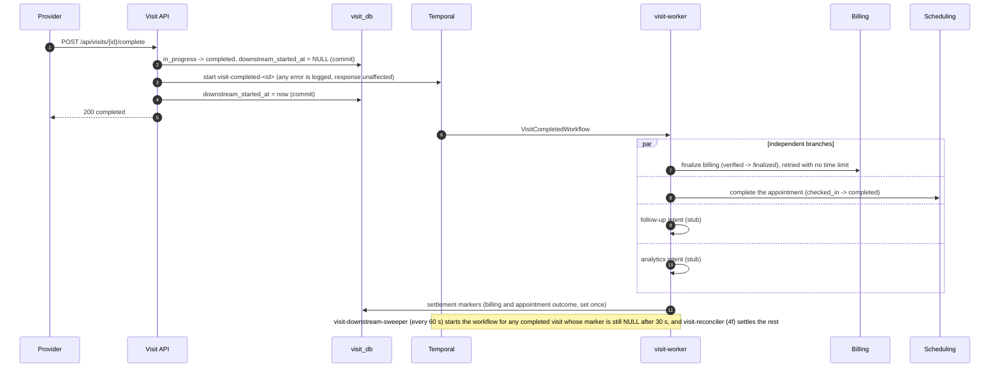

The appointment step is a fourth concurrent branch behind `workflow.patched`, so a retrying billing
branch never delays it and vice versa. Each step stamps a settlement marker on the visit
(`billing_settled_at/_outcome`, `appointment_settled_at/_outcome`, migration `visit_0002`) once it has
landed or reached a terminal business outcome (`not_finalizable`, `no_record`, `no_appointment`,
`not_checked_in`); the marker is what the reconciler reads. Billing finalize no longer gives up: its
retry has no schedule-to-close limit, so the workflow can stay open while Billing is down.

## 4c. Layered idempotency

1. **Database arbiters first**: the partial unique index `uq_appointments_active_slot`, the
   idempotency-key row `(caller_user_id, key)` with a request hash, conditional state updates
   (`UPDATE … WHERE status = <expected>`), `uq_visits_appointment`, history uniques
   (`uq_visit_history_visit_to`, `uq_billing_history_record_key`).
2. **Workflow id second**: deterministic ids with `USE_EXISTING` / `REJECT_DUPLICATE` make a
   second start a no-op; the namespace retains closed workflows for 24 h only, so the database
   rules above are what hold beyond that.
3. **Activities** are idempotent by construction (conditional updates, `Idempotency-Key` on every
   Billing call, audit `dedupe_key`), so Temporal retries are safe.

## 4d. Appointment state machine (Phase 2.1)

Mentor item **M1**. Before Phase 2.1 an appointment was only `pending`, `confirmed`, `cancelled` or
`failed`, so a patient who had checked in could still cancel and receive a refund. The vocabulary is
now seven states, defined once in `services/scheduling/domain/enums.py` (the model builds the CHECK
constraint and the index predicates from it, so model and migration cannot drift).

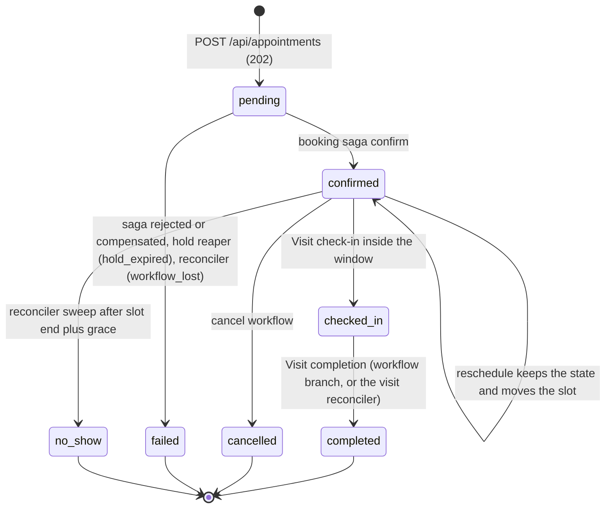

| Transition | Actor | Rule |
|---|---|---|
| `pending → confirmed` | `BookingWorkflow` confirm step | slot `held → booked` in the same transaction |
| `pending → failed` | booking saga compensation; hold reaper; Scheduling reconciler | machine-readable `failure_reason` (`BillingRejected`, `hold_expired`, `workflow_lost`, ...) |
| `confirmed → checked_in` | Visit, through `POST /internal/appointments/{id}/check-in` (Visit service token only) | inside the check-in window, judged by the **database clock** |
| `checked_in → completed` | `VisitCompletedWorkflow` appointment branch, `POST /internal/appointments/{id}/complete` | a repeat is a 200 no-op; an appointment that never checked in is `409 appointment not checked in` |
| `confirmed → no_show` | reconciler sweep (4f) | slot end plus `SCHEDULING_NO_SHOW_GRACE_MINUTES` (30) has passed; no manual staff action |
| `confirmed → cancelled` | `CancelWorkflow` | only from `confirmed`; refused with 409 for `checked_in`, `completed` and `no_show` |
| `confirmed → confirmed` | `RescheduleWorkflow` | reserve-then-swap; refused for the three new states |

**Check-in window.** It opens `SCHEDULING_CHECKIN_OPENS_BEFORE_MINUTES` (default 60) before `slot_start` and
closes `SCHEDULING_CHECKIN_CLOSES_AFTER_END_MINUTES` (default 0) after `slot_end`. The decision is made in
the same locking `SELECT` that reads the row, with `now()` of the database, never the application clock,
and the minutes are read from settings at request time.

**Database guarantees.** `scheduling_0004` widens `ck_appointments_status_valid`,
`uq_appointments_active_slot` and `ex_appointments_patient_no_overlap` to every slot-holding status
(`pending`, `confirmed`, `checked_in`, `completed`, `no_show`), so a checked-in, completed or no-show
appointment keeps its slot and keeps its patient busy at the storage layer, not just in application code.
Every transition is a conditional `UPDATE` after a row lock that returns an outcome (`checked_in`,
`already`, `too_early`, `too_late`, `not_confirmed`) and writes one `appointment_status_history` row, so
twenty concurrent check-ins make one transition.

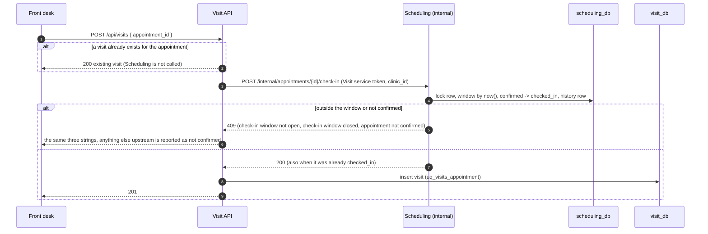

Scheduling's transition runs first and the visit insert second. The crash window between them (the
appointment is `checked_in`, no visit yet) converges on the next request: Scheduling answers 200
"already" and the visit is then created, with no compensating call and no extra state. An appointment
left `checked_in` with no visit if the patient never retries is not reconciled (an open risk, section 7).

## 4e. Provider schedule change (Phase 2.1)

Mentor item **M2**. Editing or deactivating an availability template, or deactivating a provider, used
to leave already-generated slots bookable. Provider cannot call Scheduling to fix that (no service
calls another's write path), and a push would be lost if Scheduling or Temporal were down at the moment
of the change, so the direction is a **pull from an outbox**:

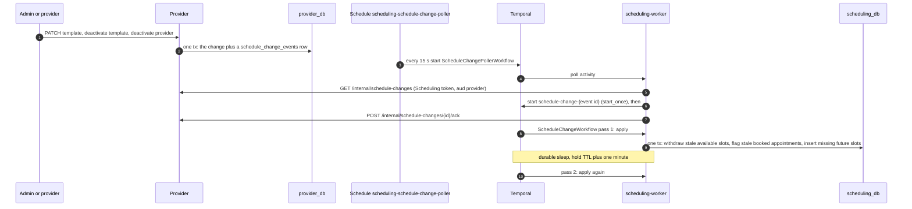

- **Outbox row.** `provider_db.schedule_change_events` (`provider_0002`): `id`, `provider_id`,
  `template_id` (null for a provider deactivation), `change_type` (`template_updated`,
  `template_deactivated`, `provider_deactivated`, `ck_schedule_change_events_type_valid`), `created_at`,
  `delivered_at`. It is written inside the repository function that already owns the commit, so the change
  and its event are atomic; a change that alters nothing writes no event. It carries ids only, no
  foreign key, and delivered rows are never purged. The partial index `ix_schedule_change_events_pending`
  serves the feed.
- **Feed.** `GET /internal/schedule-changes?limit=` returns undelivered events oldest first (no cursor:
  rows can commit out of order, so acknowledgement is a conditional update, not an offset);
  `POST .../{id}/ack` is idempotent. Both accept only Scheduling's `aud=provider` service token.
- **Poller.** The Schedule `scheduling-schedule-change-poller` runs `ScheduleChangePollerWorkflow` every
  `SCHEDULING_SCHEDULE_CHANGE_POLL_SECONDS`. For each of up to 100 events it starts one
  `ScheduleChangeWorkflow` under `schedule-change-<event id>` and only then acknowledges, so a crash
  re-delivers (at-least-once) and the repeat is a no-op.
- **Affected set by set difference.** The apply activity re-expands the provider's current templates (clinic
  timezone, DST-safe, from clinic-local yesterday to the provider's latest slot) with the same generator
  that creates slots, and treats every future slot whose exact `(start, end)` is not in that set as stale.
  An inactive or unknown provider is the empty set. No slot-to-template link is needed.
- **What the apply does.** Stale `available` slots are withdrawn (`cancelled`) by a conditional update.
  Stale `held` slots belong to an in-flight booking and are skipped in pass 1. A stale `booked` slot's
  `confirmed` or `checked_in` appointment is **flagged**, not cancelled: `schedule_change_flagged_at` and
  `schedule_change_reason` (`scheduling_0005`, partial index `ix_appointments_schedule_flagged`), a
  `schedule_changed:<reason>` history note, and one best-effort notification intent. For an active provider
  the missing future candidates are inserted (`ON CONFLICT DO NOTHING`), so an edit replaces slots.
- **Second pass.** After a durable timer of hold TTL plus one minute the workflow applies again, so a
  booking that confirmed just after pass 1 is flagged instead of missed.
- **Staff flow.** `GET /api/appointments?flagged=true&status=confirmed` is the worklist, and a patient sees
  the flag on their own appointment. Cancelling or rescheduling a flagged appointment **withdraws** its stale
  slot instead of freeing it (otherwise the provider would be bookable at a time they no longer work); a
  reschedule clears the flag. The flag stays on a cancelled appointment.
- **Ambiguity withdraws nothing.** An owner that cannot answer is a retryable error before any write; a
  missing department, clinic or timezone is a non-retryable error that fails the workflow visibly.

Phase 3 can publish the same outbox rows to Kafka instead of (or as well as) serving the pull feed.

## 4f. Reconcilers (Phase 2.1)

Mentor item **S4**. Each reconciler is a Temporal Schedule (overlap `SKIP`) running one idempotent workflow.
Every state change is a conditional update, every list is oldest first and capped, and one row's failure is
logged (ids and exception type only) and never blocks the rest. They re-derive what should have happened
from the database; they never invent an outcome.

**Scheduling reconciler** (`scheduling-reconciler`, `ReconcilerWorkflow`, every
`SCHEDULING_RECONCILER_INTERVAL_SECONDS`, 60 s). Three activities in a fixed order; one failing never blocks
the others:

1. *Stuck `pending` and the billing lookback.* A `pending` appointment older than
   `SCHEDULING_RECONCILE_PENDING_AFTER_MINUTES` (10) blocks its slot forever, because
   `uq_appointments_active_slot` covers `pending`. The step asks Temporal whether `booking-<id>` is still
   running; a running workflow is skipped, a missing or closed one is gone, and any other Temporal error skips
   the step (a booking is never failed because the control plane is down). For a gone workflow it re-reads the
   appointment, voids billing, then in one transaction releases the hold, marks the appointment `failed` with
   `workflow_lost` and writes a `billing_void_checked` note; if the void cannot be done the appointment stays
   `pending` and the next run retries. Afterwards it offers the freed slot to the waitlist. The lookback then
   voids billing for appointments failed with `hold_expired` or `workflow_lost` in the last
   `SCHEDULING_RECONCILE_BILLING_LOOKBACK_HOURS` (24) that have no `billing_void_checked` note.
2. *Stuck waitlist.* An entry `matched` for longer than `SCHEDULING_RECONCILE_MATCHED_AFTER_MINUTES` (15) is
   resolved from the outcome of its matched appointment: back to `waiting` for a lost race (`SlotUnavailable`,
   `ConfirmLostHold`, `hold_expired`, `workflow_lost`), `failed` with the reason for any other failure,
   `booked` for a committed or cancelled appointment, and left alone while the appointment is `pending`.
3. *No-show sweep.* A `confirmed` appointment whose slot ended more than
   `SCHEDULING_NO_SHOW_GRACE_MINUTES` ago gets Billing `no_refund` first and then `mark_no_show` (state and
   clock re-checked under the row lock). It re-reads the appointment as `confirmed` immediately before the
   Billing call, so a patient who checked in meanwhile never has billing moved. Either failure leaves the
   appointment `confirmed` and the next run repeats both.

The reconciler offers a freed slot under `waitlist-advance-booking-<appointment id>`, the id the booking
workflow's own failure re-offer uses, so the two paths are idempotent with each other. Rows it changes carry
the actor `system:reconciler` in `appointment_status_history`. At most `SCHEDULING_RECONCILE_BATCH_LIMIT` (50)
rows per list per run.

**Visit reconciler** (`visit-reconciler`, `VisitReconcilerWorkflow`, every `VISIT_RECONCILE_INTERVAL_SECONDS`,
60 s, plus one pass when the worker starts). A completed visit whose `billing_settled_at` or
`appointment_settled_at` marker is still empty after `VISIT_RECONCILE_GRACE_MINUTES` (10) is settled by the
same step bodies the workflow uses, under the workflow id `visit-completed-<visit id>`, so Billing's
`Idempotency-Key` and the audit dedupe key are identical whether the workflow or the reconciler runs a step.
It never updates a marker directly. Terminal business outcomes (`BillingNotFinalizable`,
`AppointmentNotCheckedIn`) are logged as refusals, not failures. Only started workflows are covered here; a
completion whose workflow was never started is the sweeper's job.

**Replay discipline.** `ReconcilerWorkflow` and `VisitReconcilerWorkflow` are new workflow types and need no
patch marker; any later change to their command sequence needs `workflow.patched` and a newly recorded history
(`reconciler_p21.json` is never re-recorded). The booking, visit-completion and visit-billing changes are
behind patch ids with recorded histories that keep replaying. Temporal replay compares commands, not activity
options, so the open-ended billing retry (an options-only change) is not enforced by replay; its patch is a
convention that makes the version visible in a run's history, and a test pins that property.

## 4g. Mentor review remediation map (Phase 2.1)

Each review item maps to a mechanism above and to test files that fail if the behaviour or the file
disappears (`tests/docs/test_phase21_traceability.py` enforces the mapping and that every id is named here).

| Item | Review finding | Where it is built | Section |
|---|---|---|---|
| **M1** | Appointment state machine, check-in window, cancel/reschedule after check-in | `checked_in`, `completed`, `no_show`; `scheduling_0004`; internal check-in and complete; Visit check-in and completion integration | 4d, 4b |
| **M2** | Provider schedule change must reach slots and bookings | `schedule_change_events` outbox, poller Schedule, `ScheduleChangeWorkflow`, flagged appointments | 4e |
| **S3** | Failures after commit | Compensations guarded by state; audit after a committed step is best effort | 4a, 7 |
| **S4** | Stuck states | Scheduling and Visit reconcilers; open-ended visit billing retry | 4f, 4b |
| **S5** | Waitlist re-offer after a failed direct booking | Booking failure re-offer, reaper offer, reconciler offer | 4a, 4f |
| **S6** | Booking a slot in the past | `422 slot has already started`; `SlotInPast` in the saga | 4a |
| **S7** | Notification only after confirm | Order validate, hold, billing pre-check, confirm, notification intent, behind `workflow.patched` | 4a |
| **C1** | `/refresh` must check the denylist and rotate | Single-use rotation with an `rjti` claim | 5 |
| **C2** | bcrypt on the event loop | Bounded `bcrypt*` thread pool (`IDENTITY_BCRYPT_THREADS`) | 5 |
| **C3** | Case-insensitive email | Normalization, `lower(email)` lookups, `uq_users_email_lower` (`identity_0002`) | 5 |
| **C4** | Provider reads own appointments; patient reads own profile | `GET /api/appointments` for a provider; `GET /api/patients/me` | 2, 5 |
| **C5** | Paginated lists | `libs.pagination`, `limit`/`offset`, `X-Total-Count` on patients, providers, clinics | 5 |
| **D1** | Quantified NFRs | NFR-01..08 in the PRD and [`nfr.md`](./nfr.md), single-sourced in `loadtest/nfr.json` | 9 |
| **D2** | A load test | k6 profiles and a seed script in `loadtest/`, `scripts/loadtest_seed.py` (targets not yet measured) | 7, 9 |

---

## 5. Token Verification Flow — RS256 + JWKS

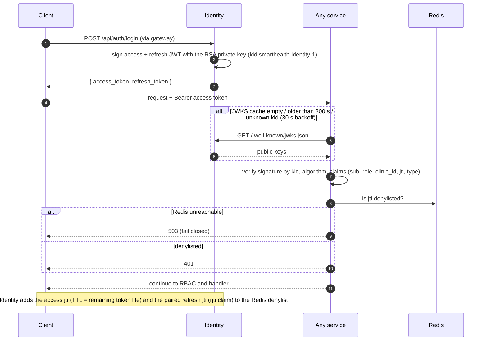

Only Identity holds the private key: it is generated by `scripts/generate_jwt_keypair.py`, gitignored,
and delivered to the Identity container alone as a Compose secret; Identity refuses to start without
it. Key rotation is supported through `kid` but has not been exercised.

**Refresh rotation and identity carry-overs (Phase 2.1, C1-C3).**

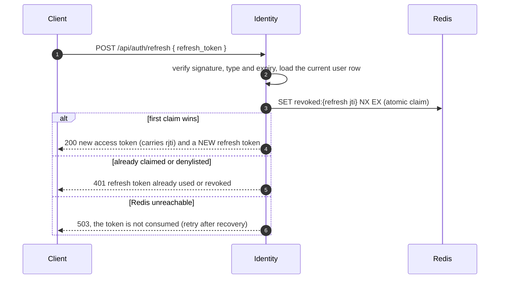

- **Single-use, rotated refresh tokens (C1).** The old refresh jti is claimed with one atomic `SET NX EX`
  *after* the token and user validated, so a bad token never burns anything and concurrent reuse yields
  exactly one winner. A client must store the rotated token from every response. A revoked token and a used
  one are deliberately indistinguishable. The access token carries an `rjti` claim naming its paired refresh
  token, so logout revokes both without client cooperation; access tokens issued before the change have no
  `rjti` and revoke only themselves. A Redis outage fails closed (503), as on the access path.
- **bcrypt off the event loop (C2).** Hashing and verification run on a bounded, named thread pool
  (`IDENTITY_BCRYPT_THREADS`, default 4; bcrypt releases the GIL) through `hash_password_async` and
  `verify_password_async`; login still verifies against a dummy hash for an unknown user. The prepared RSA
  signing key is built once per loaded key, because re-parsing the PEM per token stalled the loop as well.
- **Case-insensitive email (C3).** One normalizer (strip, lowercase) runs on register, staff create and login;
  lookups use `lower(email)`; migration `identity_0002` adds the unique expression index
  `uq_users_email_lower` after a count-only duplicate preflight (it refuses without printing an address).
  **No row is rewritten**: legacy mixed-case rows keep their casing, are matched through `lower(email)` and
  block other casings; the downgrade just drops the index.
- **Self-service reads (C4).** `GET /api/patients/me` returns the caller's own profile (identity comes only
  from the token; `404 patient profile not found` for every miss). A provider reads only their own
  appointments through the existing `GET /api/appointments` routes: Scheduling resolves the provider's id
  from Provider with a service token (`503` if Provider is down) and forces the filter; a foreign or missing
  appointment is the same 404. Booking, cancel and reschedule stay patient, front-desk and admin.
  `get_history` orders by creation time with notes after the transition they were written with.
- **Pagination convention (C5).** `libs.pagination`: patients, providers and clinics return a plain array,
  `limit` 1..200 (default 50), `offset` >= 0, a total order of `(created_at, id)` and the total in
  `X-Total-Count`; a value outside the bounds is `422`, never clamped; scope checks run before any query and
  the header is set only on a 200. The department list inside a clinic is unpaginated; Visit's list keeps its
  own inline `limit`/`offset`; the appointment list keeps `limit` (default 100, max 200) and has no total.

## 5a. Internal-auth contract for workers (Phase 2, D-06)

A workflow outlives the HTTP request, so the caller's JWT is never passed into Temporal. Instead:

- Each calling service has a **client secret file** (`scripts/generate_service_secrets.py`;
  Compose secret, never an env value or image content). Billing calls nobody and has none.
- It obtains a **service token** from Identity's `POST /internal/service-tokens` (HTTP Basic with
  the secret, one requested audience), short-lived (`SERVICE_TOKEN_EXPIRE_SECONDS`, default 60 s)
  and cached until shortly before `exp`.
- Identity mints only audiences listed for that client: Scheduling → patient, provider,
  organization, billing, scheduling; Visit → scheduling, provider, billing, visit.
- Every internal route declares its own `aud` and an explicit allowed-caller set (e.g. Billing's
  transitions accept Scheduling and Visit, and Visit may only target `finalized`).

---

## 6. Connected-trace Flow

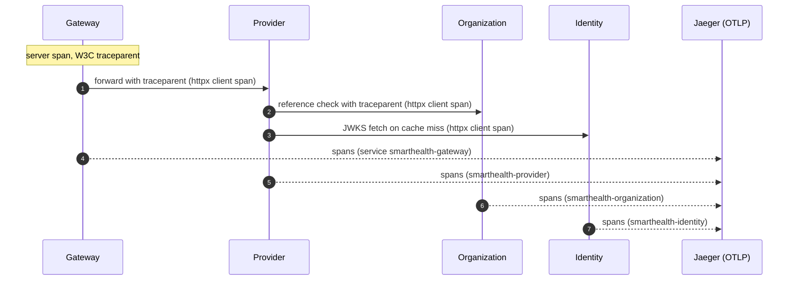

One request is one trace across services. A provider create was observed as a single trace spanning
the gateway, Provider, Organization and (JWKS fetch) Identity, confirmed through Jaeger's HTTP query
API; nobody has yet looked at it in the Jaeger UI. Every service has its own OpenTelemetry service
name and its own Prometheus scrape job; the gateway serves `/metrics` only on an internal listener
(:9100, not published). Logs are structlog JSON carrying `trace_id`/`span_id` and identifiers only.

---

## 7. Known limitations and unverified items

Phase 2 — interim mechanisms and gaps:

- **Phase 3 replaces**: the pending-booking starter and the visit downstream sweeper (lost-start
  recovery) → a transactional outbox; notification / follow-up / analytics stubs → Celery jobs and
  Kafka events; client polling → events. Temporal `auto-setup` is a dev convenience, not the
  production topology (`temporalio/server` + schema job).
- Workers expose no metrics; only the API services are scraped.
- Waitlist: FIFO per provider, optional window, at most 5 entries tried per freed slot, no
  priority and no notification to the matched patient.
- Audit (Mongo) is written after the Postgres commit and is not atomic with it (WR-04).
- Not verified: a viewer inspecting workflow traces end-to-end in Jaeger.
- **Load and NFRs are targets, not results.** NFR-01..08 and a runnable k6 load test exist
  ([`nfr.md`](./nfr.md), `loadtest/README.md`), but the targets are **not yet measured**: the full
  profiles `sustained` and `burst` have never run, and the `smoke` profile (5 requests per second for 30 s)
  crossed its latency thresholds in both runs against the real stack in plan 02.1-13 (booking accept p95 2.0
  to 6.0 s against 300 ms, saga completion p95 16.7 to 28.5 s against 5 s; every accepted booking still
  confirmed; two uncontrolled runs on a heavily loaded laptop with no Jaeger collector). The local
  single-instance stack is not claimed to meet NFR-01 or NFR-02. Phase 3 observability measures them. The concurrency suites and the live demo
  are the only load evidence today.

Phase 2.1 — what is interim and what is open:

- **Audit after a committed step is best effort (S3).** A failed Mongo write after a committed confirm,
  cancel, swap, check-in, complete or schedule-change apply is logged as `audit.write_failed` and never
  changes the outcome. The transition is durable in `appointment_status_history`, but if Mongo is down at
  that moment the audit entry can be lost for good; nothing backfills it. The general fix is Phase 3's
  transactional outbox.
- **Polled, not event-driven.** Schedule changes (default 15 s) and reconciliation (60 s) are polled.
  Delivered `schedule_change_events` rows are never purged. Waiting waitlist entries of a deactivated
  provider are not cleaned up. Phase 3 can publish the same rows to Kafka.
- **Held at pass 2.** A slot still `held` when the schedule-change second pass runs is skipped and gets no
  third pass; if the reaper frees it later, the stale slot stays bookable until the next change event or a
  re-run of the idempotent apply. A flagged appointment stays `confirmed` and keeps its slot until staff act.
- **Cancel and reschedule billing is still bounded.** Their billing steps that exhaust
  `FORWARD_ACTIVITY` are recorded as `*_incomplete:billing_pending` for an operator. Reconciled: a failed
  booking's billing (lookback void), the no-show refund state and visit billing, which alone retries without
  a time limit (its workflow can therefore stay open while Billing is down).
- **Reconciler fairness.** Lists are oldest first with a cap (50 in Scheduling, 100 in Visit) and no per-row
  backoff; more persistently failing rows than the cap would starve newer ones.
- **`no_show` is automated only**, and visits created before Phase 2.1 have no `checked_in` appointment:
  they settle their appointment as `not_checked_in`, and there is no backfill. An appointment left
  `checked_in` with no visit (the patient never retried after a mid-sequence failure) is not reconciled.
- **Refresh tokens are single-use** (clients must store the rotated token); access tokens issued before the
  change carry no `rjti`. Legacy mixed-case emails are matched, not rewritten.
- **Pagination and provider reads.** Appointment lists have no `X-Total-Count`; a provider read costs one
  service-token call to Provider and is `503` while it is down.
- **Tests and the live stack.** The e2e visit flow needs a slot inside the check-in window and skips
  within 40 minutes of clinic-local midnight. Integration tests share databases with the live
  reconcilers, and the schedule-change poller is kept paused while the feed tests run.

Carried from Phase 1.1 (`.planning/phases/01.1-microservice-re-architecture/deferred-items.md`):

- Gateway buffers whole request bodies with no size cap (the limiter bounds count, not size).
- One shared Redis holds the denylist and the rate-limit counters (outage: limiter fails open,
  verification fails closed with 503; a flush would drop revocations).
- Application containers run as root. (Service tokens gained `aud` in Phase 2.)
- Not verified: real-socket outage behaviour of the synchronous checks, a cold start from an empty
  volume, a person viewing the trace in the Jaeger UI, and the `scripts/bootstrap_admin.py`
  admin-creation branch (tests only cover the no-op path because the harness always has an admin).
- Assumptions awaiting mentor confirmation: the provider → department → clinic scope chain relies
  on write-time validation (ORG-03); overlapping availability templates remain allowed (PPL-03);
  clients combining services may briefly see stale cross-service state (PPL-04).

---

## 8. Technology Stack

| Concern | Technology | Role |
|---|---|---|
| API framework | FastAPI + Pydantic v2 (gunicorn / uvicorn workers) | Gateway and every service |
| System of record | PostgreSQL 15 · SQLAlchemy 2.0 async · asyncpg · Alembic | One database per service, migrations per service |
| Audit trail | MongoDB 8 (async PyMongo) | One shared, append-only, PHI-safe `audit_log` |
| Cache / revocation / limits | Redis 8 | jti denylist; gateway rate-limit counters |
| AuthN / AuthZ | python-jose (RS256 + JWKS) · bcrypt · custom RBAC | Access + refresh tokens, 4-role RBAC |
| Service-to-service | httpx · tenacity | Reference checks, bounded GET retries |
| Tracing | OpenTelemetry SDK → OTLP → Jaeger | Connected traces, `trace_id` in logs |
| Metrics | Prometheus + Grafana | One scrape job per service; dashboards Phase 3 |
| Workflows | Temporal (`temporalio` 1.34.0; `auto-setup` 1.29.7 server for local dev) | Booking/cancel/reschedule/waitlist/visit-completion sagas, schedule-change and reconciler workflows, retries, Schedules |
| Load test | k6 (`grafana/k6:1.8.2`, Docker image only) | `loadtest/`: smoke, sustained, burst and contention profiles; targets not yet measured |
| **Scaffolding (P3)** | Kafka + Schema Registry, RabbitMQ | Event backbone, Celery workers |

### Local ports (Docker Compose defaults; overridable in `infra/.env`)

| Service | Host port | Service | Host port |
|---|---|---|---|
| **API Gateway (the only application port)** | 8000 | Temporal | 7233 |
| PostgreSQL | 5433 → 5432 | Temporal UI | 8080 |
| MongoDB | 27017 | Jaeger UI | 16686 |
| Redis | 6379 | Prometheus | 9090 |
| RabbitMQ / mgmt | 5672 / 15672 | Grafana | 3000 |
| Kafka | 9092 | Schema Registry | 8081 |

Identity, Organization, Provider, Patient, Scheduling, Visit, Billing and both workers publish no
host port; they are reachable only on the Compose network, through the gateway.

---

## 9. Key Design Decisions

| Decision | Choice | Why |
|---|---|---|
| Service cut | Six services, database each (D-01) | Mentor review asked for true microservices; clear bounded contexts; PHI confined to Patient. Costs: network hops, availability coupling, no distributed transactions |
| Token model | RS256 + JWKS; Redis jti-denylist | Only Identity can mint tokens; services verify without calling Identity; real logout |
| Gateway | Thin FastAPI proxy, per-IP Redis limits, fail-open, no JWT check at the edge | Most reviewable; defence in depth; availability over rate protection |
| Cross-service integrity | Synchronous owner check at write time (D-05), 422/503, no cascade (D-06) | No Kafka/outbox until Phase 3 (D-08); simplest correct option |
| Reads | Ids only (D-07) | No enrichment calls; clients combine |
| Slot model | Weekly templates in Provider; empty `provider_slots` with live GiST exclusion constraint in Scheduling (D-03) | Phase 2 inherits a proven double-booking invariant without moving a table |
| Identity vs profile | Accounts in Identity; profiles in Patient/Provider linked by plain `user_id` (D-04) | Self-registration and staff-created no-login profiles; PHI out of Identity |
| Audit | Shared library writing one shared `audit_log` (D-02) | Dedicated Audit service is Phase 3; call signature kept stable |
| Deletion | Soft-delete, never hard delete | Healthcare records must remain auditable and retained |
| PHI safety | Field-name-only audit; structlog redaction; tests assert no PHI in logs | No PHI in logs or traces |
| Orchestration (Phase 2) | Temporal for multi-step sagas, not Celery | Durable execution and replay, built-in retries and compensation, Schedules instead of cron; Celery keeps single-step jobs in Phase 3 |
| Workflow placement (D-05) | Workflow lives with the aggregate owner; one task queue and one worker container per service | Activities touch only their own database; workers scale and fail independently of the APIs |
| Booking API (D-07/D-08) | Asynchronous 202 + `Idempotency-Key` stored in Postgres | A saga can take seconds; the key survives a Redis flush and replays the original answer |
| Double-booking (D-02) | Partial unique index on active appointments + slot hold | The database, not the workflow, is the final arbiter under concurrency |
| Compensation (D-09) | Reverse-order forward transitions, audit per step | Failed bookings are reconstructable; nothing is deleted |
| Billing (D-10) | Deterministic simulated pre-check behind a service boundary | Reproducible failure tests; a real gateway can replace the stub |
| Visit completion (D-16) | Commit first, then start downstream; sweeper recovers lost starts | The transition never waits on billing or analytics |
| Audit after a committed step (Phase 2.1, S3) | Non-fatal: log `audit.write_failed`, keep the outcome; transactional outbox in Phase 3 | The transition is already durable in `appointment_status_history`; failing the request or the workflow after the commit would corrupt the caller's view. Cost: an audit entry can be lost if Mongo is down at that instant |
| Schedule-change delivery (Phase 2.1, M2) | Provider outbox table pulled by a polling Schedule, not pushed | A push is lost if Scheduling or Temporal is down when the change happens; the pending-until-acknowledged table has no such window and Phase 3 can publish the same rows to Kafka. Cost: up to one poll interval of delay |
| Stale-slot detection (Phase 2.1, M2) | Set difference against the re-expanded current templates, not tracking which template made which slot | Idempotent, needs no slot-to-template link and reuses the tested generator, so the candidate set cannot drift from what generation produces |
| Stuck-state recovery (Phase 2.1, S4) | Temporal Schedule per service running one idempotent reconciler workflow (overlap SKIP, batch cap, conditional updates) | Same pattern as the hold reaper and the starter, observable in the Temporal UI; re-derives outcomes from the database instead of guessing. Cost: polling, and no fairness beyond oldest first |
| Check-in window (Phase 2.1, M1) | Opens 60 minutes before the slot, closes at slot end; no-show grace 30 minutes; all by the database clock and configurable | Judging with `now()` in the locking `SELECT` removes clock skew between services and makes the decision atomic with the transition |
| Refresh tokens (Phase 2.1, C1) | Single-use rotation with an atomic Redis claim and an `rjti` claim on the access token | One winner under concurrent reuse; logout revokes both tokens without client cooperation. Cost: clients must store the rotated token; a Redis outage blocks refresh (fail closed) |
| bcrypt placement (Phase 2.1, C2) | Bounded named thread pool via `run_in_executor` | bcrypt releases the GIL, so a small pool runs in parallel without stalling the event loop (proven by a loop-lag test) |
| Case-insensitive email (Phase 2.1, C3) | `lower(email)` unique expression index and a normalizer, without rewriting existing rows | Cheap and reversible: the migration refuses over duplicates (count only) and the downgrade just drops the index. Cost: legacy rows keep mixed casing |
| Pagination convention (Phase 2.1, C5) | Plain array body, `X-Total-Count`, `limit` 1..200 default 50, `offset` >= 0, order `(created_at, id)`, `422` outside bounds | Backward compatible with existing clients and Visit's list; the id tiebreak makes paging stable |
| Load test and NFRs (Phase 2.1, D1, D2) | k6 from a pinned Docker image; targets single-sourced in `loadtest/nfr.json`, checked against the PRD table and `nfr.md` by a test | No package added to the project; a changed number cannot drift between the documents and the thresholds. Cost: the targets are unmeasured until Phase 3 |

See [`architecture-dashboard.html`](./architecture-dashboard.html) for the interactive decision record
(alternatives and tradeoffs per decision), [`architecture.html`](./architecture.html) for a standalone
diagram view, and [`erd.md`](./erd.md) for the per-service schemas.
