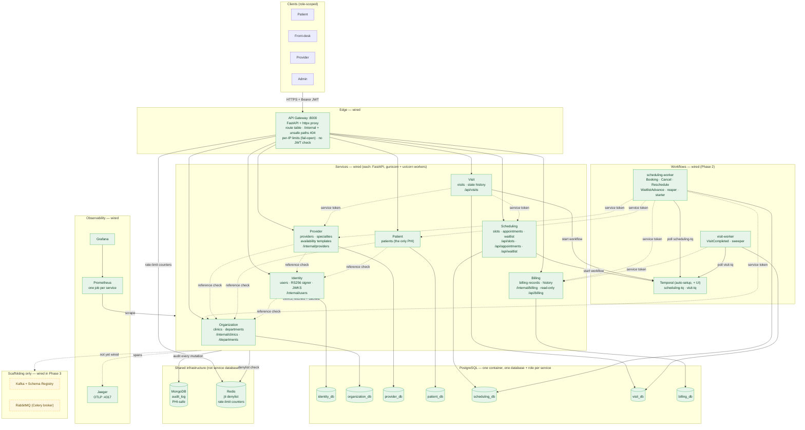
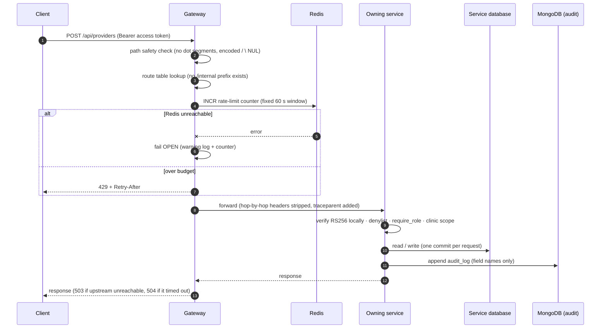
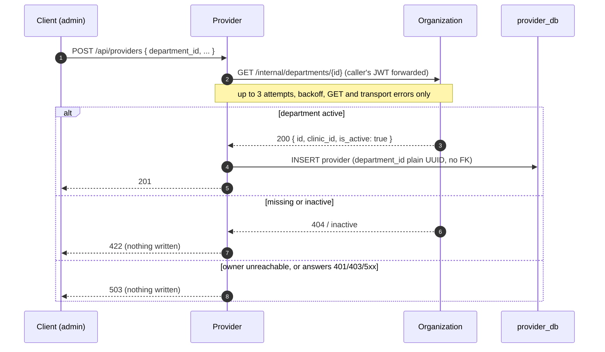
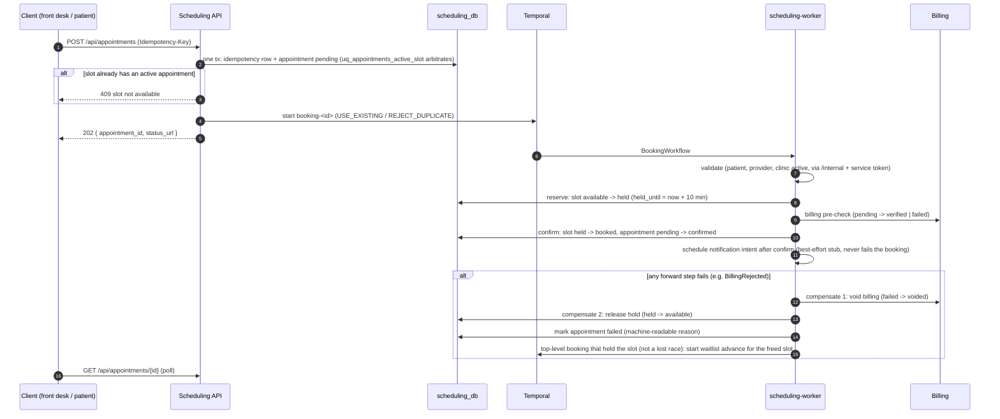
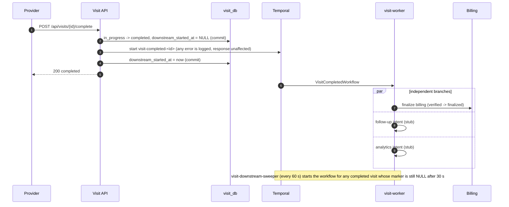
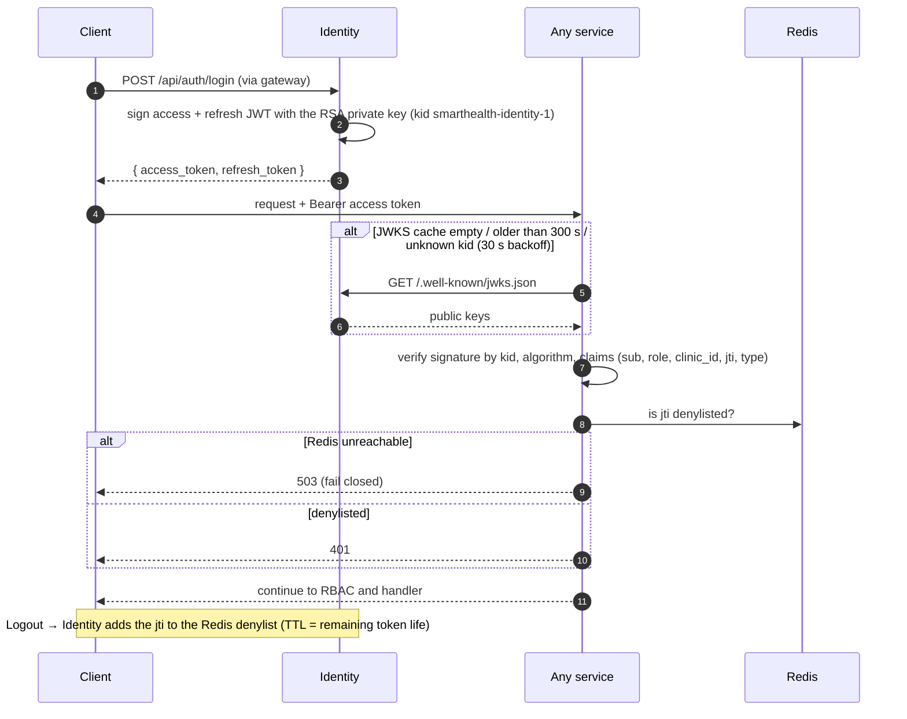
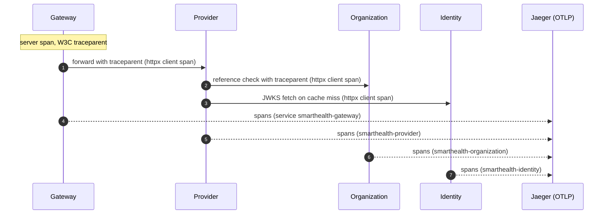

# SmartHealth — Architecture (Part A / Phase 2: scheduling, visits, billing)

Foundational healthcare-operations backend. Phase 1.1 re-delivered it as independently deployable
services (gateway, Identity, Organization, Provider, Patient, Scheduling skeleton), each owning
its own PostgreSQL database, with RS256 tokens verified locally, an append-only PHI-free audit
trail and connected tracing. **Phase 2** turns Scheduling into a real service and adds **Visit**
and **Billing**: on-demand slots, asynchronous booking as a **Temporal saga with compensation**,
cancel, reschedule, a waitlist that auto-books freed slots, the visit state machine with
non-blocking downstream work, and a simulated billing pre-check — executed by two dedicated
worker containers (`scheduling-worker`, `visit-worker`).

> **Scope note.** Temporal is live from Phase 2. Kafka and RabbitMQ/Celery are still
> **scaffolding only** (Phase 3: event backbone, Celery jobs, outbox, dedicated Audit service).
> Notification, follow-up and analytics steps are stubs behind one activity each. This is a
> local/dev system with synthetic data only; nothing here is claimed as production-hardened
> (logout, PHI log-safety and database isolation are implemented but not fully hardened); see
> [Known limitations](#7-known-limitations-and-unverified-items).

---

## 1. System / Component Diagram

Dashed service-to-service arrows are synchronous `/internal` calls: Phase 1.1 reference checks
(section 4) and Phase 2's service-token calls from APIs and workers (section 5a).

---

## 2. Service Breakdown

| Service | Owns | Database | Internal endpoints (not routed by the gateway) | Calls out to |
|---|---|---|---|---|
| **API Gateway** | Edge routing, per-IP rate limiting, path-safety checks | none | — | all five services' public routes (proxy); Redis (limits) |
| **Identity** | Accounts (`users`: credentials, role, `clinic_id`), register/login/refresh/logout, RS256 token issuance, JWKS, Redis denylist writes, 60 s service tokens | `identity_db` | `GET /internal/users/{id}` | Organization (validate `users.clinic_id`); Redis; MongoDB (audit) |
| **Organization** | Clinics, departments (soft-delete, clinic-scoped) | `organization_db` | `GET /internal/clinics/{id}`, `GET /internal/departments/{id}` | Identity JWKS (cached); Redis; MongoDB |
| **Provider** | Providers, specialties, provider↔specialty links, weekly availability templates | `provider_db` | `GET /internal/providers/{id}` | Organization (department), Identity (user); Identity JWKS; Redis; MongoDB |
| **Patient** | Patient profiles — the only service holding PHI | `patient_db` | — | Organization (clinic), Identity (user); Identity JWKS; Redis; MongoDB |
| **Scheduling** | Slots (materialized on demand from Provider templates), appointments, idempotency keys, appointment history, waitlist; booking / cancel / reschedule / waitlist-advance workflows and their activities | `scheduling_db` | `GET /internal/appointments/{id}?clinic_id=` (Visit only) | Patient, Provider, Organization (validation), Billing (pre-check, transitions); Temporal |
| **Billing** | Billing records (`pending → verified/failed → …`), status history; deterministic simulated pre-check (`DENY-` prefix denies) | `billing_db` | `POST /internal/billing/prechecks`, `…/records/{appointment_id}/transitions`, `…/relink` (all need `Idempotency-Key`) | none (answers Scheduling and Visit only; no client secret) |
| **Visit** | Visits (`checked_in → in_progress → completed`), state history, downstream marker; VisitCompleted and sweeper workflows | `visit_db` | — | Scheduling (appointment confirmed?), Provider (is this login the visit's provider?), Billing (finalize); Temporal |
| **scheduling-worker** | Executes Scheduling's workflows and activities on `scheduling-tq`; registers the hold-reaper and pending-starter Schedules | `scheduling_db` (same role as the API) | — | as Scheduling; never runs migrations |
| **visit-worker** | Executes `VisitCompletedWorkflow` and the sweeper on `visit-tq`; registers the `visit-downstream-sweeper` Schedule | `visit_db` | — | Billing; never runs migrations |

Every service also verifies tokens locally from Identity's cached JWKS and checks the shared Redis
denylist. Shared code (`libs/`) is infrastructure only — token verification and JWKS client, audit
writer, observability setup, DB/session helpers — and never shares domain models. Each service
declares its own SQLAlchemy `DeclarativeBase` and its own Alembic migrations with a fresh baseline.

Isolation is asserted by tests: no service imports another, no foreign key crosses a service, PHI
columns exist only in Patient, the private key is loaded only by Identity, and each service's
database role is refused by every other service's database.

### Workflows, task queues and ids

| Workflow | Task queue | Workflow id | Started by |
|---|---|---|---|
| `BookingWorkflow` | `scheduling-tq` | `booking-<appointment id>` | `POST /api/appointments` after the accept commit; the pending-booking starter Schedule if that start was lost; the waitlist advance (child) |
| `CancelWorkflow` | `scheduling-tq` | `cancel-<appointment id>-<version>` | `POST /api/appointments/{id}/cancel` |
| `RescheduleWorkflow` | `scheduling-tq` | `reschedule-<appointment id>-<version>` | `POST /api/appointments/{id}/reschedule` |
| `WaitlistAdvanceWorkflow` | `scheduling-tq` | `waitlist-advance-<cancel/reschedule workflow id>` | Cancel / reschedule (abandoned child, after notify) |
| `HoldReaperWorkflow`, `PendingBookingStarterWorkflow` | `scheduling-tq` | Schedules `scheduling-hold-reaper`, `scheduling-pending-starter` | Temporal Schedules (60 s / 30 s) |
| `VisitCompletedWorkflow` | `visit-tq` | `visit-completed-<visit id>` | `POST /api/visits/{id}/complete` after its commit; the sweeper if lost |
| `VisitDownstreamSweeperWorkflow` | `visit-tq` | Schedule `visit-downstream-sweeper` | Temporal Schedule (60 s) |

Workflow inputs and results are plain ids and status strings (`domain/contracts.py`, checked by a
test): no coverage reference, token, phone or address ever enters Temporal history.

---

## 3. Request Flow — through the gateway

The gateway does **not** verify JWTs: each service verifies for itself, so no service trusts the edge.
The gateway never retries (a retried POST could double-apply a write) and never aggregates
responses (reads return ids only; clients combine them).

---

## 4. Reference-check Flow — fail closed (D-05)

At write time the owning service is asked whether a referenced record exists. Example: creating a
provider under a department.

| Reference | Owner called | Outcome when missing/inactive | Outcome when owner cannot answer |
|---|---|---|---|
| `users.clinic_id` | Organization | 422 | 503 |
| `patients.clinic_id` | Organization | 422 | 503 |
| `patients.user_id` | Identity | 422 | 503 |
| `providers.department_id`, `availability_templates.department_id` | Organization | 422 | 503 |
| `providers.user_id` | Identity | 422 | 503 |

A 401/403/5xx from the owner is deliberately a 503, never a 422, so an authentication
misconfiguration between services is not mistaken for a missing record. Deactivating a referenced
record **never cascades** (D-06): existing references keep their ids and only new writes pointing at
an inactive target are refused. There is no reverse call and no distributed transaction. Kafka,
the outbox and event-fed local copies that would remove this availability coupling are Phase 3 (D-08).

---

## 4a. Booking saga with compensation (Phase 2)

Compensation runs **in reverse order as forward state transitions** (nothing is deleted), and every
step writes one audit entry with `dedupe_key = <workflow id>:<step>`, so a retried activity never
double-audits. Order note: the implemented order is validate, hold, **billing pre-check,
confirm, then a best-effort notification intent** (plan 02.1-07, S7). SCHED-02 lists the
notification earlier and the implementation deliberately differs: the notification intent is
requested **after confirm** succeeds, so a booking that fails at confirm (`ConfirmLostHold`)
sends none, and a patient is never told about a booking that is then compensated. SCHED-02's
"prevent conflicts" is the reserve step's database constraints. The order change and the
failure-path waitlist re-offer are `workflow.patched` (`booking-notify-after-confirm-v1`,
`booking-failure-waitlist-v1`), so histories recorded earlier still replay.

Post-commit safety (S3): `void_billing` and `release_slot` read the appointment's status and do
nothing once it is `confirmed`, `checked_in`, `completed` or `no_show`; the audit write after a
committed confirm, cancel, swap, check-in or complete is best effort (a failure is logged as
`audit.write_failed`, the transition stays durable in `appointment_status_history`). Booking a
slot that already started is `422 slot has already started` at the API and `SlotInPast` in the
validate step (S6).

Cancel and reschedule:

- **Cancel** (`CancelWorkflow`): cancel the appointment and release its slot → billing
  `refund_pending → refunded` when more than `SCHEDULING_CANCEL_CUTOFF_HOURS` (24 h) ahead, else
  `no_refund` (staff may waive) → notification intent → start the waitlist advance (child).
- **Reschedule** (`RescheduleWorkflow`): hold the new slot first → one Scheduling transaction
  releases the old slot, books the new one and repoints the appointment → re-link billing →
  notify → waitlist advance for the old slot. Never cancel-then-rebook.
- **Waitlist advance**: FIFO claim of the first matching `waiting` entry with
  `FOR UPDATE SKIP LOCKED` → a child `BookingWorkflow` for that patient → entry `booked`; a failed
  booking marks the entry `failed` and tries the next (cap 5); losing the slot race puts the
  entry back to `waiting`.

## 4b. Visit completion with non-blocking downstream work (Phase 2)

## 4c. Layered idempotency

1. **Database arbiters first**: the partial unique index `uq_appointments_active_slot`, the
   idempotency-key row `(caller_user_id, key)` with a request hash, conditional state updates
   (`UPDATE … WHERE status = <expected>`), `uq_visits_appointment`, history uniques
   (`uq_visit_history_visit_to`, `uq_billing_history_record_key`).
2. **Workflow id second**: deterministic ids with `USE_EXISTING` / `REJECT_DUPLICATE` make a
   second start a no-op; the namespace retains closed workflows for 24 h only, so the database
   rules above are what hold beyond that.
3. **Activities** are idempotent by construction (conditional updates, `Idempotency-Key` on every
   Billing call, audit `dedupe_key`), so Temporal retries are safe.

---

## 5. Token Verification Flow — RS256 + JWKS

Only Identity holds the private key: it is generated by `scripts/generate_jwt_keypair.py`, gitignored,
and delivered to the Identity container alone as a Compose secret; Identity refuses to start without
it. Key rotation is supported through `kid` but has not been exercised.

## 5a. Internal-auth contract for workers (Phase 2, D-06)

A workflow outlives the HTTP request, so the caller's JWT is never passed into Temporal. Instead:

- Each calling service has a **client secret file** (`scripts/generate_service_secrets.py`;
  Compose secret, never an env value or image content). Billing calls nobody and has none.
- It obtains a **service token** from Identity's `POST /internal/service-tokens` (HTTP Basic with
  the secret, one requested audience), short-lived (`SERVICE_TOKEN_EXPIRE_SECONDS`, default 60 s)
  and cached until shortly before `exp`.
- Identity mints only audiences listed for that client: Scheduling → patient, provider,
  organization, billing, scheduling; Visit → scheduling, provider, billing, visit.
- Every internal route declares its own `aud` and an explicit allowed-caller set (e.g. Billing's
  transitions accept Scheduling and Visit, and Visit may only target `finalized`).

---

## 6. Connected-trace Flow

One request is one trace across services. A provider create was observed as a single trace spanning
the gateway, Provider, Organization and (JWKS fetch) Identity, confirmed through Jaeger's HTTP query
API; nobody has yet looked at it in the Jaeger UI. Every service has its own OpenTelemetry service
name and its own Prometheus scrape job; the gateway serves `/metrics` only on an internal listener
(:9100, not published). Logs are structlog JSON carrying `trace_id`/`span_id` and identifiers only.

---

## 7. Known limitations and unverified items

Phase 2 — interim mechanisms and gaps:

- **Phase 3 replaces**: the pending-booking starter and the visit downstream sweeper (lost-start
  recovery) → a transactional outbox; notification / follow-up / analytics stubs → Celery jobs and
  Kafka events; client polling → events. Temporal `auto-setup` is a dev convenience, not the
  production topology (`temporalio/server` + schema job).
- Workers expose no metrics; only the API services are scraped.
- Waitlist: FIFO per provider, optional window, at most 5 entries tried per freed slot, no
  priority and no notification to the matched patient.
- Audit (Mongo) is written after the Postgres commit and is not atomic with it (WR-04).
- Not verified: load beyond the concurrency suites and the live demo; a viewer inspecting
  workflow traces end-to-end in Jaeger.

Carried from Phase 1.1 (`.planning/phases/01.1-microservice-re-architecture/deferred-items.md`):

- Gateway buffers whole request bodies with no size cap (the limiter bounds count, not size).
- One shared Redis holds the denylist and the rate-limit counters (outage: limiter fails open,
  verification fails closed with 503; a flush would drop revocations).
- Application containers run as root. (Service tokens gained `aud` in Phase 2.)
- Not verified: real-socket outage behaviour of the synchronous checks, a cold start from an empty
  volume, a person viewing the trace in the Jaeger UI, and the `scripts/bootstrap_admin.py`
  admin-creation branch (tests only cover the no-op path because the harness always has an admin).
- Assumptions awaiting mentor confirmation: the provider → department → clinic scope chain relies
  on write-time validation (ORG-03); overlapping availability templates remain allowed (PPL-03);
  clients combining services may briefly see stale cross-service state (PPL-04).

---

## 8. Technology Stack

| Concern | Technology | Role |
|---|---|---|
| API framework | FastAPI + Pydantic v2 (gunicorn / uvicorn workers) | Gateway and every service |
| System of record | PostgreSQL 15 · SQLAlchemy 2.0 async · asyncpg · Alembic | One database per service, migrations per service |
| Audit trail | MongoDB 8 (async PyMongo) | One shared, append-only, PHI-safe `audit_log` |
| Cache / revocation / limits | Redis 8 | jti denylist; gateway rate-limit counters |
| AuthN / AuthZ | python-jose (RS256 + JWKS) · bcrypt · custom RBAC | Access + refresh tokens, 4-role RBAC |
| Service-to-service | httpx · tenacity | Reference checks, bounded GET retries |
| Tracing | OpenTelemetry SDK → OTLP → Jaeger | Connected traces, `trace_id` in logs |
| Metrics | Prometheus + Grafana | One scrape job per service; dashboards Phase 3 |
| Workflows | Temporal (`temporalio` 1.34.0; `auto-setup` 1.29.7 server for local dev) | Booking/cancel/reschedule/waitlist/visit-completion sagas, retries, Schedules |
| **Scaffolding (P3)** | Kafka + Schema Registry, RabbitMQ | Event backbone, Celery workers |

### Local ports (Docker Compose defaults; overridable in `infra/.env`)

| Service | Host port | Service | Host port |
|---|---|---|---|
| **API Gateway (the only application port)** | 8000 | Temporal | 7233 |
| PostgreSQL | 5433 → 5432 | Temporal UI | 8080 |
| MongoDB | 27017 | Jaeger UI | 16686 |
| Redis | 6379 | Prometheus | 9090 |
| RabbitMQ / mgmt | 5672 / 15672 | Grafana | 3000 |
| Kafka | 9092 | Schema Registry | 8081 |

Identity, Organization, Provider, Patient, Scheduling, Visit, Billing and both workers publish no
host port; they are reachable only on the Compose network, through the gateway.

---

## 9. Key Design Decisions

| Decision | Choice | Why |
|---|---|---|
| Service cut | Six services, database each (D-01) | Mentor review asked for true microservices; clear bounded contexts; PHI confined to Patient. Costs: network hops, availability coupling, no distributed transactions |
| Token model | RS256 + JWKS; Redis jti-denylist | Only Identity can mint tokens; services verify without calling Identity; real logout |
| Gateway | Thin FastAPI proxy, per-IP Redis limits, fail-open, no JWT check at the edge | Most reviewable; defence in depth; availability over rate protection |
| Cross-service integrity | Synchronous owner check at write time (D-05), 422/503, no cascade (D-06) | No Kafka/outbox until Phase 3 (D-08); simplest correct option |
| Reads | Ids only (D-07) | No enrichment calls; clients combine |
| Slot model | Weekly templates in Provider; empty `provider_slots` with live GiST exclusion constraint in Scheduling (D-03) | Phase 2 inherits a proven double-booking invariant without moving a table |
| Identity vs profile | Accounts in Identity; profiles in Patient/Provider linked by plain `user_id` (D-04) | Self-registration and staff-created no-login profiles; PHI out of Identity |
| Audit | Shared library writing one shared `audit_log` (D-02) | Dedicated Audit service is Phase 3; call signature kept stable |
| Deletion | Soft-delete, never hard delete | Healthcare records must remain auditable and retained |
| PHI safety | Field-name-only audit; structlog redaction; tests assert no PHI in logs | No PHI in logs or traces |
| Orchestration (Phase 2) | Temporal for multi-step sagas, not Celery | Durable execution and replay, built-in retries and compensation, Schedules instead of cron; Celery keeps single-step jobs in Phase 3 |
| Workflow placement (D-05) | Workflow lives with the aggregate owner; one task queue and one worker container per service | Activities touch only their own database; workers scale and fail independently of the APIs |
| Booking API (D-07/D-08) | Asynchronous 202 + `Idempotency-Key` stored in Postgres | A saga can take seconds; the key survives a Redis flush and replays the original answer |
| Double-booking (D-02) | Partial unique index on active appointments + slot hold | The database, not the workflow, is the final arbiter under concurrency |
| Compensation (D-09) | Reverse-order forward transitions, audit per step | Failed bookings are reconstructable; nothing is deleted |
| Billing (D-10) | Deterministic simulated pre-check behind a service boundary | Reproducible failure tests; a real gateway can replace the stub |
| Visit completion (D-16) | Commit first, then start downstream; sweeper recovers lost starts | The transition never waits on billing or analytics |

See [`architecture-dashboard.html`](./architecture-dashboard.html) for the interactive decision record
(alternatives and tradeoffs per decision), [`architecture.html`](./architecture.html) for a standalone
diagram view, and [`erd.md`](./erd.md) for the per-service schemas.
