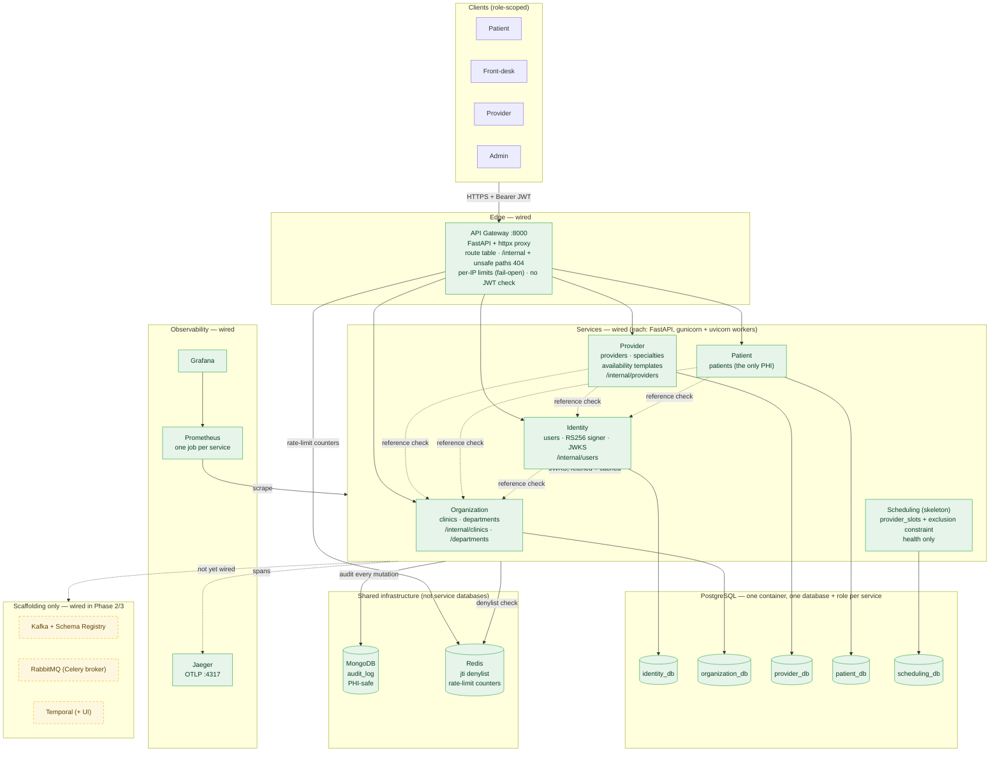
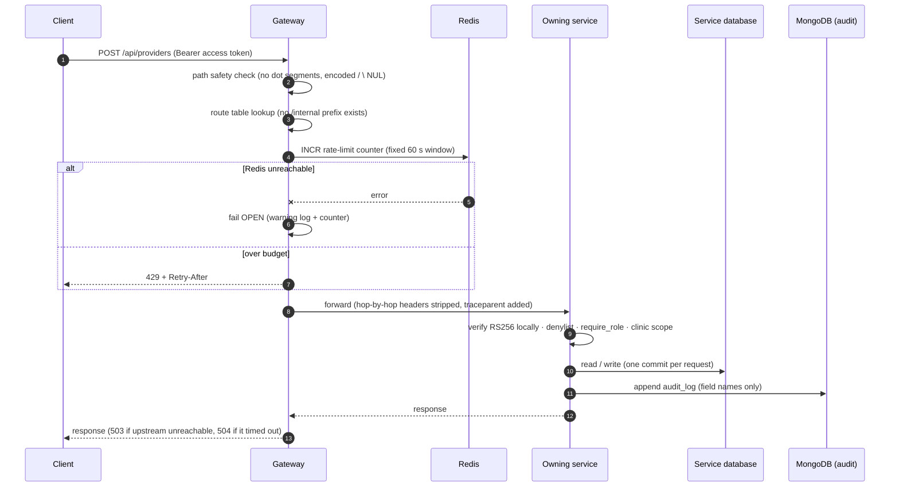
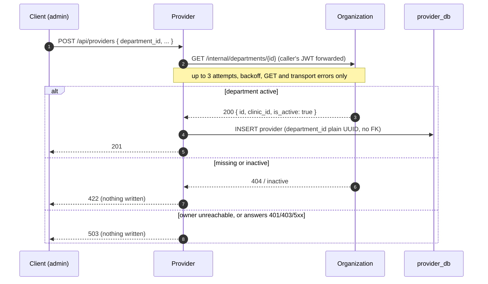
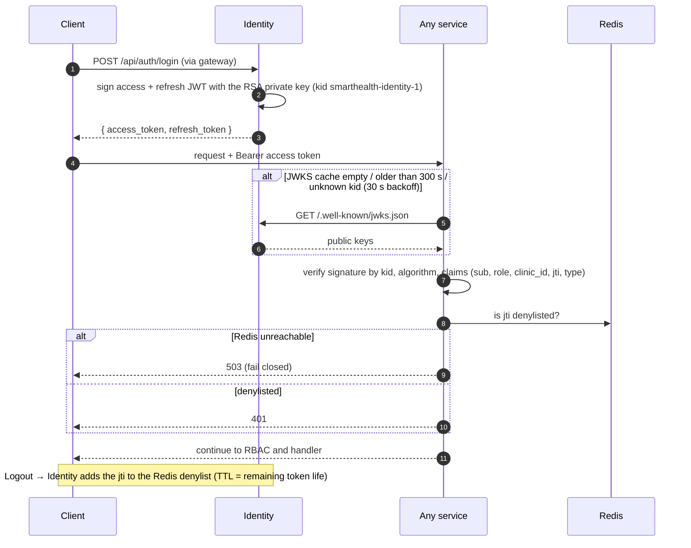
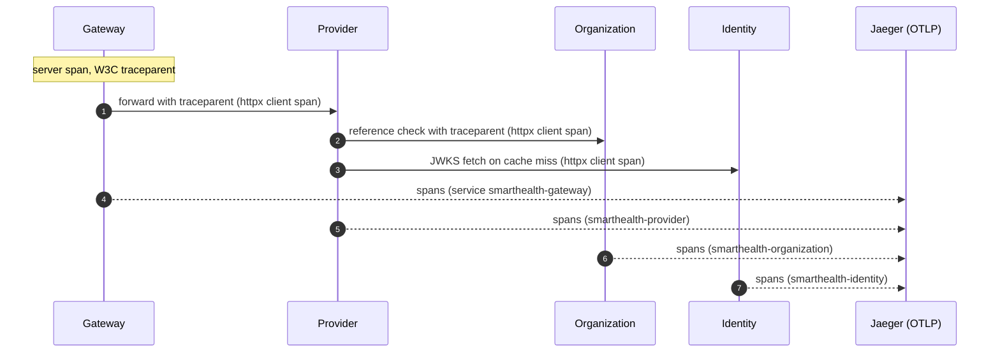

# SmartHealth — Architecture (Part A / Phase 1.1)

Foundational healthcare-operations backend, re-delivered in Phase 1.1 as **six independently
deployable services** after the week-1 mentor review: an API gateway, Identity, Organization,
Provider, Patient, and a Scheduling skeleton. Each service owns its own PostgreSQL database;
tokens are RS256 and verified locally by every service; an append-only audit trail with no PHI
in logs and first-class tracing carry over from Phase 1.

> **Scope note.** Phase 1.1 adds no new functional capability. The event/orchestration components
> (Kafka, RabbitMQ, Temporal) are still **scaffolding only**: they run in Docker Compose with
> health checks but no application code uses them. They are wired in Phase 2 (Temporal booking
> sagas) and Phase 3 (Kafka event backbone, Celery workers, dedicated Audit service). Diagrams
> mark this distinction explicitly. Nothing here is claimed as production-hardened; see
> [Known limitations](#7-known-limitations-and-unverified-items).

---

## 1. System / Component Diagram

Dashed service-to-service arrows are the synchronous reference checks (section 4); the Scheduling
service makes none yet.

---

## 2. Service Breakdown

| Service | Owns | Database | Internal endpoints (not routed by the gateway) | Calls out to |
|---|---|---|---|---|
| **API Gateway** | Edge routing, per-IP rate limiting, path-safety checks | none | — | all five services' public routes (proxy); Redis (limits) |
| **Identity** | Accounts (`users`: credentials, role, `clinic_id`), register/login/refresh/logout, RS256 token issuance, JWKS, Redis denylist writes, 60 s service tokens | `identity_db` | `GET /internal/users/{id}` | Organization (validate `users.clinic_id`); Redis; MongoDB (audit) |
| **Organization** | Clinics, departments (soft-delete, clinic-scoped) | `organization_db` | `GET /internal/clinics/{id}`, `GET /internal/departments/{id}` | Identity JWKS (cached); Redis; MongoDB |
| **Provider** | Providers, specialties, provider↔specialty links, weekly availability templates | `provider_db` | `GET /internal/providers/{id}` | Organization (department), Identity (user); Identity JWKS; Redis; MongoDB |
| **Patient** | Patient profiles — the only service holding PHI | `patient_db` | — | Organization (clinic), Identity (user); Identity JWKS; Redis; MongoDB |
| **Scheduling (skeleton)** | `provider_slots` and `ex_provider_slots_no_overlap`; health endpoint only | `scheduling_db` | — | none yet (Phase 2 will validate `provider_id` against Provider) |

Every service also verifies tokens locally from Identity's cached JWKS and checks the shared Redis
denylist. Shared code (`libs/`) is infrastructure only — token verification and JWKS client, audit
writer, observability setup, DB/session helpers — and never shares domain models. Each service
declares its own SQLAlchemy `DeclarativeBase` and its own Alembic migrations with a fresh baseline.

Isolation is asserted by tests: no service imports another, no foreign key crosses a service, PHI
columns exist only in Patient, the private key is loaded only by Identity, and each service's
database role is refused by every other service's database.

---

## 3. Request Flow — through the gateway

The gateway does **not** verify JWTs: each service verifies for itself, so no service trusts the edge.
The gateway never retries (a retried POST could double-apply a write) and never aggregates
responses (reads return ids only; clients combine them).

---

## 4. Reference-check Flow — fail closed (D-05)

At write time the owning service is asked whether a referenced record exists. Example: creating a
provider under a department.

| Reference | Owner called | Outcome when missing/inactive | Outcome when owner cannot answer |
|---|---|---|---|
| `users.clinic_id` | Organization | 422 | 503 |
| `patients.clinic_id` | Organization | 422 | 503 |
| `patients.user_id` | Identity | 422 | 503 |
| `providers.department_id`, `availability_templates.department_id` | Organization | 422 | 503 |
| `providers.user_id` | Identity | 422 | 503 |

A 401/403/5xx from the owner is deliberately a 503, never a 422, so an authentication
misconfiguration between services is not mistaken for a missing record. Deactivating a referenced
record **never cascades** (D-06): existing references keep their ids and only new writes pointing at
an inactive target are refused. There is no reverse call and no distributed transaction. Kafka,
the outbox and event-fed local copies that would remove this availability coupling are Phase 3 (D-08).

---

## 5. Token Verification Flow — RS256 + JWKS

Only Identity holds the private key: it is generated by `scripts/generate_jwt_keypair.py`, gitignored,
and delivered to the Identity container alone as a Compose secret; Identity refuses to start without
it. Internal calls with no user context use a 60 s service token minted by Identity. Service tokens
currently carry no `aud` claim (recorded gap). Key rotation is supported through `kid` but has not been
exercised.

---

## 6. Connected-trace Flow

One request is one trace across services. A provider create was observed as a single trace spanning
the gateway, Provider, Organization and (JWKS fetch) Identity, confirmed through Jaeger's HTTP query
API; nobody has yet looked at it in the Jaeger UI. Every service has its own OpenTelemetry service
name and its own Prometheus scrape job; the gateway serves `/metrics` only on an internal listener
(:9100, not published). Logs are structlog JSON carrying `trace_id`/`span_id` and identifiers only.

---

## 7. Known limitations and unverified items

Recorded in `.planning/phases/01.1-microservice-re-architecture/deferred-items.md` and the Phase 1.1 summaries:

- Gateway buffers whole request bodies with no size cap (the limiter bounds count, not size).
- One shared Redis holds the denylist and the rate-limit counters (outage: limiter fails open,
  verification fails closed with 503; a flush would drop revocations).
- Service tokens carry no `aud` claim. Application containers run as root.
- Not verified: real-socket outage behaviour of the synchronous checks, a cold start from an empty
  volume, a person viewing the trace in the Jaeger UI, and the `scripts/bootstrap_admin.py`
  admin-creation branch (tests only cover the no-op path because the harness always has an admin).
- Assumptions awaiting mentor confirmation: the provider → department → clinic scope chain relies
  on write-time validation (ORG-03); overlapping availability templates remain allowed (PPL-03);
  clients combining services may briefly see stale cross-service state (PPL-04).

---

## 8. Technology Stack

| Concern | Technology | Role |
|---|---|---|
| API framework | FastAPI + Pydantic v2 (gunicorn / uvicorn workers) | Gateway and every service |
| System of record | PostgreSQL 15 · SQLAlchemy 2.0 async · asyncpg · Alembic | One database per service, migrations per service |
| Audit trail | MongoDB 8 (async PyMongo) | One shared, append-only, PHI-safe `audit_log` |
| Cache / revocation / limits | Redis 8 | jti denylist; gateway rate-limit counters |
| AuthN / AuthZ | python-jose (RS256 + JWKS) · bcrypt · custom RBAC | Access + refresh tokens, 4-role RBAC |
| Service-to-service | httpx · tenacity | Reference checks, bounded GET retries |
| Tracing | OpenTelemetry SDK → OTLP → Jaeger | Connected traces, `trace_id` in logs |
| Metrics | Prometheus + Grafana | One scrape job per service; dashboards Phase 3 |
| **Scaffolding (P2/P3)** | Kafka + Schema Registry, RabbitMQ, Temporal | Event backbone, workers, booking sagas |

### Local ports (Docker Compose defaults; overridable in `infra/.env`)

| Service | Host port | Service | Host port |
|---|---|---|---|
| **API Gateway (the only application port)** | 8000 | Temporal | 7233 |
| PostgreSQL | 5433 → 5432 | Temporal UI | 8080 |
| MongoDB | 27017 | Jaeger UI | 16686 |
| Redis | 6379 | Prometheus | 9090 |
| RabbitMQ / mgmt | 5672 / 15672 | Grafana | 3000 |
| Kafka | 9092 | Schema Registry | 8081 |

Identity, Organization, Provider, Patient and Scheduling publish no host port; they are reachable only
on the Compose network, through the gateway.

---

## 9. Key Design Decisions

| Decision | Choice | Why |
|---|---|---|
| Service cut | Six services, database each (D-01) | Mentor review asked for true microservices; clear bounded contexts; PHI confined to Patient. Costs: network hops, availability coupling, no distributed transactions |
| Token model | RS256 + JWKS; Redis jti-denylist | Only Identity can mint tokens; services verify without calling Identity; real logout |
| Gateway | Thin FastAPI proxy, per-IP Redis limits, fail-open, no JWT check at the edge | Most reviewable; defence in depth; availability over rate protection |
| Cross-service integrity | Synchronous owner check at write time (D-05), 422/503, no cascade (D-06) | No Kafka/outbox until Phase 3 (D-08); simplest correct option |
| Reads | Ids only (D-07) | No enrichment calls; clients combine |
| Slot model | Weekly templates in Provider; empty `provider_slots` with live GiST exclusion constraint in Scheduling (D-03) | Phase 2 inherits a proven double-booking invariant without moving a table |
| Identity vs profile | Accounts in Identity; profiles in Patient/Provider linked by plain `user_id` (D-04) | Self-registration and staff-created no-login profiles; PHI out of Identity |
| Audit | Shared library writing one shared `audit_log` (D-02) | Dedicated Audit service is Phase 3; call signature kept stable |
| Deletion | Soft-delete, never hard delete | Healthcare records must remain auditable and retained |
| PHI safety | Field-name-only audit; structlog redaction; tests assert no PHI in logs | No PHI in logs or traces |

See [`architecture-dashboard.html`](./architecture-dashboard.html) for the interactive decision record
(alternatives and tradeoffs per decision), [`architecture.html`](./architecture.html) for a standalone
diagram view, and [`erd.md`](./erd.md) for the per-service schemas.
