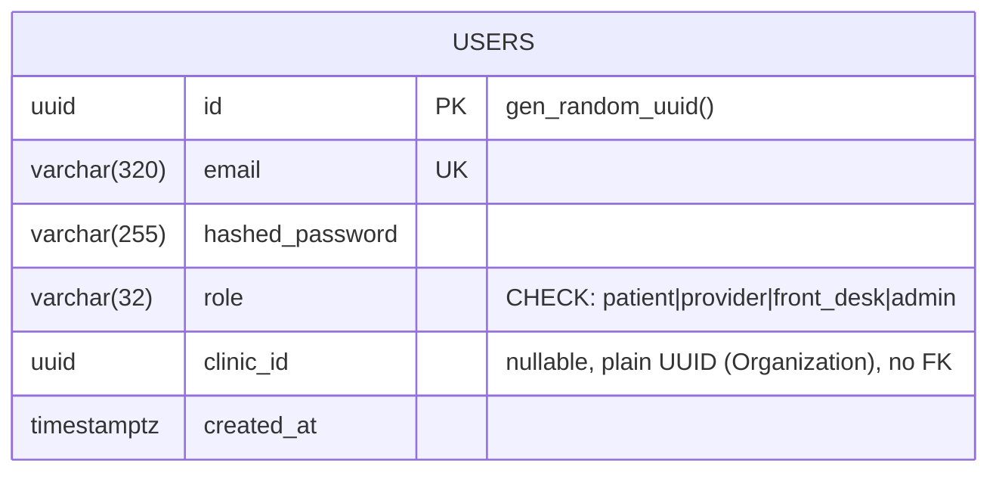
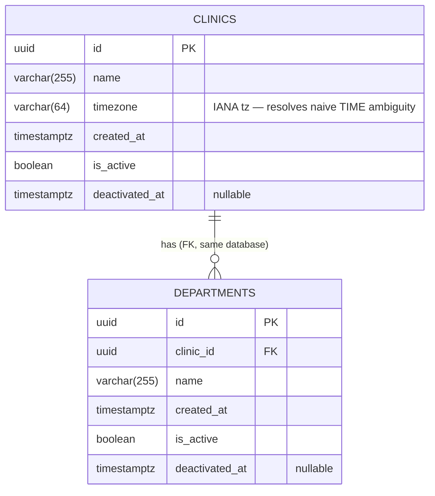
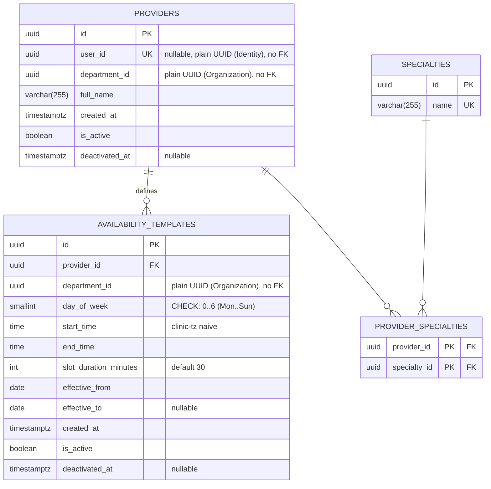
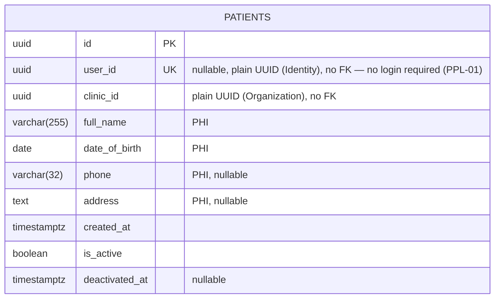
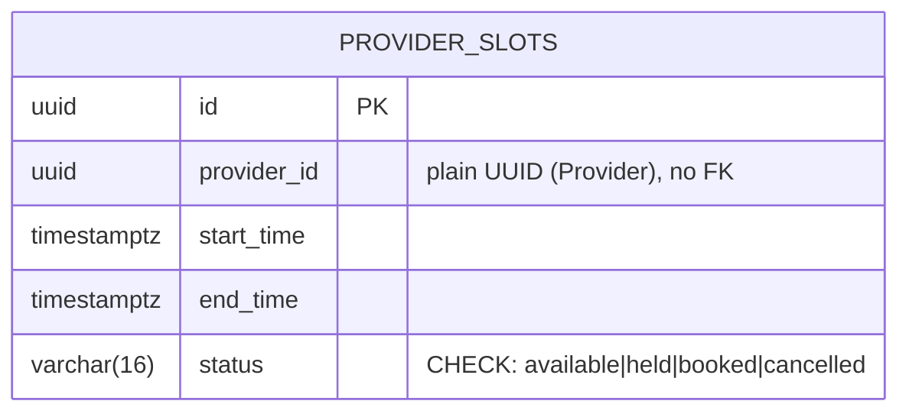
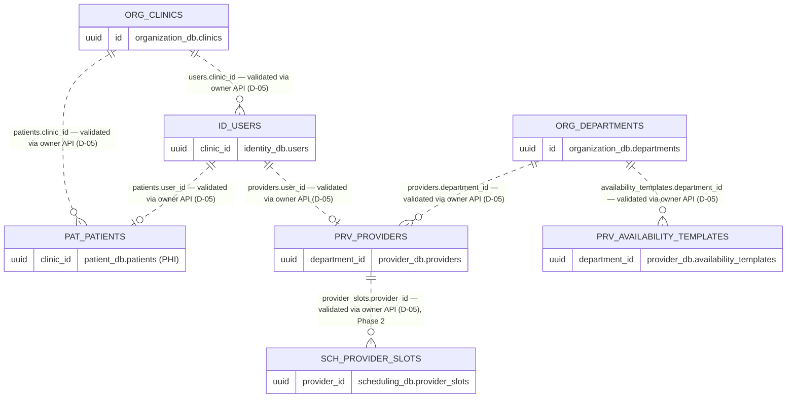

# SmartHealth — Entity-Relationship Diagrams (one schema per service, Phase 1.1)

Since Phase 1.1 there is no single system-of-record schema. Each service owns one PostgreSQL database
and one SQLAlchemy `DeclarativeBase`, and each has its own Alembic baseline:

| Service | Database | Models | Baseline migration |
|---|---|---|---|
| Identity | `identity_db` | `services/identity/repository/models.py` | `identity_0001_accounts` |
| Organization | `organization_db` | `services/organization/repository/models.py` | `organization_0001_org_hierarchy` |
| Provider | `provider_db` | `services/provider/repository/models.py` | `provider_0001_providers` |
| Patient | `patient_db` | `services/patient/repository/models.py` | `patient_0001_patients` |
| Scheduling | `scheduling_db` | `services/scheduling/repository/models.py` | `scheduling_0001_provider_slots` |

**Legend:** `PK` primary key · `FK` foreign key (always *within* one service) · `UK` unique · 🔒 PHI-bearing
(never logged, audited or sent to another service) · soft-deletable tables carry `is_active` + `deactivated_at`.
**No foreign key crosses a service.** A column that points at another service's row is a plain UUID, drawn as a
**dashed id-only link** in the last diagram and validated at write time through the owner's API (D-05), never at
read time and never with a cascade (D-06). This is asserted by `tests/libs/test_service_isolation.py`.

---

## identity_db

Accounts only: credentials, role and clinic scope. No patient or provider profile data lives here.

## organization_db

## provider_db

Provider holds no clinic data; the clinic (and its timezone) is reachable through the department's
Organization reference.

## patient_db

🔒 `full_name`, `date_of_birth`, `phone` and `address` are the only PHI-bearing columns in the platform. They live
in this database only and are never written to logs, traces, internal-call URLs, headers or bodies, another
service's database, or the Mongo audit trail (field names only).

## scheduling_db

Empty until Phase 2. `EXCLUDE USING gist (provider_id WITH =, tstzrange(start_time, end_time) WITH &&) WHERE
status <> 'cancelled'` (`ex_provider_slots_no_overlap`, needs `btree_gist`) is live and proven by an integration
test.

---

## Cross-service references (id-only, no foreign keys)

Dashed lines are plain UUID columns, **validated via owner API (D-05)** at write time. Only the referencing
column is shown for each table.

| Reference | Owner called | Checked when | If missing or inactive | If owner cannot answer |
|---|---|---|---|---|
| `users.clinic_id` | Organization | account create | 422 | 503 |
| `patients.clinic_id` | Organization | profile create | 422 | 503 |
| `patients.user_id` | Identity | profile create | 422 | 503 |
| `providers.user_id` | Identity | provider create | 422 | 503 |
| `providers.department_id` | Organization | provider create | 422 | 503 |
| `availability_templates.department_id` | Organization | template create only | 422 | 503 |
| `provider_slots.provider_id` | Provider | **not wired** — Phase 2 | — | — |

## Constraints that carry weight

| Table | Constraint | What it guarantees |
|---|---|---|
| `scheduling_db.provider_slots` | `EXCLUDE USING gist (provider_id WITH =, tstzrange(start_time,end_time) WITH &&) WHERE status <> 'cancelled'` | **Double-booking is physically impossible** at the storage layer (requires `btree_gist`). Empty until Phase 2, which inherits this proven invariant. |
| `identity_db.users` | `CHECK role IN ('patient','provider','front_desk','admin')`; `UNIQUE(email)` | The 4-role RBAC vocabulary is enforced in the DB; no duplicate accounts. |
| `provider_db.availability_templates` | `CHECK day_of_week BETWEEN 0 AND 6` | Weekly-template day is always a valid weekday. |
| `patient_db.patients.user_id`, `provider_db.providers.user_id` | `UNIQUE`, `NULLABLE` | A profile may exist with no login (PPL-01), but an account maps to at most one profile (a second link is a 409). |
| `provider_db.specialties.name` | `UNIQUE` | No duplicate specialties; concurrent creations of the same new specialty share one row. |
| `organization_db.departments.clinic_id` | `FOREIGN KEY` to `clinics.id` | The only hierarchy FK that survives, because both tables are in the same database. |

## Design notes

- **Accounts ⟂ profiles (D-04)** — `users` (Identity) and `patients`/`providers` (their own services) are linked
  only by a nullable plain `user_id`, so a front-desk-created patient needs no login (PPL-01) while
  self-registration still works (IAM-01). Creating a profile never creates the account.
- **PHI containment** — PHI columns exist only in `patient_db`; an invariant test fails if one appears elsewhere.
- **Scope chain** — `provider → department → clinic` is no longer a structural FK chain. It holds through
  write-time validation and stays sound only because a department's `clinic_id` cannot change (flagged
  assumption ORG-03, awaiting mentor confirmation).
- **Soft-delete** — every operational table except `provider_slots` (which uses `status`) and the reference
  tables `users`, `specialties`, `provider_specialties` carries `is_active` + `deactivated_at`; deletion is a
  status flip, never a row removal, and it never cascades across services (D-06).
- **Availability vs slots** — `availability_templates` (Provider) are recurring weekly *rules*; `provider_slots`
  (Scheduling) are concrete bookable rows generated in Phase 2. Template times are clinic-timezone-naive and are
  resolved against a calendar/DST at slot-generation time. Overlapping templates for one provider are still
  allowed (PPL-03 flagged assumption); Phase 2 slot generation must handle them.
- **Legacy database** — the Phase 1 single `smarthealth` database is untouched and not migrated; no service uses it.

See [`erd.html`](./erd.html) for a standalone visual, and [`architecture.md`](./architecture.md) for the
service breakdown and flow diagrams.
