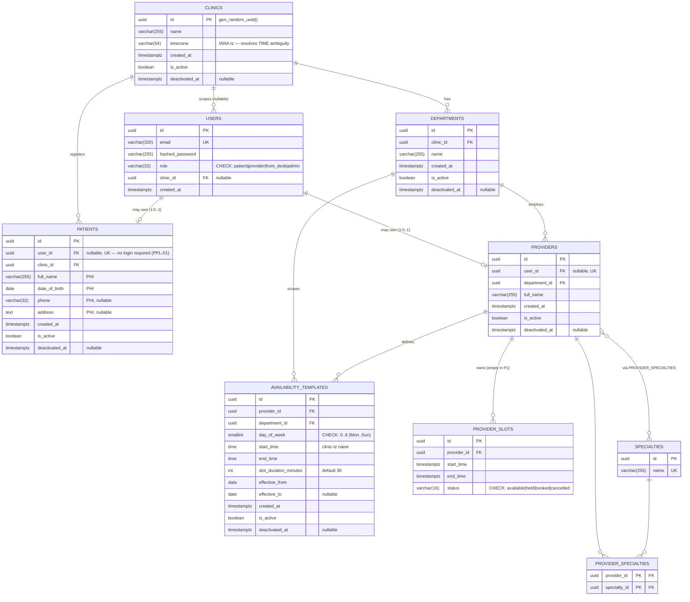

# SmartHealth — Entity-Relationship Diagram (PostgreSQL, Phase 1)

The system-of-record schema, exactly as defined in
`services/identity/repository/models.py` and Alembic migrations `0001` (initial) and `0002`
(soft-delete columns). Nine tables + one many-to-many association.

**Legend:** `PK` primary key · `FK` foreign key · `UK` unique · 🔒 PHI-bearing (never logged/audited) ·
soft-deletable tables carry `is_active` + `deactivated_at`.

## Constraints that carry weight

| Table | Constraint | What it guarantees |
|---|---|---|
| `provider_slots` | `EXCLUDE USING gist (provider_id WITH =, tstzrange(start_time,end_time) WITH &&) WHERE status <> 'cancelled'` | **Double-booking is physically impossible** at the storage layer (requires `btree_gist`). Table is empty in Phase 1; Phase 2's booking saga inherits this proven invariant. |
| `users` | `CHECK role IN ('patient','provider','front_desk','admin')` | The 4-role RBAC vocabulary is enforced in the DB, not just the app. |
| `availability_templates` | `CHECK day_of_week BETWEEN 0 AND 6` | Weekly-template day is always a valid ISO-ish weekday. |
| `patients.user_id`, `providers.user_id` | `UNIQUE`, `NULLABLE` | A profile may exist with no login (PPL-01), but a login maps to at most one profile. |
| `users.email` / `specialties.name` | `UNIQUE` | No duplicate accounts / specialties. |

## Design notes

- **`users` ⟂ `patients`** — separate tables (nullable `patients.user_id`) so a front-desk-created
  patient needs no login (PPL-01), while self-registration still creates a linked `User` (IAM-01).
- **PHI containment** — `patients.full_name / date_of_birth / phone / address` are the only PHI-bearing
  columns; they live in Postgres only and are never written to logs, traces, or the Mongo audit trail.
- **Scope chain** — `provider → department → clinic` (structural FKs) makes clinic/department scoping
  non-optional for anything hanging off a provider (ORG-03).
- **Soft-delete** — every operational table except `provider_slots` (which uses `status`) carries
  `is_active` + `deactivated_at`; deletion is a status flip, never a row removal.
- **Availability vs slots** — `availability_templates` are recurring weekly *rules*; `provider_slots`
  are concrete bookable rows generated in Phase 2. Times in templates are clinic-timezone-naive and
  resolved against a calendar/DST at slot-generation time.

See [`erd.html`](./erd.html) for a standalone visual, and [`architecture.md`](./architecture.md) for
the system/component and request-flow diagrams.
